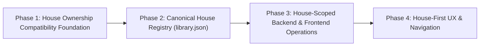

# MetaCognition Notebook — House-First Architecture Technical Design

> **Document Status:** FINAL ARCHITECTURAL SPECIFICATION — PHASES 1–4 AND PHASE 4 MANUAL ACCEPTANCE FIXES COMPLETED  
> **Target Version:** v0.7.0  
> **Revision Date:** October 24, 2026  
> **Scope:** Corrected architecture specification, data-integrity invariants, Lorebook ownership contracts, coordinated universe move journal & recovery protocol, and 4-phase rollout plan.

---

## 1. Executive Summary

MetaCognition Notebook is evolving from a **Studio-first** workspace (where Poetry, Philosophy, Lorebook, and Manuscript Tools are global top-level silos) to a **House-first** architecture (**House of Thoughts**):

```text
Application
├── House Library
│   ├── House A
│   │   ├── Poetry Studio
│   │   └── Philosophy Studio
│   ├── House B
│   │   └── Lorebook Studio
│   └── House C
│       ├── Poetry Studio
│       ├── Philosophy Studio
│       └── Lorebook Studio
├── Vault
├── Settings
└── Help Center
```

The approved architecture is **Logical House Ownership with Canonical Frontmatter Attribution**:
1. **Canonical Markdown Paths Unchanged:** Documents remain stored in their existing top-level directories (`library/Poetry/`, `library/Philosophy/`, `library/Lorebooks/`, `library/Manuscripts/`). Physical relocation into per-House directory trees (`library/Houses/...`) is rejected because it breaks existing Vault archive allowlists, complicates path collision recovery, and risks partial-move data corruption.
2. **First-Class Frontmatter Attribution (`house_id`):** Each document records its owning House via a top-level `house_id` field in its `---json` frontmatter block (whilst preserving `"type"` as the serialized frontmatter key for `DocumentType`).
3. **Permanent Default House (`"house-default"`):** Legacy documents lacking an explicit `house_id` resolve in memory and in the SQLite derived index to `"house-default"` without rewriting canonical Markdown files on startup or reindex.
4. **Canonical House Registry in `library/library.json`:** In Phase 2, the House registry is embedded inside `library/library.json` while keeping `"version": "1.0"` and preserving all unrelated top-level JSON fields via atomic read-modify-write.

---

## 2. Verified Current Architecture & Coupling Points

A line-by-line inspection of the active codebase establishes the exact current implementation contracts:

### 2.1 Backend Coupling Points (Rust / Tauri)
- **Folder Mapping:** [`src-tauri/src/models.rs#L33-L40`](file:///d:/Jetbrains_IDE_Projects/rustrover/MetaCognitionNotebook/src-tauri/src/models.rs#L33-L40) implements `DocumentType::folder_name()`, mapping `Poetry` -> `"Poetry"`, `Philosophy` -> `"Philosophy"`, `Lorebook` -> `"Lorebooks"`, and `Manuscript` -> `"Manuscripts"`.
- **Frontmatter vs. Metadata Field Names:**
  - In [`src-tauri/src/models.rs#L45-L60`](file:///d:/Jetbrains_IDE_Projects/rustrover/MetaCognitionNotebook/src-tauri/src/models.rs#L45-L60), `DocumentMetadata` serializes the document studio type as `pub doc_type: DocumentType`.
  - In [`src-tauri/src/models.rs#L65-L84`](file:///d:/Jetbrains_IDE_Projects/rustrover/MetaCognitionNotebook/src-tauri/src/models.rs#L65-L84), `Frontmatter` serializes the document studio type as `#[serde(rename = "type")] pub doc_type: DocumentType` and preserves unknown top-level frontmatter keys via `#[serde(flatten)] pub extra: BTreeMap<String, serde_json::Value>`.
- **Library Manifest Initialization:** [`src-tauri/src/storage.rs#L37-L47`](file:///d:/Jetbrains_IDE_Projects/rustrover/MetaCognitionNotebook/src-tauri/src/storage.rs#L37-L47) initializes `library/library.json` only if it does not exist, writing:
  ```json
  {
    "name": "MetaCognition Notebook Library",
    "version": "1.0",
    "created_at": "<rfc3339>",
    "description": "Canonical managed library for MetaCognition Notebook documents"
  }
  ```
- **SQLite Schema & Failure Semantics:** [`src-tauri/src/db.rs#L22-L44`](file:///d:/Jetbrains_IDE_Projects/rustrover/MetaCognitionNotebook/src-tauri/src/db.rs#L22-L44) opens `metadata.db`, runs `migrate()`, and in `src-tauri/src/lib.rs#L39-L55` sets `write_blocked = true` if database initialization or integrity checks fail—it does **not** automatically delete `metadata.db`.
- **Vault Path Allowlist & Validation:**
  - [`src-tauri/src/vault.rs#L152-L167`](file:///d:/Jetbrains_IDE_Projects/rustrover/MetaCognitionNotebook/src-tauri/src/vault.rs#L152-L167) permits only `state/catalog.json`, `library/library.json`, and files under the 8 top-level library directories (`Poetry`, `Philosophy`, `Lorebooks`, `Manuscripts`, `Attachments`, `Backups`, `Dictionaries`, `Vocabulary`).
  - [`src-tauri/src/vault.rs#L497-L501`](file:///d:/Jetbrains_IDE_Projects/rustrover/MetaCognitionNotebook/src-tauri/src/vault.rs#L497-L501) validates `library/library.json` during backup inspection and restore by parsing it as `serde_json::Value` (`serde_json::from_slice(&bytes)`).
- **Single Lorebook Catalog & Strict Serde Contracts:**
  - [`src-tauri/src/thought.rs#L238-L242`](file:///d:/Jetbrains_IDE_Projects/rustrover/MetaCognitionNotebook/src-tauri/src/thought.rs#L238-L242) enforces a single `_web_of_thought` catalog across `library/Lorebooks/`.
  - [`src-tauri/src/thought.rs#L13-L53`](file:///d:/Jetbrains_IDE_Projects/rustrover/MetaCognitionNotebook/src-tauri/src/thought.rs#L13-L53) enforces `#[serde(deny_unknown_fields)]` on `Plan`, `Universe`, `Book`, `EntityRef`, `Node`, `Change`, `RelationshipChange`, and `Relationship`.

---

## 3. Canonical House Registry Specification (`library/library.json`)

### 3.1 Existing Schema & Writers Audit
Currently, `library/library.json` has two writers in the codebase:
1. [`StorageManager::initialize()`](file:///d:/Jetbrains_IDE_Projects/rustrover/MetaCognitionNotebook/src-tauri/src/storage.rs#L37-L47), which creates `library/library.json` when initializing a new library root if `!manifest_path.exists()`.
2. [`vault::restore_inner()`](file:///d:/Jetbrains_IDE_Projects/rustrover/MetaCognitionNotebook/src-tauri/src/vault.rs#L831-L858), which extracts `library/library.json` from a `.mcbackup` archive prior to calling `storage.initialize()`.

### 3.2 Version Invariant & Unrelated Field Preservation
- **Do NOT bump `"version": "1.0"` to `"2.0"`:** Existing `library/library.json` files use `"version": "1.0"`. Introducing `"version": "2.0"` is unnecessary and risks breaking external scripts or version checks. The top-level `"version"` field **must remain `"1.0"`** (or whatever string is already present in an existing file). Versioning for the House registry is tracked strictly inside `house_registry.schema_version: 1`.
- **Unknown/Unrelated Field Preservation:** Any read-modify-write of `library/library.json` must deserialize the root JSON object into a `serde_json::Map<String, serde_json::Value>` (or a struct with `#[serde(flatten)] pub extra: BTreeMap<String, Value>`), preserve `name`, `version`, `created_at`, `description`, and any custom user or tool fields verbatim, and update only the `"house_registry"` key.

### 3.3 Canonical Schema in `library/library.json`
```json
{
  "name": "MetaCognition Notebook Library",
  "version": "1.0",
  "created_at": "2026-10-21T00:00:00Z",
  "description": "Canonical managed library for MetaCognition Notebook documents",
  "house_registry": {
    "schema_version": 1,
    "default_house_id": "house-default",
    "houses": [
      {
        "id": "house-default",
        "name": "Primary House",
        "description": "Default creative workspace containing all initial writings.",
        "color": "amber",
        "icon": "castle",
        "enabled_studios": ["poetry", "philosophy", "lorebook", "manuscript"],
        "universe_ids": [],
        "created_at": "2026-10-21T00:00:00Z",
        "updated_at": "2026-10-21T00:00:00Z",
        "archived": false
      }
    ]
  }
}
```

### 3.4 Atomic Read-Modify-Write & Concurrency Protection
When Phase 2 introduces House registry mutations:
1. **In-Process Mutex Serialization:** `StorageManager` (or `AppState`) will guard `library/library.json` read-modify-write operations with a dedicated `Mutex<()>` (and coordinate with Vault backup locks) so concurrent IPC commands cannot interleave reads and writes.
2. **Atomic Temp-File Write + Sync + Rename:**
   - Read current bytes of `library/library.json` (if present).
   - Parse as `serde_json::Value::Object(map)`.
   - Validate and insert/update `map["house_registry"]`.
   - Write serialized pretty JSON to `library/.library.json.<uuid>.tmp`, call `file.sync_all()`, and atomically `std::fs::rename` over `library/library.json`.

### 3.5 Corrupted `library.json` Handling (No Silent Replacement)
If `library/library.json` exists on disk but contains malformed JSON or an invalid `house_registry` structure:
1. **Never silently overwrite canonical data:** Reading the registry **must not** automatically overwrite a corrupted `library/library.json`.
2. **Preserve Corrupted File:** Before any recovery action can write a replacement `library/library.json`, the exact corrupted bytes are copied to `library/Backups/library_corrupt_<timestamp>_<uuid>.json` with `sync_all()`.
3. **Degraded In-Memory Fallback & Explicit Recovery Approval:**
   - On startup/read, if `library/library.json` is corrupt, the backend reports a structured `registry_Diagnostic` / corruption warning and operates in-memory using a synthesized read-only recovery registry derived from distinct `house_id` values discovered in Markdown frontmatter plus `"house-default"`.
   - Overwriting `library/library.json` on disk with the reconstructed registry requires either an **explicit user-approved recovery action** (e.g., `repair_house_registry`) or an explicit House mutation after the corrupt file has been safely preserved in `library/Backups/`.

### 3.6 Vault Archive Compatibility vs. Binary Compatibility
We distinguish two separate compatibility dimensions:
1. **Vault Archive Compatibility:**
   - **Older Vault archive (`.mcbackup` from v0.6.x / v0.7.0) restored into Newer Binary:** `library/library.json` has no `house_registry`, and Markdown files have no `house_id`. The newer binary lazily resolves all documents to `"house-default"` and synthesizes the default `"house-default"` registry entry.
   - **Newer Vault archive (`.mcbackup` containing `house_registry` in `library.json` and `house_id` in frontmatter) restored into Older Binary:** Because `library/library.json` is already in `vault.rs#allowed()`, `vault.rs#L497` validates `library.json` via `serde_json::from_slice::<serde_json::Value>()`, and `Frontmatter` in older binaries does not use `#[serde(deny_unknown_fields)]`, an older binary can verify and restore the archive without error.
2. **Older Application Binary Opening Newer Library:**
   - An older binary ignores `house_registry` in `library/library.json`.
   - In older binaries, `Frontmatter` preserves unknown top-level frontmatter keys in `extra: BTreeMap<String, Value>` (`src-tauri/src/models.rs#L83`), so saving an existing document in a recent v0.6.2/v0.7.0 binary preserves `"house_id"` via `extra`! However, an older binary will display all documents together in the flat Studio lists rather than filtering by House.

---

## 4. Document Frontmatter Ownership Contract

### 4.1 Resolution of `type` vs. `doc_type`
To eliminate any ambiguity between the canonical Markdown frontmatter and in-memory/IPC structs:
- **Canonical Markdown Frontmatter (`Frontmatter` in `src-tauri/src/models.rs`):**
  Uses `"type"` on disk via `#[serde(rename = "type")] pub doc_type: DocumentType`.
  ```json
  {
    "id": "9b1deb4d-3b7d-4bad-9bdd-2b0d7b3dcb6d",
    "title": "Meditations on First Philosophy",
    "type": "philosophy",
    "house_id": "house-default",
    "created_at": "2026-10-21T18:00:00Z",
    "updated_at": "2026-10-21T18:30:00Z",
    "tags": ["epistemology", "rationalism"]
  }
  ```
- **In-Memory / IPC Struct (`DocumentMetadata` in `src-tauri/src/models.rs` and `src/types/index.ts`):**
  Uses `doc_type: DocumentType` and `house_id: String` (TypeScript: `house_id?: string` during Phase 1 compatibility).

### 4.2 Canonical Default House ID & Normalization Rules
- **Canonical Default Constant:** `pub const DEFAULT_HOUSE_ID: &str = "house-default";`
- **Normalization (`normalize_house_id`):**
  When parsing `Frontmatter`:
  1. **Missing (`None`):** Resolves to `"house-default"`.
  2. **Empty or Whitespace-Only (`Some("")`, `Some("   ")`):** Treated as malformed/absent and normalized to `"house-default"`.
  3. **Control Characters or Path Separators:** If a `house_id` string contains control characters (`char::is_control`) or path separators (`/`, `\`), it is rejected/normalized to `"house-default"` during indexing so malformed manual edits cannot poison queries or UI state.
  4. **Valid Non-Empty Trimmed String (e.g. `"house-fantasy"`):** Preserved verbatim (`trimmed.to_string()`), even before Phase 2 registry validation exists. In Phase 2+, if a valid `house_id` is not yet in `house_registry`, it is surfaced as an unindexed/orphaned House candidate for recovery rather than silently overwritten on disk.

### 4.3 Disk Write Policy for Legacy Documents (Preserving Absent `house_id` on Unrelated Saves)
A critical backward-compatibility question is whether saving an unrelated edit to a legacy document (whose on-disk frontmatter lacked `house_id`) should inject `"house_id": "house-default"` into the file on disk or keep `house_id` absent on disk when it is still `"house-default"`.

**Selected Phase 1 & Compatibility Policy:**
1. **Startup & Reindexing:** Scanning or indexing a legacy document without `house_id` **never** rewrites the file on disk. In memory (`DocumentMetadata.house_id`) and in SQLite (`documents.house_id`), it resolves to `"house-default"`.
2. **Saving Existing Legacy Documents (`write_document_atomic`):**
   - If the existing file on disk already had a `"house_id"` key in its frontmatter, OR if `doc.metadata.house_id != "house-default"`, `write_document_atomic` serializes `"house_id": "<doc.metadata.house_id>"` in the frontmatter.
   - If the existing file on disk did **not** have a `"house_id"` key in its frontmatter AND `doc.metadata.house_id == "house-default"`, `write_document_atomic` keeps `house_id` omitted (`None`) in the serialized frontmatter.
   - **Why this policy is superior:** Unrelated prose edits, tag updates, or metadata-only saves on legacy documents do not unexpectedly mutate frontmatter keys or alter byte-preservation invariants when ownership is still the implicit default (`"house-default"`).
3. **Newly Created Documents:**
   - In Phase 1 (before explicit House selection UI exists), newly created documents resolve to `house_id = "house-default"` in `DocumentMetadata` and SQLite, and omit redundant `"house_id": "house-default"` on disk unless an explicit non-default `house_id` is provided (or `house_id` was already present in frontmatter). When a document is explicitly assigned or created in a specific House in Phase 2/3, or when `house_id` is present in frontmatter, `"house_id"` is persisted in top-level frontmatter.

---

## 5. Lorebook & Web of Thought Universe Ownership Specification

### 5.1 Single Shared Planning Catalog Invariant
As enforced in [`src-tauri/src/thought.rs#L238-L242`](file:///d:/Jetbrains_IDE_Projects/rustrover/MetaCognitionNotebook/src-tauri/src/thought.rs#L238-L242), the library contains **at most one** `_web_of_thought` catalog document in `library/Lorebooks/`.
- The `_web_of_thought` catalog document itself is a global system document (`house_id = "house-default"`) and **must never** be duplicated per House.
- All `thought.rs` structs (`Plan`, `Universe`, `Book`, `EntityRef`, `Node`, `Change`, `RelationshipChange`, `Relationship`) retain `#[serde(deny_unknown_fields)]` without modification.

### 5.2 Formal Lorebook Universe Ownership Invariants
House scoping in Lorebook operates at the **Universe** boundary via `universe_ids: Vec<String>` inside each `HouseRecord` in `library/library.json`. Every operation must uphold these 7 invariants:

1. **Invariant L1 — Single Owning House per Universe:**
   Every `Universe.id` in the Web of Thought `Plan` belongs to **at most one** explicit `HouseRecord.universe_ids` list in `house_registry`.
2. **Invariant L2 — No Duplicate Universe Assignments:**
   The sets of `universe_ids` across all `HouseRecord` entries in `house_registry.houses` must be pairwise disjoint:
   $$\forall H_i \neq H_j,\quad H_i.\text{universe\_ids} \cap H_j.\text{universe\_ids} = \emptyset$$
   Any attempt to assign a `universe_id` to a House removes it from any prior House within the same atomic registry update, or rejects duplicate registry payloads during validation.
3. **Invariant L3 — Default Resolution for Legacy/Unassigned Universes:**
   Any `Universe` present in the Web of Thought `Plan` whose `id` is not listed in any `HouseRecord.universe_ids` resolves deterministically to `default_house_id` (`"house-default"`).
4. **Invariant L4 — Entity Ownership Agreement with Universe Ownership:**
   For every `EntityRef { id, universe_id }` in `Plan.entities`, the referenced Lorebook entity document's `house_id` must agree with the owning House of `universe_id`.
   - When an entity document is created or linked to `universe_id` in House $H$, the entity document's `house_id` is $H$.
   - Cross-House entity linking (linking an entity owned by House $A$ into a Universe owned by House $B$) is rejected by validation.
5. **Invariant L5 — Universe Move Semantics (Cascade Integrity):**
   Moving a Universe $U$ from House $A$ to House $B$ is a coordinated operation that:
   - Preserves all `Book` records with `book.universe_id == U`.
   - Preserves all `Node` (milestone/event) records with `node.universe_id == U`, including their `changes` and `relationship_changes`.
   - Preserves all `Relationship` records with `rel.universe_id == U`.
   - Updates `house_id` to House $B$ on all Lorebook entity documents registered in `Plan.entities` with `entity.universe_id == U` (rolling back if any canonical file write fails), and atomically moves $U$ from $A.\text{universe\_ids}$ to $B.\text{universe\_ids}$ in `library/library.json`.
6. **Invariant L6 — Archived House Universe Retention:**
   Archiving a House (`archived: true`) retains its `universe_ids` and all associated Lorebook entities, books, nodes, and relationships intact. Neither the Universe nor its entities are deleted or silently dumped into `"house-default"`.
7. **Invariant L7 — Invalid Ownership Detection (Never Silently Reassign):**
   If a consistency check detects a mismatch (e.g., an entity document has `house_id = "house-b"` while its `EntityRef` in `Plan.entities` belongs to Universe $U$ owned by `"house-a"`, or `library.json` lists a `universe_id` under two Houses), the backend **must detect and report the ownership conflict** rather than silently reassigning or dropping entities, relationships, or universes.

---

## 6. SQLite Migration, Rollback, & Compatibility Guarantees

### 6.1 Correction: Deleting `metadata.db` Is NOT a Release Rollback Strategy
The initial draft claimed that deleting `metadata.db` was the rollback strategy for Phase 1. That was inaccurate and incomplete:
1. The application does **not** automatically delete `metadata.db` on startup failure; in [`src-tauri/src/lib.rs#L39-L55`](file:///d:/Jetbrains_IDE_Projects/rustrover/MetaCognitionNotebook/src-tauri/src/lib.rs#L39-L55), if `Database::open` or `migrate()` returns an error, the app opens an in-memory fallback DB and calls `fallback.freeze_writes()`, blocking all saves until resolved.
2. Furthermore, `metadata.db` also stores the `tags` catalog table (including unused tags created or retained via tag management). Deleting `metadata.db` without a Vault catalog or reindex loses unused tag catalog entries that are not currently attached to any Markdown file.

### 6.2 Phase 1 SQLite Schema Migration (Version 1 -> Version 2)
In [`src-tauri/src/db.rs`](file:///d:/Jetbrains_IDE_Projects/rustrover/MetaCognitionNotebook/src-tauri/src/db.rs):
- We do **NOT** create a `houses` table in SQLite. `library/library.json` is the single source of truth for the House registry (in Phase 2), avoiding dual-storage synchronization bugs between SQLite and `library.json`.
- Schema migration v2 adds `house_id TEXT NOT NULL DEFAULT 'house-default'` to `documents` and creates `idx_documents_house_id`:
  ```rust
  if current_version < 2 {
      let has_house_id: bool = self
          .conn
          .prepare("PRAGMA table_info(documents)")?
          .query_map([], |row| row.get::<_, String>(1))?
          .filter_map(Result::ok)
          .any(|col| col == "house_id");

      let tx = self.conn.unchecked_transaction()?;
      if !has_house_id {
          tx.execute(
              "ALTER TABLE documents ADD COLUMN house_id TEXT NOT NULL DEFAULT 'house-default'",
              [],
          )?;
      }
      tx.execute(
          "CREATE INDEX IF NOT EXISTS idx_documents_house_id ON documents(house_id)",
          [],
      )?;
      tx.execute("INSERT INTO schema_version (version) VALUES (2)", [])?;
      tx.commit()?;
  }
  ```
- **Idempotency & Safety:** Checking `PRAGMA table_info(documents)` inside the migration guarantees that even if a previous database had `house_id` added partially or if `migrate()` is inspected across connections, it will never fail with `duplicate column name: house_id`.
- **No Unconditional DB Deletion:** `db.rs` and `lib.rs` never delete `metadata.db` on migration failure. If migration fails, `Database::open` returns `Err`, and `lib.rs` enters read-only write-blocked mode to protect user data.

### 6.3 End-to-End Compatibility & Recovery Matrix

| Scenario | Behavior & Recovery Guarantee |
| :--- | :--- |
| **1. Legacy Markdown documents without `house_id`** | Parsed with `Frontmatter.house_id = None`, normalized to `DocumentMetadata.house_id = "house-default"`, indexed in SQLite as `'house-default'`. Files on disk are **not** modified on startup or reindex. |
| **2. Newly attributed Markdown documents (`house_id` present)** | Parsed with `Frontmatter.house_id = Some(id)`, normalized, and persisted in both `DocumentMetadata.house_id` and SQLite `documents.house_id`. Preserved across edits, organization updates, and reindexing. |
| **3. Existing v1 SQLite database (`metadata.db`)** | Upgraded in-place inside a SQLite transaction to schema version 2. Existing rows receive `house_id = 'house-default'` via SQLite column default; subsequent startup `scan_and_reindex()` updates any row whose Markdown frontmatter specifies an explicit `house_id`. |
| **4. Rebuilt SQLite database (`scan_and_reindex`)** | If `metadata.db` is absent or rebuilt on a fresh environment, `Database::open` creates the v2 table schema and `scan_and_reindex()` populates every document's `house_id` from its Markdown frontmatter (or `'house-default'` if absent). |
| **5. Older Vault backups (`.mcbackup` from v0.6.x / v0.7.0)** | Restored cleanly by `vault::restore_separate`. Missing `house_id` in `state/catalog.json` `raw_documents` deserializes to `"house-default"` via `#[serde(default = "default_house_id")]`. Missing `house_id` in Markdown files indexes as `"house-default"`. |
| **6. Failed SQLite migration** | Transaction rolls back cleanly; `metadata.db` is left untouched on disk; `lib.rs` activates `write_blocked` protection and surfaces the startup error rather than deleting `metadata.db` or risking silent state loss. |
| **7. Older binary encountering new metadata** | Older binaries (`v0.6.2` / `v0.7.0`) parse `Frontmatter` without `deny_unknown_fields`, capturing `"house_id"` inside `Frontmatter.extra` (`BTreeMap<String, Value>`) and preserving it when saving! Older SQLite schemas ignore unknown `schema_version` rows (`SELECT MAX(version)` is `>= 1`) and ignore the extra `house_id` column in `SELECT id, title, doc_type, ...` queries because columns are selected by name, not `SELECT *`. |

---

## 7. SaveCoordinator & House-Switching Protocol (Phase 3/4 Target)

Switching Houses in Phase 4 must follow the same strict SaveCoordinator guarantees as switching documents:
1. **Mandatory Flush Barrier:** `handleSelectHouse(nextHouseId)` must call `await flushSave(activeDoc?.metadata.id)` before changing `activeHouseId`.
2. **Error Blocking:** If `flushSave` fails or `saveStatus === 'error'`, the House switch is blocked and `UnsavedChangesModal` is shown so the user can retry or explicitly discard unsaved edits.
3. **Clean Editor Unmount:** `activeDoc` is cleared prior to switching `activeHouseId` so pending editor state from House A can never write into House B.

---

## 8. Implemented Four-Phase Architecture

The House-first architecture was executed in four phased milestones plus a manual acceptance hardening pass. All phases have been implemented and verified with automated test suites:



### Phase 1: House Ownership Compatibility Foundation (Current Scope)
- **Objective:** Introduce `house_id` ownership support across Rust models, canonical frontmatter parsing/writing, SQLite schema v2 migration, reindexing, Vault `Catalog` compatibility, and minimal TypeScript type definitions—without changing any UI behavior or rewriting existing user documents.
- **Deliverables:**
  1. `src-tauri/src/models.rs`: Add `DEFAULT_HOUSE_ID = "house-default"`, `default_house_id()`, `normalize_house_id()`, `Frontmatter.house_id: Option<String>`, and `DocumentMetadata.house_id: String`.
  2. `src-tauri/src/db.rs`: Transactional, idempotent schema v2 migration adding `house_id TEXT NOT NULL DEFAULT 'house-default'` and `idx_documents_house_id` to `documents`; include `house_id` in `write_document`, `get_document_metadata`, and `list_documents`.
  3. `src-tauri/src/storage.rs`: Normalize `house_id` during `parse_document_content`; preserve absent `house_id` on disk when saving legacy documents whose `house_id` is still `"house-default"`, while writing explicit `house_id` values when present on disk or non-default.
  4. `src-tauri/src/commands.rs`, `src-tauri/src/organization.rs`, `src-tauri/src/thought.rs`: Preserve `house_id` across document creation, metadata/organization updates, raw markdown canonicalization, and Web of Thought catalog writes.
  5. `src/types/index.ts`: Add `house_id?: string` to `DocumentMetadata`.
- **Verification Gate:** All existing + new Phase 1 regression tests pass (`cargo test`, `npx tsc --noEmit`, `npm test`, `npm run build`). Stop and report after Phase 1.

### Phase 2: Canonical House Registry (`library/library.json`)
- **Objective:** Implement `HouseRegistry` and `HouseRecord` persistence in `library/library.json` while keeping `"version": "1.0"` and preserving all unrelated fields.
- **Deliverables:**
  1. Atomic read-modify-write for `library/library.json` with mutex serialization.
  2. Corrupted `library.json` backup to `library/Backups/library_corrupt_...` and non-destructive diagnostic reporting + explicit recovery command.
  3. Tauri IPC commands for listing, creating, updating, and archiving Houses.
  4. Universe-to-House ownership mapping (`universe_ids`) and validation of Invariants L1–L7.


---

## 9. Phase 2 Implementation Status & Operational Verification

### 9.1 Implemented & Verified Capabilities
1. **Canonical House Registry Models (`src-tauri/src/models.rs`):**
   - `AuthoringStudio` enum distinguishing authoring studios (`poetry`, `philosophy`, `lorebook`) from optional cross-studio tools.
   - `HouseRecord` supporting stable immutable ID, name, optional description, color, icon, enabled authoring studios, manuscript tools toggle, universe ownership list, created/updated timestamps, and archived status.
   - `HouseRegistry` with independent `schema_version: 1`, `default_house_id: "house-default"`, and `houses: Vec<HouseRecord>`.
   - `CreateHouseInput` and `UpdateHouseInput` contracts.
2. **Canonical Manifest Persistence & Safety Invariants (`src-tauri/src/storage.rs`):**
   - Registry stored in `library/library.json` preserving top-level `"version": "1.0"` and all unrelated fields.
   - Lazy legacy initialization: manifests lacking `house_registry` resolve in-memory to Default House without rewriting the file on disk.
   - Atomic read-modify-write serialized via `StorageManager.registry_lock` (`Arc<Mutex<()>>`), flushing and syncing temp files in `library/` before renaming.
   - Name uniqueness enforced among active Houses (case-insensitive); archived Houses release their active name for reuse.
   - Default House (`house-default`) protected against archiving and permanent deletion.
   - Invariant validation for duplicate IDs, active names, empty or whitespace names, invalid studio values, missing Default House, and unsupported schema versions without silently overwriting corrupted files.
3. **Hardened Lorebook Universe Ownership Mapping (`src-tauri/src/storage.rs`):**
   - Reassignment across Houses strictly rejected: Attempting to assign an already-owned universe to another House fails with `"Universe '{id}' is already owned by House '{owner}'. Reassignment across Houses requires a coordinated move operation."`
   - Entity document ownership compatibility: Scanning Lorebook documents ensures an unassigned universe cannot be claimed if any of its entity documents belong to another House (including legacy Default House).
   - Atomicity and mapping preservation: Failed assignments leave original registry mappings completely untouched (never unlinked).
   - Idempotent assignment to the current owner succeeds without modification.
   - Invariant L3: unassigned or legacy universes resolve deterministically to `house-default`.
   - Invariant L6: archived Houses retain universe ownership without dropping records.
4. **Document Frontmatter House Normalization Review (`src-tauri/src/models.rs`, `src-tauri/src/storage.rs`):**
   - `parse_house_id_from_frontmatter` distinguishes:
     - Missing `house_id` (`None`): resolves to `house-default` while remaining omitted on disk for legacy documents.
     - Explicit valid `house_id`: preserved verbatim.
     - Explicit unknown valid syntax (`house-orphaned-realm`): preserved verbatim as orphaned attribution.
     - Explicit malformed `house_id` (empty, whitespace, control chars, path separators): returns an explicit `Err`, reported in `ReindexReport.errors`, and never silently rewritten or normalized.
5. **Vault Backup & Restoration Synchronization (`src-tauri/src/vault.rs`, `src-tauri/src/vault/tests.rs`):**
   - Strict lock ordering: `state.db` -> `state.storage.registry_lock` prevents partial reads, lost updates, or deadlocks during backup creation.
   - `vault::inspect` validates `house_registry` schema and invariants inside `library.json` before allowing restoration.
   - Multi-house libraries with custom studio configurations and universe mappings pass Vault capture, digest verification, staged extraction, manifest validation, and SQLite index reconstruction.
6. **Backend IPC Handlers & Frontend API Contracts (`src-tauri/src/commands.rs`, `src-tauri/src/lib.rs`, `src/types/index.ts`, `src/services/commands.ts`, `src/services/api.ts`):**
   - `list_houses`, `get_house`, `create_house`, `update_house`, `archive_house`, `restore_house`.
   - Typed contracts in TypeScript matching Rust definitions.

### 9.2 Phase 3A & Phase 3B-1 Implemented & Verified Capabilities
1. **House-Scoped Operations (Phase 3A):**
   - House-scoped `create_document`, `list_documents`, `search_documents`.
   - Frontend `selectLibrary()` filtering by `house_id`.
   - Manuscript Assembler cross-House candidate discovery and outline resolution.
2. **Phase 3A Contract Correction:**
   - `create_document` tightened: `None` defaults to `"house-default"`; `Some("house-default")` explicitly attributes; `Some("")`, `Some("   ")`, or malformed explicit IDs return validation errors.
3. **Safe Single-Document House Moves (Phase 3B-1):**
   - `move_document_to_house(doc_id, target_house_id)` backend Tauri command and typed frontend API.
   - Comprehensive validation: syntax checking, non-archived target existence, enabled studio / manuscript tools in target House.
   - Guardrails: rejects moving the shared Web of Thought planning catalog (`_web_of_thought`); rejects moving Lorebook entities away from their owning Universe (deferred to coordinated moves in Phase 3B-2). Standalone Lorebooks can move freely.
   - Canonical ownership mutation: atomic write to canonical Markdown file first (`update_document_house_id` preserving body, formatting, and unknown frontmatter fields); derived SQLite index update second.
   - Idempotent: moving a document to its current House is a safe no-op.
4. **Save Coordinator Coordination:**
   - `coordinateDocumentMove` in `src/services/autosave.ts`: flushes in-flight/pending autosaves first, serializes moves through `CommandQueue`, and updates frontend document state post-move to prevent race conditions or stale rewrites.
5. **Extended Read-Only Integrity Scanner:**
   - `inspect_house_integrity` extended to compare SQLite derived index with canonical disk files, detecting `CanonicalIndexMismatch` and `MissingCanonicalFile` issues.
6. **Vault Compatibility:**
   - Vault round-trip verified: moved documents in target Houses survive backup, restore, and derived index reconstruction without regression.

### 9.3 Phase 3B-2 Implemented & Verified Capabilities (Coordinated Lorebook Universe Moves)
1. **Durable Multi-Document Operation Journaling (`src-tauri/src/models.rs`, `src-tauri/src/storage.rs`):**
   - Journal path: `library/.operations/universe_move_journal.json`.
   - Journal schema: records `operation_id`, `universe_id`, `source_house_id`, `target_house_id`, `stage`, `documents` list with per-document status (`Pending`, `Written`, `Indexed`), and timestamps.
   - Stage progression: `Prepared` -> `RegistryUpdated` -> `FilesWritten` -> `IndexUpdated` -> `Completed` (journal deleted upon successful completion).
2. **Deterministic Roll-Forward Recovery Protocol (`src-tauri/src/storage.rs`, `src-tauri/src/commands.rs`):**
   - Implemented `StorageManager::recover_universe_move`: inspects pending journal on startup or reindexing and completes remaining stages deterministically.
   - Live rollback on validation/pre-write failures: in-memory / live execution errors before canonical disk modifications safely revert the House registry mapping (`revert_universe_in_registry_unlocked`) and remove the journal.
   - Re-entrant mutex deadlock prevention: dedicated `mutate_house_registry_unlocked`, `reassign_universe_in_registry_unlocked`, and `revert_universe_in_registry_unlocked` methods ensure atomic operations holding `registry_lock` never deadlock.
   - Reindex integration: `reindex_library_impl` automatically invokes pending move recovery before scanning files.
3. **Canonical Data-Preservation & Non-Destructive Mutation:**
   - Canonical Markdown files are rewritten in place using `update_document_house_id`, preserving exact body text, UTF-8 formatting, unknown frontmatter fields, tags, and timestamps.
   - Storage paths and document IDs remain unchanged (no directory movement).
   - Shared Web of Thought catalog (`library/Lorebooks/_web_of_thought/catalog.json`) is strictly preserved as a global catalog (`house-default`) and is NOT modified, moved, or duplicated.
   - Inter-universe relationships and manuscript outline links remain intact without broken references.
4. **Vault Backup Hardening (`src-tauri/src/vault.rs`):**
   - In `create_backup_locked`, `has_pending_universe_move_journal()?` blocks backup creation with an explicit error: `"Cannot create vault backup while a universe move operation is pending or incomplete. Please restart or reindex the library to recover."`
5. **Read-Only Integrity Scanner Extension (`src-tauri/src/storage.rs`):**
   - `inspect_house_integrity` detects interrupted universe moves via `has_pending_universe_move_journal()`, reporting `IntegrityIssueType::IncompleteUniverseMove` with stage details and incrementing `incomplete_universe_move_count`.
6. **Frontend Coordination & Autosave Flushing (`src/services/autosave.ts`, `src/services/api.ts`):**
   - `coordinateUniverseMove` flushes active editor saves, drains pending saves, and serializes move commands via `MutationQueue`.
   - After a successful move, dispatches post-move callbacks and reconciles active editor metadata.
   - `MockStorage` and test harness updated to support universe moves in mock/browser mode.

### 9.4 Phase 4: House-First UX & Navigation (Completed)
- **Objective:** Transition the user interface to the House-first navigation model while preserving SaveCoordinator guarantees.
- **Delivered Capabilities:**
  1. **House Switcher in Shell (Region A):** Active House indicator with custom color accents and iconography, popover listing accessible Houses with quick creation and direct access to House Management.
  2. **Save & Switch Safety Barrier:** Flushes active-document edits and awaits command queue idle before switching Houses; aborts switch with clear notification if save fails.
  3. **Studio & Manuscript Enablement:** Navigation items, Quick Create modals, and empty state CTA cards dynamically adapt to per-House `enabled_studios` and `manuscript_tools_enabled` settings.
  4. **House Library Scoping:** Document lists strictly display documents belonging to the active House without presenting foreign-House documents as locally owned; legacy documents without explicit `house_id` resolve to Default House.
  5. **Cross-House Search & Attribution:** Scope toggle ("This House" vs "All Houses") with clear House badges for cross-house results; selecting a cross-house result safely switches Houses.
  6. **Move Document & Universe Modals:** User-friendly dialogs with guardrails explaining why Universe-bound Lorebook entities cannot move individually, and coordinated Universe moves preserving all entities, books, and story nodes.
  7. **House Management Modal:** Active, Archived, and Integrity & Health tabs allowing creation, editing, studio customization, safe archiving/restoring, and self-healing roll-forward recovery.

### 9.5 Phase 4 Manual Acceptance Fixes: Scoped Counts & Navigation Isolation (Completed)
Following manual Windows acceptance testing, focused corrections were applied to eliminate cross-House state contamination and clarify navigation hierarchy:
1. **Studio Document Count Isolation:**
   - **Root Cause:** Navigation badges in `AppLayout.tsx` previously read `libraryInfo?.poetry_count`, etc., directly from backend SQLite global query totals (`SELECT COUNT(*) FROM documents WHERE doc_type = ?`), aggregating documents across all Houses.
   - **Architectural Fix:** Implemented `computeStudioCounts(docs: DocumentMetadata[]): StudioCounts` in `src/utils/house.ts`. Counts in `AppLayout.tsx` now derive strictly from `houseDocuments`, looping through the active House's documents, excluding the internal Web of Thought catalog document (`_web_of_thought`), and tallying `all`, `poetry`, `philosophy`, `lorebook`, and `manuscript`. A House with 0 Philosophy documents strictly shows a badge count of `0`.
2. **Document Selection Isolation:**
   - **Root Cause:** When switching Studio tabs, `performSelectCategory` previously executed `documents.find((d) => d.doc_type === category)` across global `documents`. In a House with 0 Philosophy documents, it selected and opened a Philosophy document belonging to another House.
   - **Architectural Fix:** Scoped `performSelectCategory` strictly to `houseDocuments.find(d => d.doc_type === category && !isCatalog(d))`. If no document in that category exists in the active House, `activeDoc` is set to `null`, correctly presenting the empty studio workspace.
3. **Startup Selection Scoping:**
   - Updated `loadLibrary(openFirst = true)` in `src/App.tsx` to scope initial document opening strictly to the active House's documents (`houseDocs[0]`), setting `activeDoc` to `null` if the active House has 0 documents.
4. **Document Selection Reconciliation:**
   - Updated `performSelectDocument` to automatically reconcile `activeHouseId` if a document from another House is explicitly selected (e.g. from global cross-House search), ensuring active House and open document never disagree.
5. **Manuscript Tools vs House of Thoughts Hierarchy:**
   - Replaced "Cross-Studio Tools" with a dedicated **House Tools** subsection in Region A, styled with an `optional` badge and gated by `isManuscriptEnabled(activeHouse)`.
   - Clarified the conceptual boundary: House of Thoughts is the overarching workspace selector; Manuscript Tools is an optional document assembly tool within a House.

### 9.6 Full Verification Summary
- **Phase 4 Automated Suites**: 14/14 automated tests in `tests/phase4_house_ui.test.ts` passing (including count isolation, move lifecycle, manuscript enablement, and category switching isolation).
- **Frontend Suites**: 352/352 frontend tests passing across 29 suites (`npm test`).
- **Rust Backend Suites**: 107/107 Rust backend unit/integration tests passing (`cargo test`).
- **Rust Linter**: `cargo clippy --manifest-path src-tauri/Cargo.toml --all-targets -- -D warnings` clean with 0 warnings.
- **TypeScript Typecheck**: `npx tsc --noEmit` clean with 0 errors.
- **Production Build**: `npm run build` (Vite v6.4.4 production build) successful.
- **Manual Windows Acceptance**: Pending native desktop sign-off.

---

*End of Revised Architectural Specification.*
