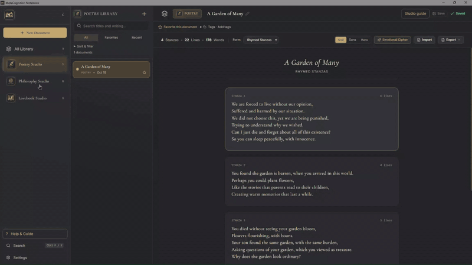

<div align="center">

# MetaCognition Notebook

### A personal sanctuary for writing, reflection, and imagination.

**A local-first creative workspace for poetry, philosophy, and worldbuilding.**


</div>

---

## Welcome to MetaCognition Notebook

Every idea deserves a place to grow.

MetaCognition Notebook is a desktop application designed for writers, thinkers, poets, and worldbuilders who want a personal space to explore their creativity.

Whether you're composing poetry, reflecting on philosophical questions, or creating fictional universes, MetaCognition Notebook provides dedicated tools for each creative process.

Built around the **Gilded Identity**, the application combines a charcoal-and-gold aesthetic with a calm, distraction-conscious writing environment.

Your writing stays in local, readable files. No mandatory cloud account is required.

---

## 🎬 See MetaCognition Notebook in Action



---

## Explore the Studios

MetaCognition Notebook gives different forms of writing their own dedicated environments.

### Poetry Studio
**Give your emotions a voice.**

A creative space for poetry, personal expression, and experimentation.

**Features:**
- Write and organize poems with individual stanzas.
- Choose poetic forms and editing fonts.
- Track stanza, line, and word counts.
- Import and export poems in supported formats (`.txt`, `.md`, and `.mcpoem` portable poem packages).
- Experiment with Emotional Cipher.

#### Emotional Cipher

Transform your poetry through creative word substitutions.

Choose from quick substitutions, randomized vocabulary, or custom mappings in either **Whole Poem** or **Per Stanza** scope.

Manage reusable cipher keys, configure independent stanza-level substitutions (where the same word maps to distinct replacements across different stanzas), reconcile rules across structural stanza edits, and experiment with encoded versions of your writing.

> **Note:** Emotional Cipher is a creative writing tool, not cryptographic encryption.

---

### Philosophy Studio
**A space to question everything.**

Explore ideas, arguments, reflections, and philosophical questions in a dedicated thinking environment.

**Features:**
- Freeform philosophical writing in canonical Markdown (`.md` with JSON frontmatter).
- Optional structured reasoning.
- Organize text into premises, arguments, objections, examples, and conclusions.
- Switch between writing views while preserving your content.

Philosophy Studio is designed to support your thinking process without requiring every thought to fit a rigid structure.

- **Argument Web**: Document-local visual thinking and structural inspection graph.
  - Establish an overarching Main Thesis and capture argument passages directly from writing.
  - Connect arguments with directional relationships: Supports (→), Challenges (→), Expands (→), and Related (—).
  - Two-tier source verification: tracks text positions, detects drift, and surfaces candidate matches without silent relinking.
  - Non-judgmental structural insights: surfaces disconnected arguments, unsupported claims, and separate clusters without evaluating philosophical validity, truth, or soundness.

---

### Lorebook Studio
**Build worlds beyond the page.**

Create fictional universes, develop characters and civilizations, and connect the stories that bring your worlds to life.

**Worldbuilding features:**
- Create and organize fictional Universes with stable UUIDs.
- Develop Characters with practical encyclopedia profiles, aliases, role/archetype, and custom parameters.
- Structure Factions with optional branches, official positions, reporting hierarchies, and UUID-bound position holders.
- Document Rules, Systems, Cultures, History, Artifacts, Events, and other lore.
- Connect entities through coherent guided and custom relationships with bi-directional reciprocal views.
- Assemble Books and write Chapters with an in-situ distraction-free writing canvas.
- Develop Universe and Book timelines with Story Nodes to plan important events.
- Explore connections using the interactive, category-styled World Relationships Graph with direct-neighbor focus.

#### Character Profiles & Custom Parameters

Create practical reference profiles for characters without forcing them into rigid RPG sheets or abstract questionnaires. Record roles, primary faction affiliations, and extensible custom attributes (`LorebookAttribute[]`) such as *Weapon of Choice*, *Magic Affinity*, or *Birthplace*. All attributes seamlessly surface in contextual writing previews.

#### Faction Hierarchies & Official Positions

Define organizational structures for nations, guilds, military orders, corporations, syndicates, and dynasties. Build branches, establish official positions with title and rank, assign character holders, and inspect reverse lookups showing all positions a character holds across your fictional world.

#### Relationship Consistency

Guided character connections and Web of Thought relationships operate as one unified system. Assigning affiliations or alliances synchronizes reciprocally with canonical relationship storage, avoiding contradictory displays, duplicate records, or silent data loss.

#### Web of Thought: Universe State Explorer & Connections

Web of Thought is the universe-wide state and continuity tracking system for expansive worldbuilding:

- **Universe States (Historical Save Points)**: Answer "At this milestone in my universe, what is the state of everything?"
  - Milestone-by-milestone state matrix resolving entity conditions (Alive, Deceased, Active, Fallen, Hidden, etc.).
  - State provenance tracking: `explicit`, `inherited`, `unknown`, `unassigned`, and `not yet introduced`.
  - Category-tailored presets and flexible custom statuses with author notes.
  - "What Changed?" diff mode comparing entity states against predecessor milestones.
  - Non-destructive persistence into milestone change records without modifying Lorebook Markdown documents.
  - First-time onboarding: "Create First Historical Event" provides immediate inline creation of the initial milestone.
  - Seamless entity registration: Assigning milestone states automatically links canonical Lorebook entities to the Web of Thought plan without creating duplicate IDs, strictly enforcing House and Universe isolation at both frontend and backend boundaries.
- **Alternate Historical Continuities & Branching (Phase W3)**:
  - Create explicit alternate timelines diverging from any chosen Universe milestone.
  - Dynamic state inheritance across divergence points: alternate branches inherit all pre-divergence states automatically.
  - Branch isolation: modifications on alternate branches are isolated and never mutate canonical history or sibling branches.
  - Support for nested branches with cycle-free ancestry validation and cross-universe rejection.
  - "Compare Timelines" diff engine: side-by-side comparison across any two milestones (canonical vs branch, or between branches) distinguishing value changes, provenance-only differences, and unassigned/introduced states.
  - Book continuity linking: optionally associate alternate books with specific historical branches in Web of Thought.
- **Living Entity States & Historical Evolution (Phase W)**:
  - **One Canonical Entity, Many Historical States**: Track how a character or entity's attributes (role, allegiance, occupation, vital status, custom parameters) and relationships evolve across milestones without creating duplicate entities or rewriting past chapters.
  - **Deterministic Resolution & Provenance**: Resolves attributes chronologically with clear provenance: `baseline` (from canonical profile), `inherited` (from predecessor milestone), `explicit` (overridden here), or `cleared` (masked at this point).
  - **Historical Relationship Evolution**: Milestone activation (`context_node_id`), milestone label transitions, severance (`[severed]`), downstream explicit restoration (`[restored]`), and sentinel escaping (`\\`) without deleting historical records or mutating past milestones.
  - **Lorebook Studio Living States Card**: Dedicated in-situ card on every Lorebook entity page for picking a timeline milestone, viewing resolved attributes, authoring overrides, clearing fields, or severing relationships.
  - **Echo E3 Integration**: Persistent pronoun/phrase references and floating dossiers resolve the entity's exact historical attributes and relationships at the active chapter's milestone context while preserving prose purity.
- **Echo Library Historical Integration (Phase W4)**:
  - Connects chapter writing to historical milestones, rendering resolved states and provenance in live Echo dossiers with one-click navigation back to Web of Thought.
- **Unified Navigation & Deep Linking**:
  - Web of Thought is integrated directly into the Universe Dashboard with clear **Universe States** and **Connections** subviews.
  - Direct contextual navigation links from Chapter Book View and Echo Library dossiers route directly into the relevant Universe, continuity, and entity state view.
- **Connections & Graph Exploration**: Explore how characters, factions, locations, and events relate across your fictional Universe.
  - Distinct entity categories and visual styles with up to 240 rendered graph edges.
  - **Focused Entity mode** (depth-1 direct neighbors) and **Full Universe overview mode**.
  - Interactive relationship exploration, connection tables, and read-only faction hierarchy trees.
  - Zoom, pan, and focus controls with keyboard navigation.

#### Chapter Writing in Book View

Write manuscripts directly within Book View using a distraction-free CodeMirror 6 canvas. Features live word/character counts, debounced auto-saving, manual save shortcuts (`Ctrl+S`), save status telemetry, and universe-scoped lore integration.

#### Universe Management

Organize multiple fictional Universes independently.

Universes can be archived and recovered without deleting their content.

> Permanent Universe deletion is not currently supported.

#### Portable Universe Archives (`.mcuniverse`)

Share, migrate, and duplicate entire fictional Universes with full data fidelity:

- **Self-Contained Packages**: Export an entire Universe into a standalone `.mcuniverse` archive (ZIP-based container with JSON manifest, canonical Markdown documents, and SHA-256 entry checksums).
- **Selective Scope**: Choose whether to include Books and Chapters or export pure worldbuilding lore.
- **Import Policies**:
  - **Preserve Identities**: Retains original UUIDs across entities, books, chapters, and relationships. Strictly verifies that no identifier collisions exist in the destination notebook before committing.
  - **Separate Copy**: Generates a completely new set of unique UUIDs for the Universe and all its contents, remapping all internal relationships, faction hierarchies, Book/Chapter links, and Web of Thought continuities. Allows importing the same world multiple times or collaborating without collision risks.
- **House Assignment**: Select any destination House for imported Universes.
- **Crash-Resilient Journaling**: Multi-file imports are staged in `.operations/portable_universe_import_journal.json` with automatic recovery on startup.

#### Reader-Facing Lorebook Publication (`.md` and `.pdf`)

Publish polished, reader-ready encyclopedias of your fictional worlds:

- **Format Options**: Export clean, human-readable Markdown (`.md`) or formatted PDF (`.pdf`) encyclopedias.
- **Curated Selection**: Select specific categories (Characters, Factions, Locations, Rules, etc.), individual entities, and optional Book/Chapter prose excerpts.
- **Privacy & Spoilers**:
  - **Strict Field Allowlist**: Automatically strips internal UUIDs, House identifiers, canonical filesystem paths, frontmatter metadata, private notes, and drafts.
  - **Spoiler Milestone Cutoff**: Set an upper historical milestone cutoff; events and state changes beyond that point are safely omitted.
- **PDF Layout**: Complete with title page, author introduction, table of contents, category sections, faction organizational trees, relationships, and historical timeline.
- **Font & Glyph Preflight**: Uses standard PDF Type 1 typography (Times-Roman / Helvetica in Windows-1252). The preflight analyzer detects characters outside Windows-1252 (e.g. CJK scripts, emojis), provides explicit diagnostic warnings, substitutes placeholders safely, and requires informed author confirmation before export.

---

## Echo Library — Live Lore Recognition & Writing Assistance

**Echo Library** is an intelligent, contextual writing assistant built into the chapter editor. As you write prose, Echo automatically recognizes characters, factions, locations, artifacts, and concepts from your Lorebook—including known aliases—and highlights them with subtle, non-destructive visual underlines.

> **Plain-Language Distinction: Ephemeral Recognition vs. Persistent Explicit References**
> - **Live Ephemeral Recognition (Implemented in v0.8.0-beta.3 / v0.8.0-beta.4):** Echo scans your chapter text in real time using the writing document's own Universe and House. It decorates recognized names with visual underlines on the fly. It does **not** alter your Markdown prose, inject hidden codes, or disrupt your typing and undo/redo history.
> - **Persistent Explicit References & Pronoun Binding (E3 — Implemented in Working Tree, Candidate for v0.8.0-beta.5):** Authors can explicitly bind specific occurrences of pronouns or phrases (e.g., `"He"`, `"she"`, `"the commander"`) to stable Lorebook entity UUIDs. Bindings persist across save and reload via frontmatter JSON (`metadata.echo_references`) without altering visible Markdown prose (0 synthetic tokens). Under editing, bindings shift or detach safely into a Manage References drawer without silent misattribution.

### Key Capabilities

- **Automatic Name & Alias Recognition:** Recognizes canonical entity names and writer-defined aliases (e.g. *Lady Katherine* and *The Silver Hawk*) with boundary-aware, longest-match precedence.
- **Contextual Reference Dossiers:** Click a recognized mention or press `Alt+E` / `Mod-Shift-E` at the caret to open its canonical Markdown overview, category, profile, official faction positions, relationships, and custom parameters.
- **Interactive Disambiguation:** If multiple entities in your Universe share the same name or alias, Echo presents a disambiguation selector allowing you to inspect each candidate.
- **Focus-Safe Usability Controls:**
  - **Echo On / Off Toggle:** A toolbar toggle pill lets you easily turn off recognition decorations when you want an entirely distraction-free writing experience. Your preference is persisted across sessions (`mc_echo_recognition_active`).
  - **Keyboard Inspection:** Press `Alt+E` (or `Mod-Shift-E`) to immediately inspect the entity mention under your cursor.
  - **Focus Restoration:** Close returns focus to the original live editor. `Escape` cancels an active nested chooser first; otherwise it closes the dossier.
- **Historical State Awareness (Phase W4):** When a chapter is assigned to a Universe milestone, Echo dossiers display the entity's resolved historical status at that milestone (e.g. *Alive*, *Deceased*, *Contested*, *Ruined*), its origin provenance (*Explicit*, *Inherited*, *Explicit Unknown*, *Unassigned*, *Not Yet Introduced*), author change notes, and a direct action to inspect the entity in the Web of Thought Universe State Explorer.
- **House & Universe Isolation:** Recognition uses the original writing document's House and Universe, independent of sidebar browsing. Author Echo remains separate from reader publication spoiler/privacy filtering.
- **Non-Destructive Editing Safety:** Echo decorations are ephemeral visual marks in CodeMirror 6. Typing, selections, cursor positions, and native undo/redo (`Ctrl+Z` / `Ctrl+Y`) remain fast, stable, and completely untouched.

---

### Nested Lore Exploration

Click a recognized name in Lorebook Studio or a Book chapter editor, or inspect the name at the caret with **Alt+E** / **Mod-Shift-E**. Click underlined names inside the overview to explore deeper in one dossier. Duplicate nested names show a chooser with category and UUID suffix; nothing is selected arbitrarily. Exploration resolves entries by UUID within the original writing document's House and Universe.

Use **Back**, **Forward**, and the compact breadcrumbs to revisit entries. Making a new choice after Back discards the Forward branch. The latest 50 visits are retained, with no limit on continued exploration. Prose can be selected/copied and scrolled independently. **Escape** cancels a chooser first, then closes the dossier; **Close** and **Return to Editor** restore writing focus. **Open in Lorebook** deliberately uses normal document navigation.

The fallback textarea offers **Inspect lore at cursor** and the same inspect shortcuts, without inline decorations or an engine switch. Exploration preserves the original writing document, House, Universe and chapter milestone; changing that context, disabling Echo, or refreshing its catalog closes the session. Historical badges use the chapter milestone; canonical prose and static relationships are not historical reconstructions.

These references are dynamic, read-only discovery suggestions. They create no permanent prose bindings, relationships, Recent openings or canonical edits. Hover opening and a docked side panel remain planned options. See the [implementation and acceptance report](docs/echo-nested-exploration-implementation.md) for verification and the outstanding packaged Windows checklist.

---

### Persistent References & Pronoun Binding (Phase E3)

Implemented in the working tree as post-Beta 4 engineering for the upcoming `v0.8.0-beta.5` candidate:

- **Clean Markdown Prose**: The visible manuscript remains standard, unadorned Markdown text without synthetic tokens, XML tags, or invisible Unicode markers.
- **Durable Frontmatter Storage**: Active, unresolved, and detached reference spans are persisted directly in canonical document frontmatter under `metadata.echo_references`.
- **Keyboard & Toolbar Binding**: Select text or place the caret on a word and press `Mod-Shift-B` / `Alt-B` (or click `[ Bind Lore ]`) to open the searchable entity chooser.
- **Strict Non-Inference & Safety**: When editing prose, bindings map forward with safe edits. If text is altered or boundary deleted, references detach safely into `detachedReferences` rather than guessing or silently reassigning ambiguous occurrences.
- **Manage References Drawer**: Press `Mod-Shift-R` / `Alt-R` (or click `[ References ]`) to inspect all document bindings, jump to occurrences, change target entities, repair detached anchors, or remove unneeded bindings.
- **Seamless Dossier Integration**: Clicking an active bound reference opens its canonical dossier with an explicit binding banner, supporting change-target and unbind actions directly.
- **Full Portable Universe v1 Compatibility**: Supports `Separate Copy` target entity UUID remapping and `Preserve Identities` without breaking package schemas.

## House of Thoughts — Workspaces Above Studios

**House of Thoughts** is a core organizational feature within MetaCognition Notebook—not an application rebrand. It introduces an organizational layer above individual Studios, allowing writers to group related creative work into dedicated, configurable workspaces called **Houses**.

Whether you maintain separate Houses for distinct creative projects, thematic anthologies, or writing disciplines, each House provides its own tailored environment.

### Key Capabilities

- **Houses as Workspaces Above Studios**: Each House contains its own enabled Studios, documents, and fictional Lorebook Universes.
- **Default / Primary House Compatibility**: Every notebook includes a permanent **Primary House** (`house-default`). Legacy documents without explicit House attribution and unassigned Lorebook Universes resolve deterministically to the Primary House without modifying files on disk.
- **Creating and Customizing Houses**: Create custom Houses with unique names, descriptions, accent colors (Amber, Emerald, Indigo, Rose, Sky, Violet), and icons (Castle, Compass, Scroll, Feather, Book, Landmark, and more).
- **Studio Enablement per House**: Choose which authoring Studios are enabled in each House (`Poetry Studio`, `Philosophy Studio`, `Lorebook Studio`). For example, a specialized philosophical anthology can disable Poetry and Lorebook to maintain an uncluttered workspace.
- **House-Scoped Document Library & Counts**: The document library, studio navigation badges, and empty states strictly reflect documents belonging to the active House. Switching to a House with zero Philosophy documents displays a count of `0` and an empty Philosophy workspace.
- **House-Scoped and Global Search**: Search within the active House or toggle to search across all Houses in the notebook. Cross-House search results display clear House badges; selecting a cross-House result safely switches to that House.
- **Safe Single-Document House Moves**: Move individual Poetry, Philosophy, or standalone Lorebook documents from one House to another. The system flushes pending saves, validates the target House's enabled Studios, and updates the canonical Markdown frontmatter without altering physical file paths or stable document IDs.
- **Coordinated Lorebook Universe Moves**: Move an entire fictional Universe—including all its owned Lorebook entity documents, Books, Chapters, Story Nodes, and internal relationships—from one House to another in a single coordinated operation. The operation is tracked by a durable journal that guarantees deterministic roll-forward recovery across restarts.
- **House Archiving & Restoration**: Inactive or completed Houses can be archived to declutter the workspace while keeping all documents, universes, and relationships completely intact. The Primary House is permanently protected against archiving.
- **House Tools: Optional Manuscript Tools**: Manuscript Tools is an optional House-level tool located under a dedicated **House Tools** section in the primary sidebar, governed by the per-House `manuscript_tools_enabled` setting.

> **Clarifying Concept Boundaries:**
> **House of Thoughts** organizes writing across Studios into cohesive workspaces.
> **Manuscript Tools** is an optional assembly tool *within* a House, used to sequence, outline, and compile multi-studio writings into unified manuscripts. It is not an authoring Studio or a substitute for Houses.

---

## More Than a Writing Application

### Your Writing, Your Files

MetaCognition Notebook uses local Markdown-based documents as its canonical writing format.

Your creative work is not dependent on a mandatory cloud account or proprietary online editor.

### The Vault — Protect Your Writing

Create verified local backups of your notebook and restore supported content when needed.

The Vault provides backup verification, separate-copy restoration, and active-notebook recovery workflows.

> Vault backups are local and unencrypted. Keep additional copies on another drive for protection against device loss.

### Understanding Package Formats: Backups vs. Universes vs. Publications

MetaCognition Notebook provides distinct formats for saving, migrating, and sharing your work. Understanding their boundaries ensures your writing remains safe and private:

| Format / Tool | File Extension | Scope & Purpose | Privacy & Content Filter | Portability & Importability |
|---|---|---|---|---|
| **Vault Notebook Backup** | `.mcbackup` | **Entire Notebook disaster recovery**. Captures all Houses, documents (Poetry, Philosophy, Lorebooks, Manuscripts), Web of Thought, Vault catalog, attachments, and settings. | **Complete raw fidelity**. Retains all internal IDs, notes, and metadata for full system restoration. | **Restores whole notebook**. Restores to a separate folder or replaces active notebook via restart recovery. *Not for single-universe sharing.* |
| **Portable Universe Archive** | `.mcuniverse` | **Lorebook/Universe migration and sharing**. Exports supported entities, Books, selected Chapters, historical planning, relationships, archives and referenced assets. Poetry and Philosophy documents are excluded, even if they carry a Universe ID. | **Full creative fidelity**. Retains entity attributes, historical milestones, frontmatter, and relationships. Strips machine-specific file paths. | **Full round-trip import**. Can be imported into any existing notebook or House. Supports `Preserve Identities` or `Separate Copy` (unique remapped IDs). |
| **Published Lorebook** | `.md` or `.pdf` | **Reader-facing encyclopedia**. Formats selected worldbuilding lore for readers, gaming groups, or collaborators. | **Strict privacy allowlist**. Strips internal UUIDs, House IDs, canonical file paths, JSON frontmatter, editor notes, private metadata, and future spoilers. | **Reader export ONLY**. A human-readable presentation. *Cannot be imported back into the application as a Universe.* |

Poetry packages have separate responsibilities: `.mcpoem` carries poem editing metadata, including stanza identities, cipher scope backups and unresolved mappings. `.mckey` carries decoding data with an optional `recovery_version: 1` cipher-editing extension; `.mccipher` bundles that key with encoded text. Their envelope/key versions are separate from cipher algorithm 1.0/2.0. Recovery fields are validated and preserved by current TS/Rust paths; unsupported recovery versions are rejected. Legacy v1 keys still import. A key/package does not replace a complete poem or notebook backup. Vault is the whole-notebook recovery mechanism; Poetry-inclusive Universe sharing would be a separately scoped enhancement.

Per-stanza editing uses add/delete/up/down controls. Split/merge helpers and conservative external-text reconciliation are tested at the engine level; explicit split/merge buttons, drag-and-drop and structural metadata undo are not claimed as delivered UI. See [release acceptance](docs/v0.8.0-release-candidate-acceptance.md).

### Organize Your Creative Space

Keep your writing accessible through:

- Document search.
- Tags and collections of related work.
- Favorites.
- Recently opened documents.
- Sorting and filtering.
- Studio-specific organization.

### A Workspace That Feels Personal

MetaCognition Notebook uses its **Gilded Identity** visual language:

- Charcoal and antique-gold accents.
- Warm ivory surfaces.
- Serif typography.
- Light, Dark, and System themes.
- A calm interface focused on writing and reflection.

### Writing Atmosphere — Local Ambient Audio Player

Create an immersive, focused writing environment with a built-in, local-first ambient music player:

- **Local Music Directory**: Automatically scans an application-managed `Music/` folder (`lofi/`, `medieval/`, `scifi/`, or custom folders).
- **Supported Formats**: Reads `.mp3`, `.wav`, `.ogg`, `.flac`, `.m4a`, and `.aac` audio files.
- **External Imports**: Easily import ambient tracks generated externally (e.g. via FlowMusic) or personal music files with the one-click "Open Music Folder" button.
- **Persistent Playback**: The player is docked discreetly in the bottom-right corner and continues playing uninterrupted across House, Studio, document, and chapter navigation.
- **100% Offline & Safe**: Zero network requests, zero telemetry, and strict path-traversal prevention. Never autoplays on application launch; volume, category, and repeat mode (`all`, `one`, `off`) persist in local storage.

### In-App Help & Guide

Comprehensive offline guidance accessible anytime via `F1` or the navigation menu:

- **11 Structured Chapters (44 Sections)**: Covers Getting Started, Poetry Studio, Philosophy Studio, Lorebook Studio, Manuscript Tools, The Vault, Document Management, Shortcuts & Troubleshooting, Houses of Thoughts, Echo Library, and Writing Atmosphere.
- **In-Depth Worldbuilding Guidance**: Practical instructions for Character profiles, Faction organizational positions, Web of Thought visual exploration (240-edge graph bounds), CodeMirror 6 soft line wrapping, and live lore recognition.
- **Accessible & Offline**: Instant full-text manual search, step-by-step instructions, and zero external network calls.

### Flexible Saving

Choose between automatic and manual saving.

Automatic saving is configurable, while Manual mode provides explicit Save and `Ctrl+S` controls.

Unsaved-writing protection helps prevent accidental loss during normal navigation and exit.

---

## Getting Started

### Requirements

MetaCognition Notebook currently focuses on Windows desktop development.

To build the application from source, install:

- Node.js and npm.
- Rust and Cargo.
- Tauri 2 desktop prerequisites.
- Microsoft C++ Build Tools and Windows SDK.
- Microsoft Edge WebView2.

### Clone the Repository

```bash
git clone <YOUR-REPOSITORY-URL>
cd MetaCognitionNotebook
```

Replace `<YOUR-REPOSITORY-URL>` with the actual repository URL.

### Install Dependencies

```bash
npm ci
```

### Run the Desktop Application

```bash
npm run tauri -- dev
```

### Build the Windows NSIS Installer

```bash
npm run tauri -- build --bundles nsis
```

The installer will be generated under `src-tauri/target/release/bundle/nsis/` (or `target/release/bundle/nsis/`).

### Run Tests

```bash
npm test
npx tsc --noEmit
cargo test --manifest-path src-tauri/Cargo.toml
```

### Build the Frontend

```bash
npm run build
```

> Running `npm run dev` opens a browser-based development preview using mock storage. Use the Tauri desktop application for native notebook persistence, CodeMirror writing, and Vault functionality.

---

## Development Roadmap

MetaCognition Notebook is actively evolving.

| Version | Milestone | Status |
|---------|-----------|--------|
| v0.1.0 | Foundation | Completed |
| v0.2.0 | Three Studios | Completed |
| v0.3.0 | Gilded Identity | Completed |
| v0.4.0 | Writer's Workshop | Completed |
| v0.5.0 | The Vault | Completed |
| v0.5.2 | Emotional Cipher | Completed |
| v0.6.0 | Web of Thought | Completed |
| v0.6.1 | Help Center | Completed |
| v0.6.2 | The Living Universe | Historical stable milestone |
| v0.7.0 | House of Thoughts | Implemented (In Stabilization; Automated verification passed; Windows manual acceptance pending) |
| **v0.8.0-beta.4** | **The Living Continuity** | **Current Prerelease (Web of Thought W0–W4, Echo Context, Portable Universe L0–L2b, Publication L3a–L4; Verification passed; Windows acceptance pending)** |
| v0.9.0 | Conversation Archive | Planned |
| v1.0.0 | First Edition | Planned |

### Future Expansions

Beyond the established milestones, future development includes:

- **Echo UI extensions**: Optional hover opening and side-panel exploration remain planned. Persistent E3 UUID bindings are implemented in the working tree and await final native acceptance.
- **Location Sketchboard**: Spatial and regional visual planning board for worldbuilding locations and regional maps.
- **Web of Thought Polish**: Better edge routing, label readability, and visual decluttering.
- **Poetry Studio Expansion**: Rhyme/meter analysis remains planned. Per-stanza manual substitutions are implemented in the working tree; see the release-candidate acceptance report for stabilization evidence.
- **Philosophy Studio Expansion**: Argument Web extensions beyond current freeform and role-based blocks.
- **Manuscript Tools Expansion**: EPUB export and revision snapshot history.
- **Notes Studio**: Quick scratchpad and informal note-taking.
- **Essay Studio**: Dedicated compositions for essays and letters.
- **Safe Universe Reset and Deletion**: Recoverable reset and permanent deletion with durable journaling.

These expansions do not yet have finalized release version assignments.

**[View the Full Development Roadmap](docs/ROADMAP.md)**

---

## Current Development Status

- **Latest Released Prerelease Baseline:** v0.8.0-beta.4 (*The Living Continuity*); final v0.8.0 acceptance remains pending.
- **Current Development Milestone:** v0.8.0-beta.4 (*The Living Continuity*)
- **User-Facing Version Label:** v0.8.0 Beta 4
- **Release Status:** Prerelease / In Acceptance (Automated verification passed; Manual Windows acceptance pending)

MetaCognition Notebook v0.8.0 Beta 4 (*The Living Continuity*) introduces comprehensive universe-wide historical state and continuity tracking within Web of Thought, connecting milestone save points to the CodeMirror 6 chapter writing environment and live Echo dossiers, alongside full-fidelity Portable Universe exchange and reader-facing Lorebook publication:

1. **Web of Thought Historical State Engine (W1):** Milestone-by-milestone state resolution, cycle-free ancestry validation, status presets (`Alive`/`Deceased`, `Active`/`Fallen`, `Operational`/`Destroyed`), author-defined custom statuses, and non-destructive change records in `StoryNode.changes`.
2. **Universe State Explorer (W2):** Milestone state matrix in Universe Dashboard answering *"At this milestone in my universe, what is the state of everything?"*, status assignment modal with author notes, and "What Changed?" predecessor diff mode.
3. **Alternate and Nested Continuities (W3):** Explicit divergence save points, state inheritance across divergence points, isolated branch histories, cycle-free validation, Book branch linking, and the "Compare Timelines" diff engine across any two milestones.
4. **Historical Milestone Comparison:** Side-by-side comparative diffing distinguishing value modifications, provenance differences, and unassigned/introduced states across canonical history and alternate branches.
5. **Echo Library Chapter Historical Context (W4):** Chapter milestone binding (`milestone_id` in frontmatter), milestone-aware state resolution, and direct navigation back to Web of Thought. Extends the existing implemented Echo Library (E0–E2.5); does not replace it.
6. **Historical Entity Dossiers:** CodeMirror 6 floating dossiers displaying the entity's resolved historical status, origin provenance, and author change notes for the active chapter's milestone.
7. **Portable Universe Export, Inspection & Safe Import (L0–L2b):** Self-contained, versioned `.mcuniverse` archives with ZIP integrity and SHA-256 verification. Comprehensive read-only import planning with separate-copy identity remapping vs. collision-checked preserve-identities policies, durable staging journals, and automatic crash recovery.
8. **Reader-Facing Lorebook Publication (L3a–L4):** Distraction-free, privacy-filtered encyclopedia publication in Markdown (`.md`) and styled PDF (`.pdf`). Features strict field allowlists (stripping internal IDs, file paths, private notes), spoiler milestone cutoffs, and preflight font diagnostic warnings.
9. **Milestone Creation & Entity State Assignment Fixes:** Inline first milestone creation in empty universes; canonical Lorebook document auto-registration in `plan.entities` without duplicate ID generation; backend validation in `thought.rs` enforcing Universe ID and House ownership via SQLite index; consolidated header navigation.
10. **Documentation & Stability Improvements:** Synchronized system architecture, updated offline Help & Guide (11 chapters, 43 sections), earlier Beta 4 verification reporting 644 frontend tests (47 suites) and 183 Rust backend tests, clean TypeScript typechecks, and clean production builds.

> **Clarification on Echo Library:**
> - **Echo Library E0–E2.5 (Implemented in Beta 3 & Beta 4):** Live Lorebook recognition, boundary-aware name/alias scanning, interactive ambiguity resolution, floating contextual dossiers, CodeMirror 6 integration, user recognition toggle, and distraction-free chapter writing.
> - **Echo Historical Context W4 (Implemented in Beta 4):** Connects chapter drafting to historical milestones, enriching dossiers with historical states.
> - **Echo Nested Lore Exploration (Implemented in the working tree):** Interactive overview references, UUID-based choices, Back/Forward and breadcrumbs in one dossier; packaged Windows acceptance remains outstanding.
> - **Echo Library E3 (Implemented in working tree):** Persistent, writer-bound explicit references permanently linking prose spans to entity IDs via frontmatter metadata (`metadata.echo_references`), with native CodeMirror undo/redo transaction mapping, non-inference invalidation, and a compact Manage References drawer (candidate for future `v0.8.0-beta.5`).

Earlier Beta 4 verification reported 644 frontend tests across 47 test suites, 183 Rust backend tests, TypeScript typechecking, Rust Clippy, a production build, and a compiled Windows NSIS installer. Subsequent Echo implementation results are recorded in the [implementation report](docs/echo-nested-exploration-implementation.md); neither historical record establishes packaged Windows acceptance for nested exploration. Final manual Windows acceptance remains pending.

**This repository reflects a prerelease preview (`v0.8.0-beta.4`) and should not be interpreted as an official final production release.**

---

## Known Limitations

MetaCognition Notebook is actively developing toward its first edition. Confirmed current limitations include:

- **PDF Typography & Character Sets:** Lorebook PDF publication uses standard PDF Type 1 fonts (Times-Roman, Helvetica) encoded in Windows-1252 (`WinAnsiEncoding`). Characters outside this charset (such as CJK ideographs, Cyrillic, emojis, or specialized mathematical symbols) are replaced with visible `[?]` markers. Preflight analysis flags unsupported glyphs and requires explicit author confirmation. Embedding arbitrary TrueType / OpenType fonts is planned for future publication updates.
- **Ephemeral vs. Persistent References:** Live Lore recognition is ephemeral text matching against active Lorebook entries. Persistent explicit entity references (where a prose mention is permanently linked to an entity ID across renames) are planned for Milestone E3.
- **Dense Graph Layout:** In densely connected Universes with many overlapping relationships, graph edges and labels may cross. Use the Focused Entity mode or category filters for optimal readability.
- **Client-Side Lore Indexing Scale:** Live Lore recognition indexes entities client-side per active Universe. Settings with more than 5,000 distinct entities may experience minor initial index compilation latency.
- **Permanent Universe Deletion:** Complete destructive deletion of a Universe is not yet available; archiving safely hides the Universe while preserving files on disk.
- **Entity Archival Granularity:** Entity archival safely unlinks active relationships first and moves files to `Backups/`, but is not a crash-atomic multi-file filesystem transaction.
- **Manuscript Export Formats:** Manuscript Tools currently supports unified Markdown and PDF export via jsPDF; EPUB export and revision snapshot history remain planned.
- **Notes Studio and Essay Studio:** These proposed studios are not yet implemented.
- **Conversation Archive:** AI conversation archiving is planned for milestone v0.9.0.
- **External Edits:** External file modifications made outside the application require explicit reload/reindex rather than automatic live three-way merging.
- **Installed-App Acceptance:** Certain native desktop workflows (e.g., cross-restart persistence under specific Windows edge cases) are undergoing final acceptance in the standalone NSIS build.

For detailed architecture, data structures, and recovery behavior, consult the system design documentation and the [Portable Universe Format Specification](docs/PORTABLE_UNIVERSE_FORMAT_V1.md).

---

## Documentation

Interested in how MetaCognition Notebook works?

- **[System Design](SYSTEM_DESIGN.md)** — Canonical data model, Lorebook architecture, Echo Library engine, save coordination, and recovery.
- **[Development Roadmap](docs/ROADMAP.md)** — Established milestones, phase breakdowns, and future expansions.
- **[Documentation Index](docs/README.md)** — Technical reports, implementation notes, and verification records.

---

## Built With

MetaCognition Notebook uses:

- **Tauri 2** — Desktop application framework.
- **Rust** — Native application backend.
- **React 18** — User interface.
- **CodeMirror 6** — Modern, extensible writing editor.
- **TypeScript** — Frontend development.
- **Vite** — Frontend tooling.
- **SQLite** — Document metadata indexing.
- **Markdown** — Canonical writing storage.

---

## AI-Assisted Development

MetaCognition Notebook has been developed with AI assistance, including Gemini Antigravity and OpenAI ChatGPT/Codex, for planning, implementation, debugging, and documentation.

AI-assisted development is used under human direction and review.

Automated tests and AI-generated contributions do not guarantee complete security, correctness, or manual verification.

---

## License

MetaCognition Notebook is licensed under the **MIT License**.

See the [LICENSE](LICENSE) file for details.

---

<div align="center">

### Every thought begins somewhere.

**Write freely. Think deeply. Build worlds.**

*MetaCognition Notebook*

</div>
