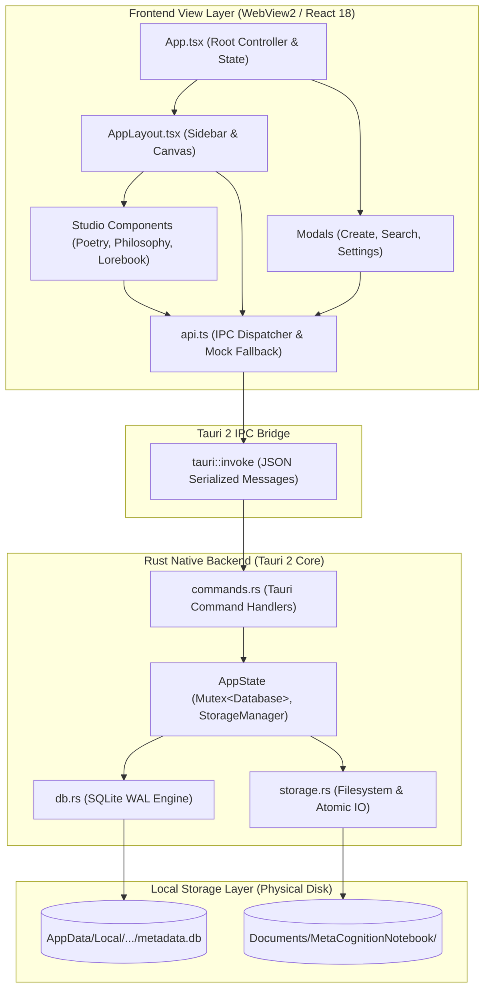
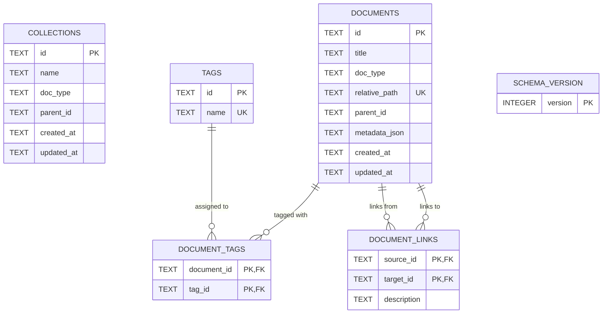
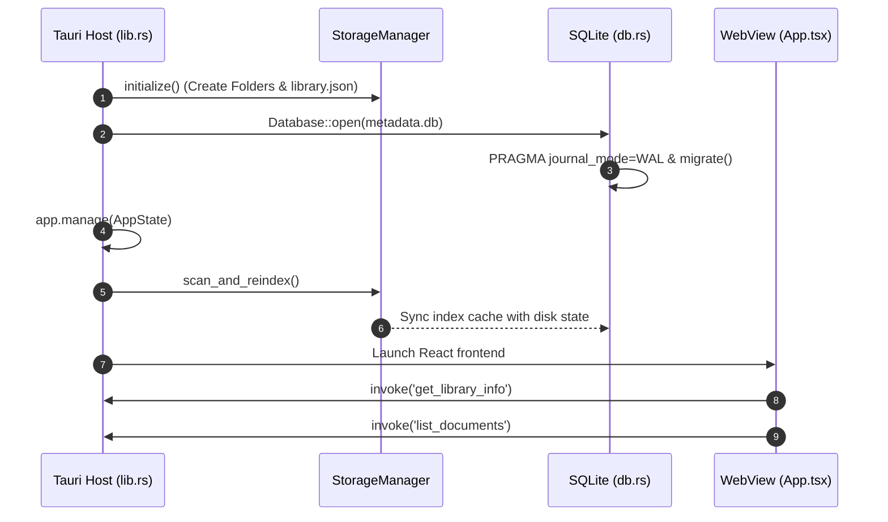
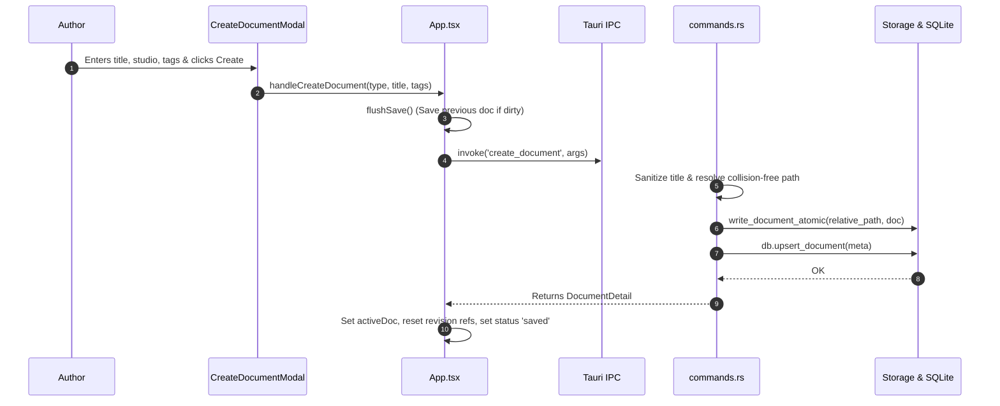
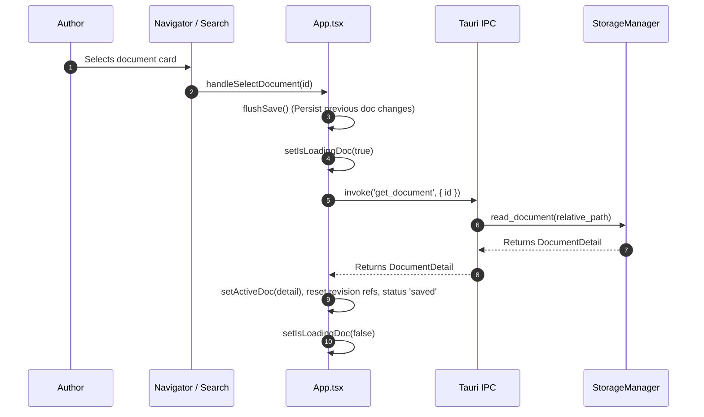
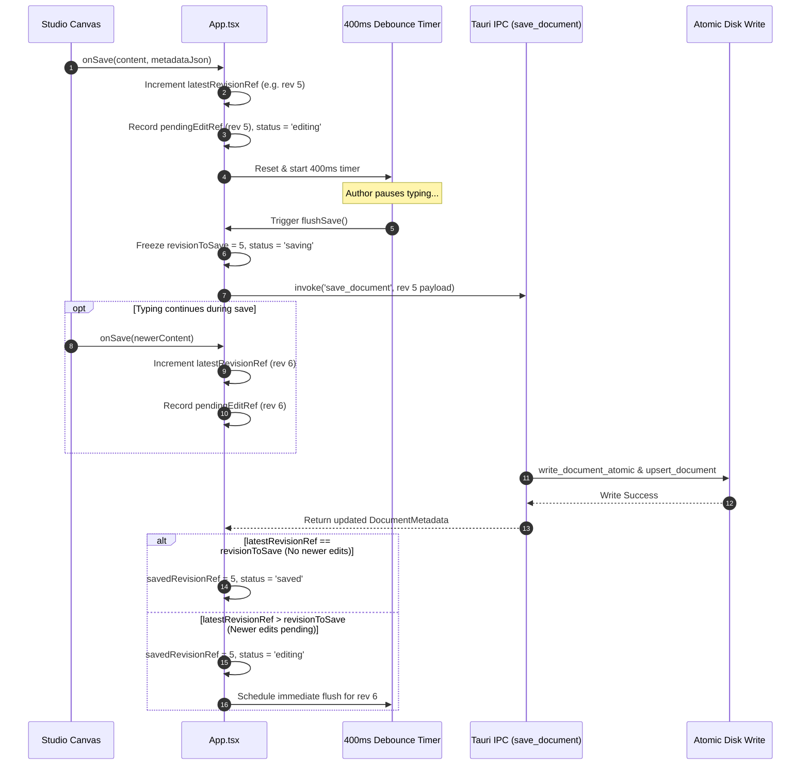
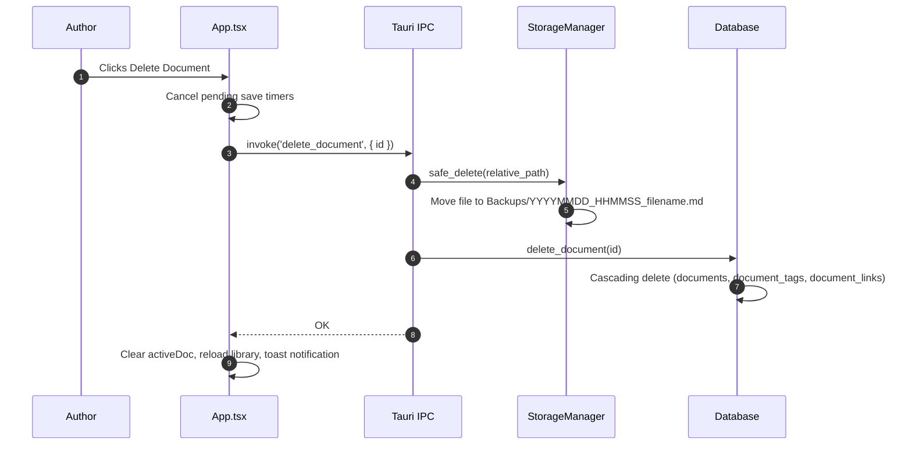
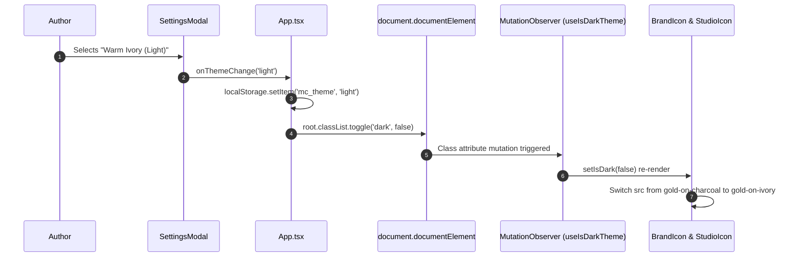

# MetaCognition Notebook — Technical System Design & Architecture

> **Engineering Reference Document for MetaCognition Notebook (MC)**  
> **Target Audience:** Systems Architects, Core Developers, Technical Contributors, QA Engineers  
> **Application Version:** `v0.3.0`  
> **Product Overview:** See [`README.md`](./README.md) for product motivations, studio overviews, and user workflows.

---

## Table of Contents

- [1. System Overview](#1-system-overview)
- [2. Architectural Architecture](#2-architectural-architecture)
  - [High-Level Architectural Diagram](#high-level-architectural-diagram)
- [3. Technology Stack & Rationale](#3-technology-stack--rationale)
- [4. Repository & Directory Structure](#4-repository--directory-structure)
- [5. Frontend Architecture](#5-frontend-architecture)
- [6. Backend Architecture (Rust)](#6-backend-architecture-rust)
- [7. Tauri IPC Contract Reference](#7-tauri-ipc-contract-reference)
- [8. Database Design & Relational Schema](#8-database-design--relational-schema)
  - [Entity-Relationship Diagram](#entity-relationship-diagram)
  - [Schema Definitions](#schema-definitions)
- [9. Document Data Model & Storage Lifecycle](#9-document-data-model--storage-lifecycle)
- [10. Core Application Workflows](#10-core-application-workflows)
  - [Workflow A: Startup & Database Initialization](#workflow-a-startup--database-initialization)
  - [Workflow B: Document Creation](#workflow-b-document-creation)
  - [Workflow C: Document Opening & Loading](#workflow-c-document-opening--loading)
  - [Workflow D: Debounced Autosave & In-Flight Protection](#workflow-d-debounced-autosave--in-flight-protection)
  - [Workflow E: Safe Archival (Deletion)](#workflow-e-safe-archival-deletion)
  - [Workflow F: Theme Switching & Asset Resolution](#workflow-f-theme-switching--asset-resolution)
- [11. Autosave & Data Integrity Engine](#11-autosave--data-integrity-engine)
- [12. Security & Privacy Architecture](#12-security--privacy-architecture)
- [13. Theme & Branding System Architecture](#13-theme--branding-system-architecture)
- [14. Build, Packaging & Distribution](#14-build-packaging--distribution)
- [15. Verification & Testing Strategy](#15-verification--testing-strategy)
- [16. Error Handling & Observability](#16-error-handling--observability)
- [17. Performance Characteristics & Resource Budgets](#17-performance-characteristics--resource-budgets)
- [18. Architectural Decisions & Trade-Offs](#18-architectural-decisions--trade-offs)
- [19. Future Architecture & Extension Points](#19-future-architecture--extension-points)
- [20. Technical Debt, Risks & Open Questions](#20-technical-debt-risks--open-questions)
- [21. Technical Glossary](#21-technical-glossary)

---

## 1. System Overview

### 1.1 Purpose
MetaCognition Notebook is a specialized, local-first desktop application engineered to provide domain-specific writing interfaces for Poetry, Philosophy, and Worldbuilding (Lorebook) authors. It unites these creative modes within a single managed document ecosystem.

### 1.2 Local-First Principles
- **Canonical Markdown on Disk:** The authoritative source of truth for all user prose is standard UTF-8 Markdown (`.md`) files containing structured JSON frontmatter stored in the user's OS `Documents` folder.
- **SQLite Metadata Index:** A local embedded SQLite database acts as a query accelerator, relationship graph, and index cache. The database can be wiped and fully rebuilt from filesystem Markdown files at any time.
- **Zero Remote Dependencies:** The application does not require internet access, remote authentication, or external API connectivity to create, edit, save, search, or export documents.

### 1.3 System Boundaries
- **Runtime Environment:** Windows 10/11 desktop operating systems (x86_64).
- **Filesystem Boundaries:**
  - Content Root: `%USERPROFILE%\Documents\MetaCognitionNotebook\`
  - Database Root: `%USERPROFILE%\AppData\Local\com.metacognition.notebook\metadata.db`
- **Network Boundaries:** No outgoing or incoming socket connections are initiated by the application runtime.

---

## 2. Architectural Architecture

The system is structured as a two-tier desktop architecture: a **Web UI View Layer** (React/TypeScript) and a **Native Desktop Shell & Controller** (Tauri 2/Rust). Communication occurs across a strictly typed, asynchronous Inter-Process Communication (IPC) bridge.

### High-Level Architectural Diagram



---

## 3. Technology Stack & Rationale

| Layer | Component | Version | Role in Architecture | Architectural Rationale & Constraints |
| :--- | :--- | :--- | :--- | :--- |
| **Shell** | [Tauri 2](https://v2.tauri.app/) | `^2.2.0` | Desktop Application Shell & Native Host | Lightweight footprint (~15MB RAM idle vs ~150MB+ for Electron). Utilizes native Windows WebView2 runtime; sandboxed OS filesystem access via Rust backend. |
| **Backend** | [Rust](https://www.rust-lang.org/) | `2021 Edition` | Core Domain, Filesystem IO, SQLite Driver | Memory safety without garbage collection; fast startup; thread-safe atomic file replacement. |
| **Frontend** | [React](https://react.dev/) | `^18.3.1` | Declarative UI View Framework | Component-based UI for complex dynamic studio canvases; well-supported ecosystem for rich state management. |
| **Language** | [TypeScript](https://www.typescriptlang.org/) | `^5.7.3` | Type System & Compilation | End-to-end interface contracts aligning frontend IPC payloads with Rust Serde structs. |
| **Database** | [SQLite 3](https://www.sqlite.org/) | `3.x` via `rusqlite 0.32` | Local Relational Indexing Engine | Zero-configuration embedded database; Write-Ahead Logging (WAL) for concurrent read access; fast indexing of metadata and tags. |
| **Styling** | [Tailwind CSS](https://tailwindcss.com/) | `^3.4.17` | Utility-First Design Token Engine | Centralized design tokens (Charcoal, Antique Gold, Warm Ivory); zero runtime CSS overhead; responsive desktop layouts. |
| **Icons** | [Lucide React](https://lucide.dev/) | `^0.475.0` | System Action Iconography | Clean, scalable SVG icons for system navigation, document actions, and window controls. |
| **Bundler** | [Vite](https://vitejs.dev/) | `^6.1.0` | Frontend Build Engine & HMR | Instant Hot Module Replacement during development; highly optimized production rollup bundling. |

---

## 4. Repository & Directory Structure

```text
MetaCognitionNotebook/
├── index.html                   # HTML entrypoint with font imports and root viewport
├── package.json                 # Node dependencies, scripts, and build tasks
├── tailwind.config.js           # Design tokens, color palette, and dark mode setup
├── tsconfig.json                # TypeScript compiler configuration
├── vite.config.ts               # Vite configuration with React plugin and path aliases
├── README.md                    # Product-oriented overview and beginner workflow
├── SYSTEM_DESIGN.md             # This technical architecture document
├── tests/                       # Automated frontend and integration test suites
│   ├── document_operations.test.ts        # Document lifecycle and mock IPC contract tests
│   └── phase2a_autosave_reliability.test.ts # Autosave debouncing and persistence tests
├── src/                         # React Frontend Application
│   ├── main.tsx                 # React DOM mount point
│   ├── App.tsx                  # Root state controller, autosave debouncer, shortcuts
│   ├── index.css                # Atmospheric background gradients, scrollbars, filters
│   ├── types/
│   │   └── index.ts             # Domain models, metadata types, studio definitions
│   ├── services/
│   │   ├── api.ts               # Unified API client (Tauri invoke + Mock fallback)
│   │   └── commands.ts          # Strongly typed Tauri command argument maps
│   ├── utils/
│   │   └── cn.ts                # Tailwind class merging utility (clsx + tailwind-merge)
│   ├── assets/
│   │   └── brand/               # Official brand master assets (dark and light artwork)
│   │       ├── app-icon-square.png         # Dark square MC emblem (1024x1024)
│   │       ├── app-icon-square-light.png   # Light square MC emblem (460x460)
│   │       ├── logo-horizontal.jpg         # Dark horizontal wordmark
│   │       ├── brand-horizontal-light.jpg  # Light horizontal wordmark
│   │       ├── studio-poetry.jpg           # Dark Poetry emblem
│   │       ├── studio-poetry-light.jpg     # Light Poetry emblem
│   │       ├── studio-philosophy.jpg       # Dark Philosophy emblem
│   │       ├── studio-philosophy-light.jpg # Light Philosophy emblem
│   │       ├── studio-lorebook.jpg         # Dark Lorebook emblem
│   │       └── studio-lorebook-light.jpg   # Light Lorebook emblem
│   └── components/
│       ├── common/              # Reusable UI controls and dialogs
│       │   ├── BrandIcon.tsx               # Theme-aware brand and studio icon components
│       │   ├── CreateDocumentModal.tsx     # New document modal with studio selectors
│       │   ├── Modal.tsx                   # Accessible backdrop dialog wrapper
│       │   ├── SearchModal.tsx             # Universal search dialog with keyword highlight
│       │   ├── SettingsModal.tsx           # Theme settings, paths, and reindex trigger
│       │   └── Toast.tsx                   # Toast notification context and container
│       ├── layout/
│       │   └── AppLayout.tsx               # Dual sidebar, header, and workspace canvas
│       └── studios/             # Specialized studio editors
│           ├── PoetryStudio.tsx            # Stanza editor, line metrics, poem metadata
│           ├── PhilosophyStudio.tsx        # Dialectical block editor, argument taxonomy
│           └── LorebookStudio.tsx          # Worldbuilding editor, attributes, canon status
└── src-tauri/                   # Rust Native Desktop Backend
    ├── Cargo.toml               # Rust dependencies and crate metadata
    ├── tauri.conf.json          # Tauri application configuration, window specs, icon suite
    ├── icons/                   # Generated multi-resolution Windows icons (.ico, .png)
    └── src/
        ├── main.rs              # Application entrypoint
        ├── lib.rs               # Tauri setup, state instantiation, command registration
        ├── models.rs            # Serde data transfer objects (DocumentMetadata, Frontmatter)
        ├── db.rs                # SQLite database connection, migrations, SQL queries
        ├── storage.rs           # Filesystem IO, atomic write, safe delete, parser, reindex
        └── commands.rs          # IPC command handlers and unit test suites
```

---

## 5. Frontend Architecture

### 5.1 Application State Model
The root controller (`src/App.tsx`) manages core application state:
- `documents: DocumentMetadata[]` — The cached collection of library documents for sidebar navigation.
- `activeDoc: DocumentDetail | null` — The currently open document (metadata + raw content).
- `selectedCategory: DocumentType | 'all'` — The active studio filter.
- `saveStatus: SaveStatus` — Visual state machine (`saved` | `saving` | `editing` | `error`).
- `theme: 'dark' | 'light' | 'system'` — Active interface appearance preference stored in `localStorage` (`mc_theme`).

### 5.2 Navigation & Layout
[`AppLayout.tsx`](file:///d:/Jetbrains_IDE_Projects/rustrover/MetaCognitionNotebook/src/components/layout/AppLayout.tsx) coordinates a three-region responsive workspace:
1. **Primary Sidebar (`Region A`):** Collapsible panel (`w-64` expanded, `w-18` collapsed) containing the brand emblem, quick creation button, studio navigators (All Library, Poetry, Philosophy, Lorebook), search shortcut, and settings toggle.
2. **Secondary Document Navigator (`Region B`):** Collapsible panel (`w-72` expanded, `w-0` collapsed) displaying real-time search filtering, tag filters, and sorted document cards with active selection states.
3. **Workspace Canvas (`Region C`):** The primary view displaying either the active studio editor or the introductory empty workspace hero with studio selection cards.

### 5.3 Theme Detection Architecture
Theme switching is completely decoupled from prop drilling via the `useIsDarkTheme()` hook in [`BrandIcon.tsx`](file:///d:/Jetbrains_IDE_Projects/rustrover/MetaCognitionNotebook/src/components/common/BrandIcon.tsx):
- Utilizes a `MutationObserver` on `document.documentElement.classList`.
- Immediately detects when `App.tsx` toggles the `.dark` class.
- Dynamically swaps image source references between gold-on-charcoal and gold-on-ivory assets without requiring an application restart.

---

## 6. Backend Architecture (Rust)

The Rust backend is encapsulated in `src-tauri/src/` with clear separation of concerns:

```
┌────────────────────────────────────────────────────────┐
│                      commands.rs                       │
│  (Tauri IPC Command Handlers & Parameter Validation)   │
└──────────────────────────┬─────────────────────────────┘
                           │ Calls
             ┌─────────────┴─────────────┐
             ▼                           ▼
┌─────────────────────────┐ ┌────────────────────────────┐
│          db.rs          │ │         storage.rs         │
│  (rusqlite Database &   │ │  (StorageManager, Atomic   │
│     WAL Index Engine)   │ │    Writes, Reindex Engine) │
└─────────────────────────┘ └────────────────────────────┘
```

- **`lib.rs`:** Initial setup life-cycle. Resolves OS paths (`Documents/MetaCognitionNotebook` and `AppData/Local/...`), initializes storage directories, opens SQLite database, runs migrations, spawns initial library reindexing, and registers commands.
- **`commands.rs`:** Defines `AppState { db: Mutex<Database>, storage: StorageManager, db_path: PathBuf }` and dispatches commands. All commands map to pure `*_impl` functions to facilitate direct Rust unit testing without mocking Tauri runtime states.
- **`storage.rs`:** Manages physical file manipulation:
  - `write_document_atomic`: Writes content to a temporary file via [`tempfile`](https://crates.io/crates/tempfile) in the same directory, flushes buffers, and executes an atomic file replace, guaranteeing file integrity against sudden power loss.
  - `resolve_safe_path`: Enforces strict path traversal defenses by inspecting path components for `ParentDir` (`..`), `RootDir`, or drive prefixes.
  - `safe_delete`: Moves deleted files to a timestamped `Backups/` directory rather than unlinking them from disk.
  - `parse_document_content`: Extracts YAML-like JSON frontmatter (`---json\n{...}\n---\n`) from raw Markdown files.
- **`db.rs`:** Wraps a `rusqlite::Connection` configured with `PRAGMA foreign_keys = ON;` and `PRAGMA journal_mode = WAL;`. Executes schema migrations via a version-tracked `schema_version` table.

---

## 7. Tauri IPC Contract Reference

The following table documents all 10 verified Tauri IPC commands exposed by the Rust backend and called by the React frontend:

| Command Name | Frontend Method (`api.ts`) | Parameters Received (Rust) | Return Type | Validation & Error Handling |
| :--- | :--- | :--- | :--- | :--- |
| `get_library_info` | `api.getLibraryInfo()` | *None* | `LibraryInfo` | Returns total document count, per-studio counts, and filesystem paths. |
| `list_documents` | `api.listDocuments(docType?)` | `doc_type: Option<String>` | `Vec<DocumentMetadata>` | Validates `doc_type` against allowed values (`poetry`, `philosophy`, `lorebook`). Returns sorted by `updated_at DESC`. |
| `get_document` | `api.getDocument(id)` | `id: String` | `DocumentDetail` | Queries database for document metadata; reads Markdown file from `relative_path`. Returns error if ID not found or file unreadable. |
| `create_document` | `api.createDocument(...)` | `doc_type`, `title`, `parent_id?`, `initial_content?`, `metadata_json?`, `tags?` | `DocumentDetail` | Sanitizes filename; handles file collision by incrementing suffix (`_1.md`); writes file atomically; indexes in SQLite. |
| `save_document` | `api.saveDocument(...)` | `id`, `content`, `title?`, `tags?`, `metadata_json?` | `DocumentMetadata` | Updates timestamps to UTC RFC-3339; atomic replace of Markdown file; updates SQLite index. |
| `rename_document` | `api.renameDocument(...)` | `id`, `new_title` | `DocumentMetadata` | Resolves new filename; creates new file atomically; deletes old file; updates SQLite index with new path and title. |
| `delete_document` | `api.deleteDocument(id)` | `id: String` | `()` | Moves Markdown file to timestamped `Backups/` folder; cascades deletion in SQLite (`documents`, `document_tags`, `document_links`). |
| `reindex_library` | `api.reindexLibrary()` | *None* | `ReindexReport` | Scans disk folder tree; parses frontmatter; clears and rebuilds SQLite index. Returns error list and count. |
| `search_documents` | `api.searchDocuments(...)` | `query: String`, `doc_type: Option<String>` | `Vec<SearchResult>` | Matches title (weight: title) or content (weight: snippet). Returns empty vector for blank queries. |
| `list_tags` | `api.listTags()` | *None* | `Vec<String>` | Returns all unique tag names from `tags` table in alphabetical order. |

> **Serialization Notice:** Tauri 2 automatically maps frontend camelCase parameter objects (e.g., `{ docType: 'poetry', newTitle: 'New' }`) to Rust snake_case variables (`doc_type`, `new_title`).

---

## 8. Database Design & Relational Schema

### Entity-Relationship Diagram



### Schema Definitions

The SQLite database (`metadata.db`) is initialized and migrated in [`db.rs`](file:///d:/Jetbrains_IDE_Projects/rustrover/MetaCognitionNotebook/src-tauri/src/db.rs):

```sql
-- Schema Migration Version Tracker
CREATE TABLE IF NOT EXISTS schema_version (
    version INTEGER PRIMARY KEY
);

-- Planned Collections (Hierarchical Grouping)
CREATE TABLE IF NOT EXISTS collections (
    id TEXT PRIMARY KEY,
    name TEXT NOT NULL,
    doc_type TEXT NOT NULL,
    parent_id TEXT,
    created_at TEXT NOT NULL,
    updated_at TEXT NOT NULL
);

-- Core Documents Index Table
CREATE TABLE IF NOT EXISTS documents (
    id TEXT PRIMARY KEY,
    title TEXT NOT NULL,
    doc_type TEXT NOT NULL,
    relative_path TEXT NOT NULL UNIQUE,
    parent_id TEXT,
    metadata_json TEXT,
    created_at TEXT NOT NULL,
    updated_at TEXT NOT NULL
);

CREATE INDEX IF NOT EXISTS idx_documents_doc_type ON documents(doc_type);
CREATE INDEX IF NOT EXISTS idx_documents_parent_id ON documents(parent_id);

-- Unique Tags Repository
CREATE TABLE IF NOT EXISTS tags (
    id TEXT PRIMARY KEY,
    name TEXT NOT NULL UNIQUE
);

-- Many-to-Many Document Tags Mapping
CREATE TABLE IF NOT EXISTS document_tags (
    document_id TEXT NOT NULL,
    tag_id TEXT NOT NULL,
    PRIMARY KEY(document_id, tag_id),
    FOREIGN KEY(document_id) REFERENCES documents(id) ON DELETE CASCADE,
    FOREIGN KEY(tag_id) REFERENCES tags(id) ON DELETE CASCADE
);

CREATE INDEX IF NOT EXISTS idx_document_tags_doc ON document_tags(document_id);
CREATE INDEX IF NOT EXISTS idx_document_tags_tag ON document_tags(tag_id);

-- Document Relationship Graph
CREATE TABLE IF NOT EXISTS document_links (
    source_id TEXT NOT NULL,
    target_id TEXT NOT NULL,
    description TEXT,
    PRIMARY KEY(source_id, target_id),
    FOREIGN KEY(source_id) REFERENCES documents(id) ON DELETE CASCADE,
    FOREIGN KEY(target_id) REFERENCES documents(id) ON DELETE CASCADE
);
```

---

## 9. Document Data Model & Storage Lifecycle

### 9.1 Frontmatter Format
Documents on disk use strict JSON frontmatter delimited by `---json` and `---`:

```markdown
---json
{
  "id": "c7a8b41e-5f92-4d2a-8d6b-3e5f1b9a2c4d",
  "title": "On the Indivisibility of Consciousness",
  "type": "philosophy",
  "created_at": "2026-10-18T05:30:00Z",
  "updated_at": "2026-10-18T05:45:22Z",
  "tags": ["epistemology", "mind"],
  "parent_id": null,
  "metadata": {
    "work_title": "Prolegomena to Metacognition",
    "chapter": "Section II"
  }
}
---
<!-- premise -->
Conscious perception occurs as a unified experiential field.
```

### 9.2 Fallback Parsing
If an external Markdown file without frontmatter is placed into a studio folder, [`storage.rs`](file:///d:/Jetbrains_IDE_Projects/rustrover/MetaCognitionNotebook/src-tauri/src/storage.rs#L122-L151) infers the document type from its folder name, assigns a new UUIDv4, extracts the title from the filename, and serializes canonical frontmatter on the next save.

---

## 10. Core Application Workflows

### Workflow A: Startup & Database Initialization



### Workflow B: Document Creation



### Workflow C: Document Opening & Loading



### Workflow D: Debounced Autosave & In-Flight Protection



### Workflow E: Safe Archival (Deletion)



### Workflow F: Theme Switching & Asset Resolution



---

## 11. Autosave & Data Integrity Engine

To ensure that writing is never silently discarded while avoiding database thrashing, MetaCognition Notebook utilizes a **Revision-Tracked Debounced Persistence Engine**:

1. **400ms Debouncing:** Rapid typing events do not hit the disk. Keystrokes record changes in an in-memory `pendingEditRef` and reset a 400ms timer.
2. **Monotonic Revision Counters:** Each edit increments `latestRevisionRef`. When `flushSave()` executes, it captures the current revision number. If newer edits occur while the asynchronous IPC write is in flight, the save response advances `savedRevisionRef` but leaves the status as `editing`, immediately scheduling another flush. Stale responses can never mark newer edits as saved.
3. **Deterministic Navigation Flushes:** Switching documents (`handleSelectDocument`) or switching studios (`handleSelectCategory`) immediately awaits `flushSave()` before unmounting the active document.
4. **Window Unload & Process Close Protection:**
   - Registers a `window.beforeunload` listener in the browser layer.
   - Registers a native Tauri `getCurrentWindow().onCloseRequested` handler that flushes pending edits before the OS window terminates.
5. **Atomic File Replacement:** File writing in Rust utilizes `tempfile::NamedTempFile` in the same directory, followed by `persist()`, preventing half-written files if power fails during write operations.

---

## 12. Security & Privacy Architecture

- **Path Traversal Elimination:** The backend strictly evaluates every relative path component in `StorageManager::resolve_safe_path`:
  ```rust
  for component in Path::new(relative_path).components() {
      match component {
          Component::ParentDir | Component::RootDir | Component::Prefix(_) => {
              return Err("Invalid path traversal attempted".to_string());
          }
          _ => {}
      }
  }
  ```
- **SQL Injection Prevention:** All SQLite queries execute through parameterized prepared statements (`params![...]`). Raw string concatenation of user inputs into SQL strings is forbidden.
- **Zero Remote Attack Surface:** The Tauri configuration declares no remote URL permissions or external capabilities. No HTTP clients are embedded in the Rust backend.
- **Data Boundary:** User data resides exclusively on local block storage. Encryption at rest is not currently implemented; security relies on host OS user-account access controls.

---

## 13. Theme & Branding System Architecture

### 13.1 Palette Tokens (`tailwind.config.js`)
- **Charcoal Ground:** `#252629` (Primary dark surface), `#343538` (Elevated card), `#444549` (Borders).
- **Warm Ivory Ground:** `#FAF7F2` (Primary light canvas), `#F5EFE6` (Secondary surface), `#EDE5D8` (Borders).
- **Gold Accents:**
  - `gold.primary`: `#C6A66B` (Classic antique gold)
  - `gold.rich`: `#DDBA78` (Luminous active borders and highlights)
  - `gold.highlight`: `#F0D59A` (Drop shadows and focus rings)

### 13.2 Asset Suite
- All brand emblems exist in paired dark and light variations:
  - Dark: High-contrast gold lines over dark charcoal ground.
  - Light: Warm gold lines over ivory ground with internal gold borderlines.
- Sizing polish (+30%) standardizes display dimensions: `w-10 h-10` (sidebar emblem), `w-8 h-8` (nav icons), `w-18 h-18` (empty workspace cards), `w-12 h-12` (modal selectors).

---

## 14. Build, Packaging & Distribution

### 14.1 Compilation Pipeline
```
[TypeScript / TSX Sources] ──> [tsc & Vite] ──> [dist/ Web Assets (HTML, CSS, JS, Chunks)]
                                                          │
                                                          ▼
[Rust Sources (src-tauri)] ──> [Cargo & Tauri CLI] ──> [Native Executable & Windows Bundle]
```

### 14.2 Build Commands
```bash
# Frontend Compilation Check & Asset Packaging
npm run build

# Native Debug Binary Compilation
cargo build --manifest-path src-tauri/Cargo.toml

# Production Desktop Binary & Installer Bundle
npm run tauri build
```

---

## 15. Verification & Testing Strategy

The repository contains automated unit and integration tests across both languages:

### 15.1 Frontend Test Suites (`npm test`)
Executed via Node's native test runner (`npx tsx --test`):
- [`document_operations.test.ts`](file:///d:/Jetbrains_IDE_Projects/rustrover/MetaCognitionNotebook/tests/document_operations.test.ts): Verifies document creation across all three studios, filtering, renaming, content persistence, safe deletion, search filtering, and camelCase Tauri IPC parameter mappings.
- [`phase2a_autosave_reliability.test.ts`](file:///d:/Jetbrains_IDE_Projects/rustrover/MetaCognitionNotebook/tests/phase2a_autosave_reliability.test.ts): Verifies rapid typing debouncing, in-flight race condition prevention, automatic flush on document switching, failure recovery, tag preservation, and desktop keyboard shortcuts dispatch.

### 15.2 Backend Rust Test Suites (`cargo test`)
Executed via Cargo:
- `storage::tests::test_path_traversal_protection`: Asserts rejection of `../`, `..\\`, and absolute path escape attempts.
- `storage::tests::test_frontmatter_roundtrip`: Asserts exact serialization and deserialization of YAML-like JSON frontmatter and UTF-8 prose.
- `db::tests::test_database_crud_and_tags`: Asserts SQLite transactions, cascading tag deletions, and unique constraints.
- `commands::tests::*`: Tests collision resolution (`file_1.md`), invalid document type rejections, safe deletion archival, and search snippet extraction.

---

## 16. Error Handling & Observability

- **Frontend Observability:** Asynchronous failures are captured and displayed through the `ToastProvider` ([`Toast.tsx`](file:///d:/Jetbrains_IDE_Projects/rustrover/MetaCognitionNotebook/src/components/common/Toast.tsx)), providing actionable user feedback (e.g., "Save Failed: Disk full. Your edits are retained in memory. Press Ctrl+S to retry").
- **Backend Error Propagation:** All Rust command handlers return `Result<T, String>`. Internal `std::io::Error` and `rusqlite::Error` types are mapped to descriptive string messages sent across the IPC barrier.
- **Unsaved Edit Protection:** Save errors flip the UI status to `error` without clearing `pendingEditRef`, allowing the author to retry manual saves without losing in-memory edits.

---

## 17. Performance Characteristics & Resource Budgets

- **Idle Memory:** ~15MB – 35MB RAM (significantly lower than comparable Chromium/Electron runtimes).
- **Storage Footprint:** Minimal disk consumption (plain text files consume ~2KB – 100KB each; SQLite database index consumes ~100KB – 2MB for thousands of entries).
- **Search Latency:** Sub-millisecond title and snippet matching across typical personal libraries (<5,000 documents) via in-memory scanning of cached SQLite records.

---

## 18. Architectural Decisions & Trade-Offs

| Decision | Selected Option | Alternative Considered | Rationale & Trade-Off |
| :--- | :--- | :--- | :--- |
| **Document Storage** | Markdown (`.md`) with JSON Frontmatter | Monolithic SQLite blob storage | **Rationale:** Absolute data portability; user files remain readable by any external text editor.<br>**Trade-off:** Filesystem IO requires synchronization with SQLite index cache. |
| **Desktop Shell** | Tauri 2 (Rust + WebView2) | Electron | **Rationale:** Minimal binary size, low memory consumption, native security guarantees.<br>**Trade-off:** Windows builds require Microsoft C++ Build Tools and WebView2 runtime. |
| **Database Engine** | Embedded SQLite 3 (WAL mode) | Flat JSON index file | **Rationale:** Atomic transactions, relational tag queries, fast sorting, zero data corruption.<br>**Trade-off:** Adds native compilation dependency (`rusqlite`). |
| **Studio Models** | Specialized Domain Studios | Generic unstructured editor with plugins | **Rationale:** Optimized mental models for specific writing disciplines (verse, logic, lore).<br>**Trade-off:** Requires dedicated studio UI maintenance. |
| **Autosave Engine** | 400ms Debounce + Monotonic Revisions | Auto-save on every keystroke | **Rationale:** Prevents excessive disk IO and database lock contention while ensuring safety.<br>**Trade-off:** Requires in-flight revision tracking. |

---

## 19. Future Architecture & Extension Points

The following extensions are planned for future roadmap milestones and **are not yet implemented in the codebase**:

1. **Notes Studio & Essay Studio:** Future studio modules sharing the universal `DocumentDetail` and `DocumentType` models. (Essay Studio will encompass both formal treatises and letter correspondence).
2. **The Web of Thought (v0.6.0):** Bidirectional linking using `[[Document Title]]` syntax, stored in the existing `document_links` relational table.
3. **Echo Library (v0.8.0):**
   - **Exclusively for Lorebook Studio:** A specialized worldbuilding entity registry.
   - **Explicit Registration Only:** Entities (characters, locations, factions) must be deliberately registered by the author; arbitrary words will never be registered automatically.
   - **Stable Entity Identifiers:** Entities are tracked by UUID, allowing multiple distinct entities to share the same display name.
   - **Explicit Mention Linking:** Authors explicitly link text mentions to registered entities, displaying contextual hover previews and character sheets without modifying the user's raw prose.
4. **Conversation Archive (v0.9.0):** A separate archive engine for importing and indexing conversation transcripts from AI platforms without conflating them with Echo Library entities.

---

## 20. Technical Debt, Risks & Open Questions

1. **Full-Text Search Scaling:** The current search implementation scans document titles in SQLite and searches contents in memory. As libraries grow past 10,000 large entries, activating SQLite FTS5 (Full-Text Search 5) will be necessary.
2. **Multi-Window Editing:** Tauri 2 supports multi-window architectures, but current state management (`App.tsx`) assumes a single active canvas. Supporting side-by-side split windows will require moving state to a shared store.
3. **Binary Attachments:** The `Attachments/` directory is created on disk during initialization, but frontend drag-and-drop attachment handling is not yet integrated.

---

## 21. Technical Glossary

- **Atomic File Write:** A file-writing technique where data is written to a temporary file on the same volume and then renamed into the target path, ensuring the file is never left in a partially written or corrupted state.
- **Canon Status:** A Lorebook metadata flag (`canon`, `draft`, `speculative`) indicating the factual authority of an entry within a fictional universe.
- **Dialectical Classification:** A Philosophy Studio marker (`premise`, `argument`, `objection`, `example`, `conclusion`, `prose`) designating the argumentative function of a paragraph.
- **Frontmatter:** Metadata positioned at the absolute start of a Markdown document, enclosed by formal delimiter markers (`---json` and `---`).
- **Local-First:** Software architecture prioritizing local data ownership, local execution, and total offline autonomy over remote cloud dependence.
- **Reindex Engine:** A recovery routine in `storage.rs` that traverses the local storage directory and rebuilds the SQLite database from disk Markdown files.
- **Studio:** A distinct, domain-specific writing environment within MetaCognition Notebook tailored to a particular discipline of thought.
- **Write-Ahead Logging (WAL):** A SQLite operational mode that writes changes to a sequential log, allowing concurrent readers without blocking writes.

---

*This document is maintained as the authoritative technical reference for MetaCognition Notebook. For product features and usage guidelines, refer to [`README.md`](./README.md).*
