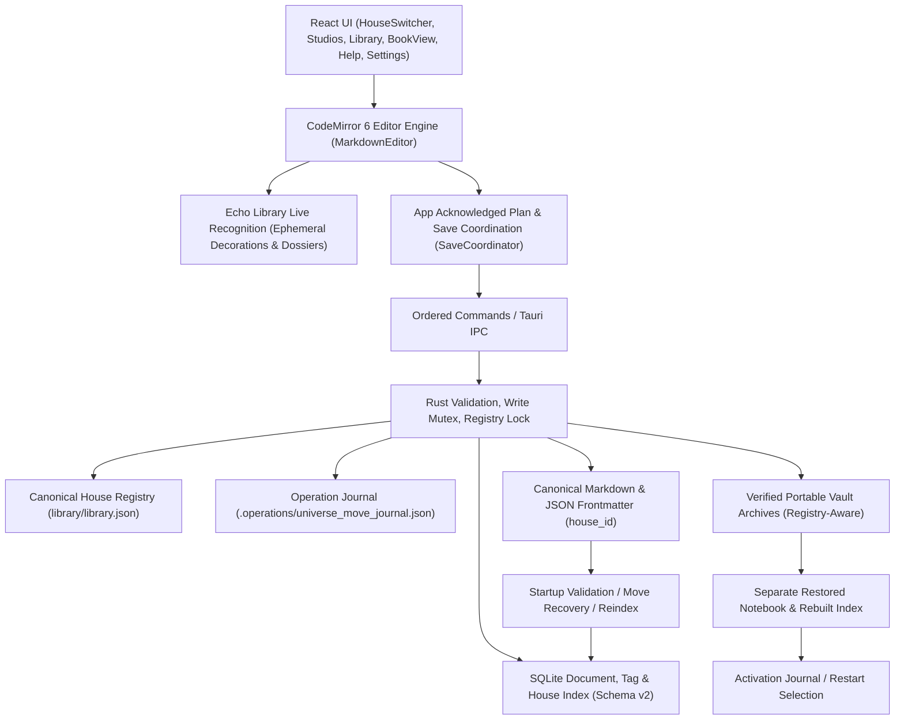
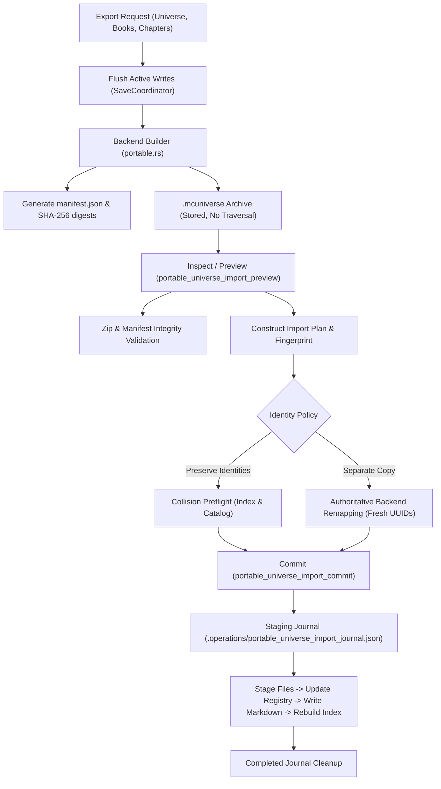

# MetaCognition Notebook — System Design

Authoritative architecture for **v0.8.0-beta.4 — The Living Continuity**, audited 2026-10-28. This describes implemented behavior, not an official final release or security certification. [README](README.md) introduces the product; [documentation index](docs/README.md) identifies historical evidence and pending acceptance.

## Architecture and boundaries

Tauri 2 hosts a React 18 / TypeScript / Vite frontend with a CodeMirror 6 writing engine and Rust 2021 backend. The frontend owns view state, CodeMirror editor state, and pending writing; the backend validates commands and owns filesystem and index access. Markdown with JSON frontmatter is canonical. SQLite is a derived metadata/tag/house index. Planning relationships and worldbuilding entities are stored canonically in Markdown and never sourced from an uncoupled SQLite graph.



The diagram shows control and data flow, not a distributed transaction. Filesystem writes and SQLite commits remain separate operations.

| Area | Source of truth / scope |
| --- | --- |
| Notebook | A selected canonical root and its corresponding index; not a Book |
| House | Canonical workspace and ownership boundary recorded in `library/library.json`; not a filesystem directory |
| Authoring Studio | Poetry, Philosophy, or Lorebook primary writing environment; enabled per House |
| Manuscript Tools | Optional House-level assembly workspace under House Tools; enabled per House via `manuscript_tools_enabled` |
| Universe | Stable planning ID/name, owned by at most one House; logical worldbuilding workspace |
| Lore entity | Ordinary Lorebook document plus registration using its document ID and Universe ID |
| Book | Stable planning ID, owning Universe, name/description and continuity |
| Chapter | Ordinary Lorebook prose document with chapter entry type and Universe/Book/order metadata |
| Story Node | Stable planning milestone with scope/order/state records; never Chapter prose |
| Universe timeline | Nodes scoped to Universe with no Book |
| Book timeline | Nodes scoped to one Universe and one Book |
| Relationship | Canonical planning definition referencing entity IDs, optional Book/context node |
| Echo Recognition | Ephemeral CodeMirror 6 visual marks and contextual dossiers derived from active Universe lore |

Universe and Book membership describes ownership within the planning model. A milestone's entity references, relationship endpoints, and shared-event links are references: they neither copy prose nor transfer document ownership.

### Source map and command boundaries

- [App.tsx](src/App.tsx): document lifecycle, acknowledged plan, queues, guarded navigation/exit and Vault coordination.
- [AppLayout.tsx](src/components/layout/AppLayout.tsx): library views, search/filter/sort and navigation.
- [HouseSwitcher.tsx](src/components/house/HouseSwitcher.tsx), [HouseManagementModal.tsx](src/components/house/HouseManagementModal.tsx), [MoveDocumentModal.tsx](src/components/house/MoveDocumentModal.tsx), [MoveUniverseModal.tsx](src/components/house/MoveUniverseModal.tsx), [house.ts](src/utils/house.ts): House of Thoughts navigation, workspace switcher, House management, move coordination, and scoped count calculations.
- [LorebookStudio.tsx](src/components/studios/LorebookStudio.tsx), [UniverseDashboard.tsx](src/components/studios/lorebook/UniverseDashboard.tsx), [BookView.tsx](src/components/studios/lorebook/BookView.tsx): Universe-first UI, in-situ chapter writing canvas, and separate prose/planning views.
- [MarkdownEditor.tsx](src/components/editor/MarkdownEditor.tsx): production CodeMirror 6 editor engine, live Echo Lore decorations, contextual dossiers, toolbar toggle controls, and keyboard shortcuts.
- [echoLore.ts](src/utils/echoLore.ts): conversion of Lorebook Markdown documents into Echo entities; unified attribute extraction supporting canonical `metadata.attributes: LorebookAttribute[]` and legacy `custom_fields`.
- [echoExtension.ts](src/components/echo/echoExtension.ts), [EchoDocumentationPopup.tsx](src/components/echo/EchoDocumentationPopup.tsx), [EchoClarificationModal.tsx](src/components/echo/EchoClarificationModal.tsx): CodeMirror 6 ViewPlugin, `RangeSet` visual decorations, floating contextual reference dossiers, and interactive ambiguity resolution.
- [CharacterProfileFields.tsx](src/components/studios/lorebook/CharacterProfileFields.tsx): Character encyclopedia profile fields, guided fields, and custom attributes.
- [FactionOrganizationEditor.tsx](src/components/studios/lorebook/FactionOrganizationEditor.tsx), [CharacterAffiliationSelector.tsx](src/components/studios/lorebook/CharacterAffiliationSelector.tsx), [universe.ts](src/utils/universe.ts): Faction organization hierarchy, branches, official positions, UUID-bound position holders, and reverse office lookups (`getCharacterHeldOffices`).
- [RelationshipGraph.tsx](src/components/studios/lorebook/RelationshipGraph.tsx), [relationshipGraph.ts](src/utils/relationshipGraph.ts): Web of Thought graph exploration, focused entity mode, direct-neighbor highlighting, and relationship table.
- [ManuscriptAssembler.tsx](src/components/manuscript/ManuscriptAssembler.tsx), [ManuscriptLibraryView.tsx](src/components/manuscript/ManuscriptLibraryView.tsx), [CreateManuscriptModal.tsx](src/components/manuscript/CreateManuscriptModal.tsx): optional House Tools assembly workspace, outline tree, reading preview, and PDF/MD compilation.
- [lib.rs](src-tauri/src/lib.rs): startup selection and registered IPC command inventory. [commands.ts](src/services/commands.ts) and [api.ts](src/services/api.ts): typed frontend calls and mock boundary.
- [commands.rs](src-tauri/src/commands.rs), [models.rs](src-tauri/src/models.rs), [storage.rs](src-tauri/src/storage.rs), [db.rs](src-tauri/src/db.rs): document validation, Markdown I/O, House registry management, move operations, and index.
- [thought.rs](src-tauri/src/thought.rs): planning schema/validation/revision writes; [thought.ts](src/utils/thought.ts), [universe.ts](src/utils/universe.ts): planning operations and compatibility.
- [portable.rs](src-tauri/src/portable.rs), [portable/validate.rs](src-tauri/src/portable/validate.rs), [portable/json.rs](src-tauri/src/portable/json.rs), [portable/import.rs](src-tauri/src/portable/import.rs), [portable/preview.rs](src-tauri/src/portable/preview.rs): Portable Universe package export, zip validation, read-only import planning, separate-copy identity remapping, staging journal, and roll-forward/rollback recovery.
- [publication/models.rs](src-tauri/src/publication/models.rs), [publication/generator.rs](src-tauri/src/publication/generator.rs), [publication/export.rs](src-tauri/src/publication/export.rs), [publication/pdf.rs](src-tauri/src/publication/pdf.rs): Reader-facing Lorebook publication engine, shared `PublicationDocument` privacy-filtered model, spoiler milestone filter, Markdown export, and print-ready PDF renderer.
- [PortableUniverseModal.tsx](src/components/studios/lorebook/PortableUniverseModal.tsx), [LorebookPublicationModal.tsx](src/components/studios/lorebook/LorebookPublicationModal.tsx), [portable.ts](src/services/portable.ts), [publication.ts](src/services/publication.ts): User-facing Universe export/import and Lorebook publication interfaces.
- [relationships.ts](src/utils/relationships.ts): semantic identity, perspective and queued attempts.
- [vault.rs](src-tauri/src/vault.rs), [notebook.rs](src-tauri/src/notebook.rs), [cipher.rs](src-tauri/src/cipher.rs): specialized native persistence.

Document commands include list/get/create/save/rename/delete/reindex/search, library information and organization/tag operations. Planning uses thought_get / thought_save. Portable Universe commands include portable_universe_export, portable_universe_inspect, portable_universe_import_preview, portable_universe_import_commit, portable_universe_recover_imports, and portable_universe_has_pending_journal. Lorebook publication uses publish_lorebook_markdown and publish_lorebook_pdf. Dialog helpers include pick_file_dialog and pick_save_dialog. Vault, activation and Cipher have distinct command groups. Backend mutation guards remain necessary even when the UI is disabled.

## Canonical storage and index

Startup resolves the OS Documents directory and app-local data directory. The default root is `Documents/MetaCognitionNotebook`; if Documents resolution fails, startup falls back to the current directory. Active recovery can select another managed root. Settings reports the actual canonical/index locations.

```text
<active root>/
  library.json   manifest and canonical House registry (house_registry)
  Poetry/        *.md
  Philosophy/    *.md
  Lorebooks/     *.md (including shared _web_of_thought catalog)
  Manuscripts/   *.md
  Backups/       archived document, corrupted registry, and recovery files
  Attachments/   initialized; no attachment editing UI
  Dictionaries/  JSON dictionaries and .mckey recovery keys
  Vocabulary/    imported text pools
  .operations/   operation journals (e.g. universe_move_journal.json)
```

Default SQLite is app-local `metadata.db` with foreign keys and WAL enabled. Recovered slots use their own `.vault-recovery/metadata.db`. App-local `Vault/`, `Notebooks/` and `NotebookActivations/` are separate from canonical studio directories.

### Frontmatter and document lifecycle

A canonical file begins with `---json`, a JSON object, and a closing `---` line, followed by the body:

```text
---json
{"id":"document-uuid","title":"Example","type":"lorebook","created_at":"2026-10-19T00:00:00Z","updated_at":"2026-10-19T00:00:00Z","tags":[],"parent_id":null,"metadata":{}}
---
Document body
```

`metadata_json` in IPC/SQLite is the serialized metadata object, not a second body. Poetry form/Cipher metadata, Philosophy composition/blocks/Argument Web, and Lorebook attributes/organization/ownership coexist with reserved namespaces. Unknown supported metadata/frontmatter fields are retained when rewriting; formatting of JSON may change.

Creation validates studio/title, allocates an identity/path and writes the canonical file before indexing. Reads support raw Markdown without frontmatter, using indexed identity where available; durable frontmatter is added on supported writes. Do not rename/copy raw imports casually during recovery because their identity may depend on the index/catalog.

Writing uses a temporary file beside the destination, file flush and rename. This narrows partial-file exposure, but does not guarantee durability under every Windows sharing, permission, device or power failure. File/index operations are not one atomic transaction. Error handling may attempt to restore original bytes; if recovery fails, retain files and follow the reported reindex/recovery instructions.

Startup validates/scans canonical files and reconstructs the document/tag index. `replace_index` is a SQLite transaction, retaining the previous index on insertion failure. Reindex cannot recover deleted prose, infer historical values or reconstruct every raw-import identity from an anonymous file alone.

### SQLite schema

[db.rs](src-tauri/src/db.rs) migrates to schema version **2** inside an explicit SQLite transaction, adding first-class House ownership attribution:

| Table | Stored fields / role |
| --- | --- |
| schema_version | version (migrated to 2) |
| documents | id, title, doc_type, unique relative_path, parent_id, metadata_json, created_at, updated_at, `house_id` (TEXT NOT NULL DEFAULT 'house-default') |
| tags | id, unique name |
| document_tags | document_id/tag_id composite key, cascading foreign keys |
| collections | id, name, doc_type, parent_id, created_at, updated_at; deferred generic structure |
| document_links | source_id/target_id composite key, description; deferred generic structure |

Indexes cover `idx_documents_doc_type`, `idx_documents_parent_id`, `idx_documents_house_id`, and composite tag joins. Schema migration 1 -> 2 checks `PRAGMA table_info(documents)` to guarantee idempotency and never deletes `metadata.db` on migration failure. If database migration fails, `lib.rs` activates `write_blocked` protection to safeguard user documents.

## House of Thoughts architecture

**House of Thoughts** is the organizational foundation introduced in v0.7.0. It provides logical workspace boundaries above individual Studios without restructuring the physical Markdown filesystem.

### House registry and identity

The canonical House registry resides in `library/library.json` under the `house_registry` key:

```json
{
  "name": "MetaCognition Notebook Library",
  "version": "1.0",
  "created_at": "2026-10-21T00:00:00Z",
  "description": "Canonical managed library for MetaCognition Notebook documents",
  "house_registry": {
    "schema_version": 1,
    "default_house_id": "house-default",
    "houses": [
      {
        "id": "house-default",
        "name": "Primary House",
        "description": "Default creative workspace containing all initial writings.",
        "color": "amber",
        "icon": "castle",
        "enabled_studios": ["poetry", "philosophy", "lorebook"],
        "manuscript_tools_enabled": true,
        "universe_ids": [],
        "created_at": "2026-10-21T00:00:00Z",
        "updated_at": "2026-10-21T00:00:00Z",
        "archived": false
      }
    ]
  }
}
```

- **Canonical Location & Versioning**: Stored inside `library/library.json`. The top-level `"version"` field remains `"1.0"` to preserve external script and Vault compatibility; the registry itself tracks its own `schema_version: 1`. All unrelated top-level keys are preserved via `serde_json::Map` read-modify-write.
- **Stable Identifiers**: The permanent Primary House uses stable ID `"house-default"`. Custom Houses receive slugged IDs with unique random suffixes (e.g. `"house-worldbuilding-a8f2"`).
- **Default House Compatibility**: Legacy documents lacking a `house_id` in frontmatter and unassigned Lorebook Universes automatically resolve to `"house-default"` in memory and SQLite without modifying disk files.
- **Protection of Default House**: `house-default` cannot be archived or deleted. Attempting to archive it is rejected with a validation error.
- **Concurrency & Lock Ordering**: Mutations to `library/library.json` are guarded by an in-process mutex (`StorageManager.registry_lock`). The strict backend lock order is `state.db` -> `state.storage.registry_lock` to prevent deadlocks with Vault backup capture and index writers. Writes use a temporary file beside the destination with `sync_all()` and atomic rename.
- **Registry Corruption Handling**: If `library/library.json` is malformed or invalid, the backend preserves the corrupted bytes to `library/Backups/library_corrupt_<timestamp>_<uuid>.json` and operates in-memory using a synthesized fallback registry derived from distinct frontmatter `house_id` values plus `"house-default"`. It never silently overwrites canonical files.
- **Archiving & Active Fallback**: Archiving a House sets `archived: true` and releases its active name for reuse while keeping all its documents, universes, and relationships intact. If the active House is archived, active resolution falls back to `house-default`.

### Document ownership contract

- **Frontmatter Authority**: Ownership is defined by a top-level `house_id` field in the canonical Markdown `---json` frontmatter block (e.g. `"house_id": "house-default"`).
- **Disk Write Policy**: To protect byte-preservation on legacy files, saving an existing legacy document that lacks a `house_id` on disk and belongs to `"house-default"` does NOT inject `house_id` into frontmatter. Explicit non-default House assignments, or documents that already possess a `house_id` key, are persisted explicitly.
- **Normalization**: Absent `house_id` normalizes to `"house-default"`. Explicit empty strings, whitespace, control characters, or path separators are rejected during creation and logged as validation errors during reindexing.
- **Physical Paths Unchanged**: Canonical files remain in top-level studio directories (`Poetry/`, `Philosophy/`, `Lorebooks/`, `Manuscripts/`). Documents are never physically moved into per-House folders, ensuring Vault path allowlists and relative reference integrity remain stable.

### Lorebook Universe ownership invariants

Scoping in Lorebook operates at the **Universe** boundary via `universe_ids: Vec<String>` in each `HouseRecord`:
1. **Invariant L1 (Single Owning House)**: Every `Universe.id` belongs to at most one House in `house_registry`.
2. **Invariant L2 (Disjoint Assignments)**: The sets of `universe_ids` across all Houses are strictly pairwise disjoint.
3. **Invariant L3 (Default Fallback)**: Any Universe in Web of Thought not listed in any House resolves deterministically to `"house-default"`.
4. **Invariant L4 (Entity Ownership Agreement)**: Every Lorebook entity document's `house_id` must agree with its owning Universe's House. Cross-House entity linking is rejected.
5. **Invariant L5 (Coordinated Move Integrity)**: Moving a Universe moves all its owned entity documents, Books, and Story Nodes, and preserves internal relationships.
6. **Invariant L6 (Archived House Retention)**: Archiving a House retains its `universe_ids` and entity documents without dropping or reassigning them.
7. **Invariant L7 (No Silent Reassignment)**: Consistency mismatches are reported by `inspect_house_integrity`, never silently reassigned.
8. **Global Catalog Invariant**: The Web of Thought planning catalog (`Lorebooks/_web_of_thought.md`) is a global system document owned by `"house-default"` and is never duplicated or assigned to custom Houses.

### Safe mutation operations

#### Single-document House moves
`move_document_to_house(doc_id, target_house_id)`:
- Validates that the target House exists and is not archived.
- Validates that the document's studio type is enabled in the target House (or manuscript tools enabled for manuscripts).
- Rejects moving the shared Web of Thought catalog (`_web_of_thought`).
- Rejects moving Universe-bound Lorebook entities individually (they must move with their Universe; standalone Lorebooks move freely).
- Rewrites the canonical Markdown frontmatter first (`update_document_house_id`), preserving exact body, formatting, and unknown frontmatter fields.
- Updates the derived SQLite index second.
- Operation is idempotent: moving to the current House succeeds as a no-op.
- `coordinateDocumentMove` in `src/services/autosave.ts` flushes in-flight/pending saves first, serializes through `CommandQueue`, and updates frontend document state.

#### Coordinated Lorebook Universe moves
`move_universe_to_house(universe_id, target_house_id)`:
- Coordinated multi-document move governed by a durable journal at `library/.operations/universe_move_journal.json`.
- **Journal Stages**: `Prepared` -> `RegistryUpdated` -> `FilesWritten` -> `IndexUpdated` -> `Completed` (journal unlinked upon completion).
- **Deterministic Roll-Forward Recovery**: `StorageManager::recover_universe_move` inspects the journal on startup and library reindex, automatically resuming and completing remaining stages across crashes or power loss.
- **Pre-Write Rollback**: If validation fails before disk writes begin, in-memory registry updates are safely reverted (`revert_universe_in_registry_unlocked`) and the journal is cleaned up.
- **Re-Entrant Locking**: Employs unlocked registry helpers to perform atomic updates while holding `registry_lock` without deadlocks.
- **Save Coordination**: `coordinateUniverseMove` flushes active editor saves and drains pending autosaves through `MutationQueue`.

#### Read-only integrity diagnostics
`inspect_house_integrity` scans the library and compares canonical Markdown files against the SQLite derived index and House registry:
- Detects orphaned documents with unknown `house_id` attributions.
- Detects mismatches between disk frontmatter and derived SQLite index.
- Detects incomplete/interrupted Universe moves via `has_pending_universe_move_journal()`.
- Surfaces findings non-destructively in the House Management modal without mutating files.

### Vault backup and recovery integration

- **Registry Protection**: `library/library.json` is included in Vault archives. On backup creation, the registry lock is acquired under the database lock (`db` -> `registry_lock`) to prevent capturing partial states.
- **Backup Barrier During Moves**: `create_backup_locked` checks `has_pending_universe_move_journal()` and rejects backup capture if an interrupted Universe move is in progress, preventing inconsistent backup archives.
- **Restoration Validation**: `vault::inspect` parses and validates the `house_registry` schema in `library.json` before restore. Missing registries in legacy archives synthesize `"house-default"`.
- **Separate-Folder Recovery**: Reconstructs the full multi-house SQLite index with `house_id` values populated from restored frontmatter.

### Frontend House-first UX architecture

- **House Switcher (Region A)**: Primary workspace selector situated above authoring studios. Displays active House name, custom icon, and color theme.
- **Save & Switch Barrier**: `handleSwitchHouse` executes a mandatory `flushSave` barrier, flushes pending mutation queues, and waits for `CommandQueue` to become idle. If an active save fails, the switch is blocked and the user is alerted. Active document is unmounted if it does not belong to the target House.
- **Active House Persistence**: Persisted in `localStorage` key `mc_active_house_id`. Falls back safely to `"house-default"` if unassigned or archived.
- **Studio Enablement**: Authoring Studios (Poetry, Philosophy, Lorebook) are conditionally rendered according to `isStudioEnabled(activeHouse, studio)`. Empty state quick-create cards also respect studio enablement.
- **House Tools (Manuscript Tools)**: Manuscript Tools is presented in a dedicated **House Tools** subsection below authoring studios, styled with an `optional` badge and rendered only when `isManuscriptEnabled(activeHouse)` is true.
- **House Library Scoping**: `houseDocuments` strictly contains documents where `(doc.house_id || 'house-default') === activeHouse.id`. The internal Web of Thought catalog is filtered out via `isCatalogDoc`.
- **House-Scoped Badge Counts**: Studio badge counts in Region A use `computeStudioCounts(documents)`, strictly tallying active House documents. A House with 0 Philosophy documents strictly displays `0`.
- **Cross-House Document Selection**: If a document from another House is selected (e.g. from global search), `performSelectDocument` reconciles `activeHouseId` to match the opened document, keeping sidebar counts and library in sync.

## Lorebook Architecture & Worldbuilding

Lorebook Studio manages fictional Universes, practical character encyclopedias, faction organizational structures, relationships, Books, and Chapters.

### Character profile architecture (Phase C1)

[CharacterProfileFields.tsx](src/components/studios/lorebook/CharacterProfileFields.tsx) and [types/index.ts](src/types/index.ts) define practical encyclopedia profiles for Character entities:
- **Guided Fields**:
  - `role`: Writer-defined character role or archetype (e.g. "Commander of the Vanguard", "Court Herbalist").
  - `primary_faction_id`: Optional UUID linking the character to their primary faction entity.
  - `aliases`: Array of alternate names, titles, or pseudonyms (e.g. `["The Silver Hawk", "Lady Kat"]`).
- **Custom Attributes (`LorebookAttribute[]`)**:
  - Stored canonically in `metadata.attributes: LorebookAttribute[]` where each entry is `{ id: string, key: string, value: string }`.
  - Allows authors to define arbitrary fictional parameters (e.g. *Magic Affinity*, *Birthplace*, *Weapon of Choice*) without rigid RPG templates.
  - **Schema Compatibility**: To preserve legacy and prototype entities, `convertDocumentToEchoEntity` in [echoLore.ts](src/utils/echoLore.ts) checks `metadata.attributes` first, and merges any legacy key-value pairs from `metadata.custom_fields` without migrating or rewriting files.
- **Markdown Narrative**: The freeform Markdown body remains the primary narrative canvas for character biographies and background lore.

### Faction organizations & official positions (Phase C2)

[FactionOrganizationEditor.tsx](src/components/studios/lorebook/FactionOrganizationEditor.tsx) and [universe.ts](src/utils/universe.ts) introduce an optional organizational hierarchy for Faction and Nation entities:
- **Data Model (`metadata.faction_fields`)**:
  - `branches`: List of organizational sub-units (`FactionBranch`), each having `{ id, name, description?, parent_branch_id? }`.
  - `positions`: List of official positions (`FactionPosition`), each having `{ id, title, rank?, branch_id?, holder_ids?, description? }`.
  - `holder_ids`: Array of Character entity document UUIDs assigned to this position.
- **Reverse Lookup (`getCharacterHeldOffices`)**:
  - [universe.ts](src/utils/universe.ts) computes all official positions held by a given character across all factions in the Universe.
  - Enables character profile views and Echo dossiers to display institutional roles (e.g. "Holds office: Captain of the Royal Guard in The Crown Alliance") without duplicating data in character documents.
- **Decoupled Architecture**: Defining an organization is entirely optional. Factions without organizations remain simple lore entities.

### Relationship consistency & Web of Thought cohesion (Phase C3)

[relationships.ts](src/utils/relationships.ts) guarantees consistency between guided entity fields and canonical Web of Thought relationships:
- **Single Canonical Store**: All relationships reside in `plan.relationships` in `Lorebooks/_web_of_thought.md`.
- **Bi-Directional Synchronization**: Selecting an affiliation in [CharacterAffiliationSelector.tsx](src/components/studios/lorebook/CharacterAffiliationSelector.tsx) updates or creates the canonical `plan.relationships` record (`Member of` / `Affiliated with`).
- **Reciprocal Projection**: Reciprocal perspectives are derived dynamically (e.g. Character "Member of" Faction produces Faction "Members" view).
- **Duplicate Prevention**: Normalized endpoint IDs, kind, and context prevent contradictory duplicate entries.

## Web of Thought & Graph Readability (Phase C4)

[RelationshipGraph.tsx](src/components/studios/lorebook/RelationshipGraph.tsx) and [relationshipGraph.ts](src/utils/relationshipGraph.ts) provide an interactive visualization of worldbuilding connections:
- **Exploration Modes**:
  - **Focused Entity Mode**: Renders the selected focal entity and its depth-1 direct neighbors, filtering out background clutter.
  - **Full Universe Mode**: Surveys all active entities and relationships across the fictional Universe.
- **Visual Styling by Category**: Distinct colors, SVG geometric shapes (ellipses, hexagons, diamonds, rectangles), and iconography for Characters, Factions, Locations, Artifacts, Events, and Rules.
- **Connection Table**: Tabular view accompanying the visual graph, allowing sortable and searchable inspection of relationships.
- **Read-Only Faction Hierarchy View**: Collapsible tree rendering faction branches and position holders.
- **Current Limits**: Graph rendering employs deterministic 120-pass force placement and 80-pass rectangular separation with a 240-edge rendering cap. In dense entity clusters, crossing lines and label collisions may still occur.


## Web of Thought — Universe State Explorer & Alternate Continuities (Phases W1–W4)

Web of Thought is a universe-wide state and continuity tracking system centered on historical milestone snapshots and explicit alternate branches:

### Architecture & Components
- **[UniverseDashboard.tsx](src/components/studios/lorebook/UniverseDashboard.tsx)**:
  - Top-level destination `activeTab: 'web_of_thought'`.
  - Subviews: **Universe States** (`wotView: 'states'`, default) and **Connections** (`wotView: 'connections'`, relationship graph).
  - Backward compatibility: legacy `'relationships'` tab alias seamlessly resolves to Web of Thought with `wotView: 'connections'`.
  - Overview tab quick stat card routes directly to Web of Thought.
  - Consolidated navigation: Standalone "Web of Thought" button in the Lorebook document editor header was removed; navigation is centralized in the Universe Dashboard and deep links from Book View and Echo Library dossiers.
- **[UniverseStateExplorer.tsx](src/components/studios/lorebook/UniverseStateExplorer.tsx)**:
  - Continuity Selector: Switch smoothly between Canonical History and author-created Alternate Branches; toggle archived branches visibility.
  - Branching Actions: "Branch from Current Milestone" creates an explicit `Branch` save point; rename and archive branch controls.
  - Milestone Navigation: Previous/Next controls, chronological dropdown scoped to active continuity, era/date indicator, and "+ Add Milestone" workflow.
  - Universe State Matrix: Tabular inspection of all active Universe entities, showing category, entity title, current state value, property key, and state provenance badge (identifying source milestone and source continuity name).
  - Filters & Search: Filter by category (Characters, Factions, Locations, Artifacts, Events, etc.), origin, changed-here, and search query.
  - State Assignment Modal: Category status presets (`Alive`/`Deceased`, `Active`/`Fallen`, `Operational`/`Destroyed`), custom status support, explicit `Unknown` and `Not Yet Introduced` options, author notes, and "Revert to Predecessor" action.
  - "What Changed?" Diff Mode: Comparative inspection highlighting newly assigned, modified, or inherited states relative to the immediate predecessor milestone.
  - "Compare Timelines" Diff Mode: Arbitrary cross-milestone and cross-continuity diff engine with difference classification (`value_change`, `provenance_only`, `unassigned_to_state`, `state_to_unassigned`, `none`).
  - Empty states: Helpful onboarding prompts and CTAs; "Create First Historical Event" initiates the creation of the initial milestone with an inline dialog.
- **[stateEngine.ts](src/utils/stateEngine.ts)**:
  - Pure, deterministic milestone state resolution engine with predecessor inheritance, branch hierarchy traversal, and ancestry validation.
  - Functions: `resolveUniverseStateAtMilestone()`, `validateMilestoneAncestry()`, `getMilestonePredecessors()`, `assignMilestoneState()`, `clearMilestoneState()`, `compareMilestoneStates()`.
  - State Provenance: `explicit` (assigned at milestone), `inherited` (carried forward from earlier milestone or parent branch), `unknown` (explicitly marked unknown), `unassigned` (no state recorded), and `not_yet_introduced` (milestone precedes introduction). Tracks `sourceBranchId` and `sourceContinuityName`.
  - Non-destructive persistence: State changes are saved as canonical `Change` records on `StoryNode.changes` on the shared Plan. Canonical Lorebook Markdown entity documents and manuscript prose are never modified.
  - Canonical Document Auto-Registration & Scope Isolation: When assigning a state to an entity in `assignMilestoneState()`, if the entity is not yet registered in `plan.entities`, the engine verifies against the active document list (`docs`) that the document exists, belongs to the active Universe (`metadata.universe_id === plan.universe_id`), and belongs to the active House (`house_id === activeHouseId`). If valid, it auto-registers `{ id: doc.id, name: doc.title, universe_id: plan.universe_id, category: doc.metadata.category || 'other' }` into `plan.entities`. This prevents "Entity not found in planning desk" errors without generating duplicate IDs or mutating document frontmatter.
- **[thought.rs](src-tauri/src/thought.rs) & [thought.ts](src/utils/thought.ts)**:
  - Backward-compatible `Branch` model: stable UUID, `universe_id`, `name`, `description`, `divergence_node_id`, `parent_continuity_id`, `archived`, `created_at`, `updated_at`.
  - `StoryNode.branch_id` and `Book.branch_id` optional fields.
  - Full Rust backend validation of branches: divergence node existence, universe matching, cycle-free parent continuity chain, and node branch ownership.
  - Backend Entity Ownership & House Validation: `save_impl` validates that every entity in `plan.entities` has matching `entity.universe_id == plan.universe_id`. For every entity existing in SQLite `metadata.db`, it queries the indexed `universe_id` and `house_id`, verifying they strictly match the Universe and its owning House in `house_registry`. Cross-House entity references are rejected at the persistence boundary.

## Echo Library — Live Lore Recognition Engine (Phase E0–E2.5)

Echo Library is a contextual writing companion integrated directly into the CodeMirror 6 chapter-writing environment.

### Core architectural principles

1. **Contextual Writing Assistant, Not an Automatic Prose Editor**: Echo never rewrites, modifies, or injects text into manuscript documents without explicit author action.
2. **Strictly Non-Destructive**: All recognition highlights are ephemeral visual marks rendered via CodeMirror 6 decorations. They do not alter document history, undo/redo buffers, or physical Markdown files.
3. **Strict Universe Scoping**: Entity recognition is scoped exclusively to the active chapter's owning Universe, preventing lore contamination across different fictional worlds.

### CodeMirror 6 writing foundation

Chapter writing in both [BookView.tsx](src/components/studios/lorebook/BookView.tsx) and [LorebookStudio.tsx](src/components/studios/LorebookStudio.tsx) is powered by [MarkdownEditor.tsx](src/components/editor/MarkdownEditor.tsx), built on CodeMirror 6:
- **Extensions**: Markdown syntax parsing, bracket matching, history (`undo`/`redo`), keymaps, and custom Echo recognition plugins.
- **Telemetry**: Real-time word count and character count metrics displayed in the writing canvas header.
- **Save Coordination**: Integrates with `SaveCoordinator` with a 1200ms debounce, manual `Ctrl+S` immediate flush, and visual save status telemetry (`Saved`, `Saving...`, `Unsaved changes`, `Error`).
- **Intentional Empty Saves**: Verified safe distinction between intentional empty body saves (`""`) and accidental missing arguments.

### Live entity & alias recognition engine

[echoExtension.ts](src/components/echo/echoExtension.ts) and [echoLore.ts](src/utils/echoLore.ts) implement live mention detection:
- **Entity Indexing**: `convertDocumentToEchoEntity` compiles active Lorebook documents into `EchoEntity` descriptors:
  - Canonical entity title.
  - Category (character, faction, location, etc.).
  - Aliases array from frontmatter.
  - Summary / short description.
  - Custom attributes (`metadata.attributes` and `metadata.custom_fields`).
  - Derived faction positions held.
- **Mention Scanner**:
  - Scans editor text using boundary-aware, case-insensitive regular expressions with longest-match precedence.
  - Matches canonical names and all registered aliases.
- **CodeMirror 6 ViewPlugin & RangeSet**:
  - Recognized spans are converted into `Decoration.mark` ranges within a CodeMirror `RangeSet`.
  - Decorations render subtle styling (`border-bottom: 2px dotted` in gold/amber tone) indicating an interactive lore mention.

### Contextual dossiers & ambiguity resolution

- **Contextual Dossier Popover ([EchoDocumentationPopup.tsx](src/components/echo/EchoDocumentationPopup.tsx))**:
  - Hovering or activating a recognized mark surfaces a floating dossier card.
  - Displays: Entity Name, Category Badge, Aliases, Narrative Role / Summary, Official Faction Positions, and Custom Attributes (e.g. *Weapon of Choice*).

### Echo Library Historical State Awareness & Chapter Context (Phase W4)

- **Chapter Historical Context Binding**:
  - Chapters optionally store `milestone_id?: string | null` in `LorebookMetadata`.
  - Persisted non-destructively through standard `save_document` with `{ isMetadataOnly: true }`. Manuscript prose is preserved byte-for-byte.
  - Compatible milestones selector in [BookView.tsx](src/components/studios/lorebook/BookView.tsx) filters milestones according to the book's continuity (`canonical`, `alternate`, `standalone`).
- **Cached State Resolution Engine**:
  - `resolveEntityHistoricalEchoState()` and `getCachedResolvedUniverseState()` memoize resolved state maps keyed by `${universeId}:${milestoneId}:${plan.revision}:${propertyKey}`.
  - O(1) resolution upon dossier open; zero overhead per keystroke in the CodeMirror editor.
- **Historical Dossier Section ([EchoDocumentationPopup.tsx](src/components/echo/EchoDocumentationPopup.tsx))**:
  - Displays Continuity name, Milestone title and era, resolved state badge (Alive, Deceased, Contested, Ruined, etc.), and provenance (Explicit, Inherited with source milestone link, Explicit Unknown, Unassigned, Not Yet Introduced).
  - Displays author change notes recorded at the milestone.
  - Direct action: "Inspect in Web of Thought" switches view seamlessly to the Universe State Explorer with pre-selected continuity, milestone, and entity query.
- **Graceful Fallbacks & House/Universe Isolation**:
  - Chapters without milestone context, or with missing/archived milestones, fall back cleanly to baseline Lorebook profiles without crashing or fabricating states.
  - Entities and milestones from other Houses or Universes are strictly blocked from chapter context and Echo recognition.
- **Ambiguity Resolution ([EchoClarificationModal.tsx](src/components/echo/EchoClarificationModal.tsx))**:
  - When two or more entities in the active Universe share the same name or alias, Echo detects the collision and displays an interactive disambiguation popover.
  - Authors can inspect the dossiers of each candidate entity without leaving their writing flow.

### Usability controls & accessibility

- **Toolbar Recognition Toggle**:
  - An `Echo On / Off` button in the editor toolbar allows writers to silence recognition decorations whenever they desire completely distraction-free writing.
  - The toggle state is persisted in `localStorage` under key `mc_echo_recognition_active`.
- **Keyboard Shortcut (`Alt+E` / `Mod-Shift-E`)**:
  - Pressing `Alt+E` inspects the text under the current editor cursor. If the cursor is within a recognized entity mention, the dossier opens immediately.
- **Focus Preservation**:
  - Dismissing a dossier (via `Escape` or the close button) immediately calls `editorView.focus()`, returning cursor focus to the prose editor so writing can resume without mouse interaction.

### House & Universe scope resolution

In [LorebookStudio.tsx](src/components/studios/LorebookStudio.tsx) and [BookView.tsx](src/components/studios/lorebook/BookView.tsx), Universe context resolution prioritizes the chapter's own bound universe:
```typescript
const chapterUniverseId = resolveEntityUniverse(activeDocument).universeId 
  || parseLoreMetadata(activeDocument).universe_id 
  || activeUniverseId;
```
This guarantees that even if a writer was previously browsing Universe B, opening a Chapter belonging to Universe A indexes only Universe A's lore entities.

### Fundamental distinction: Ephemeral recognition vs. Persistent references

To prevent architectural ambiguity, MetaCognition Notebook maintains a strict conceptual boundary:

| Capability | Current State | Architecture |
| :--- | :--- | :--- |
| **1. Ephemeral Live Recognition** | **Implemented in v0.8.0-beta.1 / v0.8.0-beta.3 / v0.8.0-beta.4 (E2/E2.5)** | Text matching in CodeMirror 6 on the client. Ephemeral visual decorations. Completely non-destructive to prose. No changes to Markdown files. |
| **2. Persistent Explicit References** | **Planned for Future Milestone E3 (NOT implemented)** | Explicit user-bound entity references saved in Markdown frontmatter or structured reference spans. Survives entity renames and provides explicit manuscript back-references. Requires dedicated design review prior to implementation. |

**Milestone E3 is NOT currently implemented in the codebase.**

## Writing Atmosphere — Local Ambient Audio Player (M1)

Writing Atmosphere is a local-first audio player built into the application shell ([WritingAtmospherePlayer.tsx](src/components/atmosphere/WritingAtmospherePlayer.tsx)), designed for distraction-free background listening during creative writing sessions.

### Architectural Invariants & Safety
1. **Completely Local & Offline**: Audio playback reads exclusively from the user's application-managed local `Music/` folder (`local_data_dir().join("Music")`). Zero network calls, zero external telemetry, and zero cloud streaming.
2. **Strict Path-Traversal Prevention**: The Rust backend ([music.rs](src-tauri/src/music.rs)) strictly canonicalizes paths and validates that all requested tracks reside within the canonical `Music/` root directory. Paths containing `..`, absolute drive letters, or symbolic escapes are rejected immediately.
3. **Supported Formats**: Reads `.mp3`, `.wav`, `.ogg`, `.flac`, `.m4a`, and `.aac` via native HTML5 `<audio>` blobs constructed in-memory from bytes returned by `music_get_track_bytes`.
4. **Category Subfolders & Normalization**: Automatically scans the root `Music/` directory and category subfolders (`lofi/`, `medieval/`, `scifi/`, or user-defined folders). Folder names are normalized to human-readable category labels (e.g., `lofi` / `lo-fi` -> `"Lo-Fi"`).
5. **Title Sanitization**: Leading track numbering (e.g. `01 - `, `02. `, `1_`) and underscores are stripped in Rust for clean presentation while preserving Unicode and case.
6. **No Autoplay on Startup**: Playback is never initiated automatically upon application launch. Volume, category selection, and repeat modes (`all`, `one`, `off`) persist safely in `localStorage` under key `mc_atmosphere_preferences`.
7. **Persistent Global Audio**: The player is mounted at the root application shell ([App.tsx](src/App.tsx)), persisting uninterrupted across House, Studio, document, and chapter transitions.

## In-App Help & Guide Architecture

The in-app manual ([manual.ts](src/help/manual.ts), [content.ts](src/help/content.ts), [HelpCenter.tsx](src/components/common/HelpCenter.tsx)) provides fully offline, accessible documentation organized into 11 numbered chapters:
1. `getting-started`: Overview, document creation permitted by active House, saving in CodeMirror 6, interface layout.
2. `poetry-studio`: Stanza composition, poetic forms, and Emotional Cipher.
3. `philosophy-studio`: Freeform reflection, structured reasoning blocks, and Argument Web.
4. `lorebook-studio`: Universes, Books, Chapters, Character profiles, Faction official positions and branches, Web of Thought visual relationship exploration (240-edge graph limits).
5. `manuscript-tools`: Multi-studio document assembly, outlining, and PDF/Markdown export.
6. `the-vault`: Verified local backups, separate-folder inspection, and active notebook recovery.
7. `document-management`: Tags, Favorites, Recent opened history, and archiving.
8. `shortcuts-troubleshooting`: Keyboard shortcuts (`Ctrl+E` / `Mod-e` for Echo Library), common problems, and file locations.
9. `houses-of-thoughts`: Managing Houses, creative domains, studio enablement, and universe isolation.
10. `echo-library`: Live entity and alias recognition in CodeMirror 6, contextual reference dossiers, and disambiguation.
11. `writing-atmosphere`: Managing local audio files in `Music/`, supported formats, player controls, and offline operation.

## Organization and search

No schema migration is required. Tags continue using the existing frontmatter `tags` array and SQLite `tags` / `document_tags` tables. Favorites and recency use the existing indexed `metadata_json` object and canonical JSON frontmatter:

```json
{
  "chapter": "II",
  "_workshop": {
    "favorite": true,
    "last_opened_at": "2026-10-18T08:00:00+00:00"
  }
}
```

Missing fields mean unstarred and never recorded as opened. `_workshop` is reserved for application organization; existing unknown properties within it are retained. A non-object namespace fails safely. Existing studio metadata, including Philosophy composition/boundary information and Lorebook attributes, is preserved by organization commands.

`organization.rs` provides two additional Tauri commands:

| Command | Frontend arguments | Result |
| --- | --- | --- |
| `update_organization` | `{ id, patch: { tags?, favorite?, opened? } }` | Updated `DocumentMetadata` |
| `manage_tag` | `{ oldName, newName? }` | `{ updated: DocumentMetadata[], errors: string[] }` |

Neither command accepts a document body. The backend holds the existing database mutex, reads the current canonical file, applies only the requested organization fields, writes the same body through the temporary-file writer, then updates the index. It leaves logical `updated_at`, `created_at`, identity and paths unchanged. A failed index transaction triggers an attempt to restore the original file bytes. If restoration itself fails, the returned error explicitly directs reindex recovery. A process crash between file and index writes remains a cross-resource limitation; startup reindex rebuilds the index from canonical files.

Library-wide tag operations use per-document commits, not a global filesystem transaction. Each successful document is included in `updated`, and failed documents are identified in `errors`. Retrying the same rename/remove is idempotent and finishes remaining matches. Renaming to an existing tag merges exact, trimmed names without duplicates. Case is preserved and comparisons are case-sensitive. Only the selected old tag name is removed from the registry once it has no assignments; unrelated unused names are preserved. The UI includes the existing tag catalog as well as assigned tags, so unused names can also be renamed or removed. New tags are created naturally by assignment rather than through a standalone creation form.

The storage writer preserves unknown top-level frontmatter fields. Frontmatter formatting can change when it is rewritten, while the body remains exact. Raw Markdown imports retain their indexed identity on reads and receive durable frontmatter when their first organization update is saved. Merely reading, searching, or listing documents never records history or rewrites a file.

The App explicitly queues an `opened: true` patch after an editor is displayed through selection, startup auto-opening, or creation. The backend records current UTC time when that patch is persisted. Only the latest timestamp per document is stored; this is not a full event log. Recent is ordered by that value, never by `updated_at`. Filesystem mtime can change when frontmatter is written, but logical last-modified sorting remains about writing/title changes.

`src/utils/organization.ts` supplies shared metadata handling, normalization, and library selection. Sorting/filtering runs over library metadata in React. All and Favorites support modified-descending, created-descending, locale-aware title ascending/descending with stable ID tie-breaking. Recent always uses last-opened descending. Studio, tag intersection (AND), view and search-result IDs compose. The library search uses the existing full-body/title search API with a 150ms debounce and ignores obsolete responses. The independent global search modal keeps its own studio filter and also rejects obsolete responses. Native snippet boundaries are UTF-8-safe.

Shared `DocumentOrganization` controls sit above all three studios. `AppLayout` adds compact library views, an optional Sort & filter section, clear-filter feedback and empty states. `TagManager` provides global rename/merge/remove with inline removal confirmation. The existing Gilded Identity tokens, studio canvases and canonical path scheme are retained. Filter/view/sort selections are session state; durable organization lives in Markdown.

Search first obtains applicable document metadata from SQLite, then StorageManager::search performs case-insensitive substring checks over titles and canonical bodies. Title matches precede body checks for that document; body read failures are skipped. It is neither SQLite FTS nor semantic search, and large-library performance is not established. A recent timestamp is not revision history.

## Studios and portable poem files

Poetry stores stanza text, form and supported metadata. Its UI provides form/font/counts and stanza operations, not automated meter/rhyme analysis. Imports of .txt/.md/.mcpoem create new documents with duplicate-title resolution and a 5 MB limit. Exports support text, Markdown frontmatter and poem packages.

Philosophy new documents default to freeform. Optional structured blocks have reasoning roles and stable boundaries; legacy documents without composition mode retain structured interpretation. Switching presentation preserves text rather than generating an argument or joining existing blocks destructively.

### Philosophy Studio & Argument Web

The **Argument Web** is a document-local visual thinking and structural inspection graph tool. It is strictly non-judgmental: it never assesses logical validity, truth, persuasiveness, or soundness.

#### Data Model & Persistence
Stored entirely within the document frontmatter JSON (`metadata.argument_web`), requiring zero database schema changes and retaining full compatibility with the Vault backup system:
- `main_thesis`: optional single overarching thesis object with `id`, `title`, `content`, optional `passage_source`, and optional canvas `position`.
- `nodes`: list of passage-based argument nodes with `id`, `title`, `snapshot` (verbatim excerpt), `source` (`start_offset`, `end_offset`, optional `block_index`, `block_id`), optional canvas `position`, `created_at`, `updated_at`.
- `relationships`: list of manual links with `id`, `source_id`, `target_id`, `relation_type` (`supports`, `challenges`, `expands`, `related`), and optional `explanation`.
- `dismissed_insights`: list of dismissed structural observation IDs.

#### Relationship Invariants
- Self-loops are strictly prohibited (`source_id !== target_id`).
- Both endpoints must exist in the document web.
- Exact duplicate connections (same endpoints and relation type) are prohibited.
- For non-directional `related` relationships, symmetry is enforced: connecting `B` to `A` when `A -> B` exists is rejected as a duplicate.
- Distinct relation types between the same nodes (e.g. `expands` and `supports`) are permitted.

#### Source Location Verification
- **Verified**: passage snapshot matches the exact recorded start/end offsets.
- **Moved**: passage has moved within the document (e.g. due to edits elsewhere). Candidate occurrences are provided with snippet previews. The system **never silently relinks**; the writer must choose "Relink Here" deliberately.
- **Unlocated**: passage can no longer be found anywhere in document text. The writer can relink to newly highlighted text or delete the node.

#### Structural Insights & Layout
- Structural insights engine identifies:
  - Disconnected arguments (no edges).
  - Arguments with no incoming support.
  - Separate clusters / subgraphs.
  - Arguments requiring source review.
- Insights can be dismissed and restored.
- Deterministic layout positions the Main Thesis centrally and arranges argument tiers without arbitrary node count caps (accommodating 20–50+ nodes).

### Emotional Cipher

[emotionalCipher.ts](src/utils/emotionalCipher.ts) applies non-recursive substitutions with longest-phrase precedence and layout/casing handling. Quick swaps eligible words; Random draws from offline vocabulary pools; Manual uses rules/reusable dictionaries. Collision warnings and verified poem-specific records distinguish exact recovery from best-effort reversal.

Temporary previews become persisted keys through save/export operations. .mckey stores the exact key; .mccipher bundles encoded text and key. Import & Decode verifies and creates a recovered original, while Import Cipher Package retains encoded text/key. Saving a ciphered poem and key is sequential, not transactional. Partial failures must be inspected; a similar dictionary name or reroll is not a replacement for the original key.

Dictionaries use versioned JSON, imported vocabulary uses text files, and poem-specific keys are retained in Dictionaries. Key deletion checks poem references. These files participate in Vault, but Cipher is not encryption or an independent security boundary.

## Web of Thought and continuity

One ordinary Lorebook Markdown document, `Lorebooks/Web_of_Thought_<id>.md`, stores the shared `_web_of_thought` namespace. Format 1 includes revision, Universes, Books, entities, nodes and `plan.relationships`. Discovery rejects duplicate/malformed/future catalogs. Opening an empty desk alone creates no catalog; explicit creation does. The catalog has an 8 MiB / 30,000-ID validation bound, not a measured performance guarantee.

Universe and Book names can change without changing IDs. New Universe-first entities/Chapters use explicit ownership IDs; legacy string labels resolve by a unique case-insensitive name where possible. Unassigned/ambiguous entries remain accessible without silent reassignment. Planning renames do not rewrite legacy labels. The optional Universe archived flag defaults false and retains format 1; older strict readers may reject records where it is true.

Story Nodes retain IDs when reordered. Each has a Universe, optional Book, position, summary/perspective, optional date/status, questions, entity references, sparse property/relationship observations, history links and archive state. Order is normalized within its scope. Node archival preserves records and excludes them from active evaluation.

A property observation records entity/property, nullable new value, optional previous-value expectation and explanation. A value is direct at its node, earlier/uncertain evidence later, or unknown. Expected previous values do not backfill earlier nodes. Reordering recomputes conflicts; it does not rewrite observations or infer elapsed time, causes or unrecorded events. Comparisons use one timeline scope, with no automatic cross-Book state overlay.

Books are Canonical, Alternate or Standalone. A Canonical Book milestone can be explicitly confirmed for promotion as a copied/linked Universe history event. The original Book perspective survives. Other Books can reference shared history without overwriting their descriptions. Changing continuity does not promote anything or reverse a prior explicit promotion.

## Relationships and reciprocal views

`plan.relationships` is the single canonical collection. Definitions include stable ID, source/target entity IDs, label, direction, Universe, optional Book/context milestone, description and archive state. Node observations record later changes without overwriting history. A timeless baseline has no context node; missing/archived context can produce unknown evidence. Book views distinguish local observations from shared read-only definitions.

[relationships.ts](src/utils/relationships.ts) centralizes normalized semantic families and perspective:

| Author-entered connection | Reciprocal display |
| --- | --- |
| Character Member of / Affiliated with Faction | Faction Members |
| Faction Led by Character | Character Leads |
| Faction Controls Location | Location Controlled by |
| Allied with / Rival of | Same symmetric meaning at both endpoints |

Residence and ownership/creator/site/participant families also have explicit aliases. Membership does not imply leadership. Unknown custom labels retain incoming direction rather than inventing an inverse. Symmetric alliances/rivalries render without arrows, including legacy directed records in those families.

Duplicate identity includes normalized kind/orientation, Universe, Book and context. Equivalent reverse/symmetric input is rejected, while distinct kinds or contexts coexist. Existing historical duplicates are not destructively merged. Live endpoint/type/Universe checks protect new edits; missing historical IDs remain inspectable. Guided single-value replacement archives the applicable baseline, retaining contextual history. Legacy free text remains until explicit conversion; ambiguous candidates require a choice.

### State synchronization and writing protection

[autosave.ts](src/services/autosave.ts) supplies revision-tracked SaveCoordinator, retained MutationQueue, serialized CommandQueue and workspace/exit coordination. App owns the acknowledged plan and latest-plan reference; Lorebook consumes it directly rather than fetching a competing local copy.

Planning mutations may be functional transforms or snapshots. Transforms execute against the latest acknowledged plan at their ordered turn; snapshots retain the expected revision from submission. Prepared payload/IDs/revision survive retries for idempotence. Native thought_save compares canonical expected revision under the write mutex, validates the plan and rejects stale writes. Identical lost-ack retries are accepted. It preserves catalog body and unrelated metadata; indexing failure attempts restoration or retains a discoverable first-save catalog.

A failed action remains queued; additional edits are blocked behind the known failed head. Retry / Ctrl+S repeats the retained attempt. Explicit cancellation clears uncompleted queued changes and reloads acknowledged canonical data after writing flush; active writes and completed operations cannot be undone by cancellation. **There is no automatic whole-plan conflict merge in the current save handler.** The older reconcilePlans helper/tests remain in the repository but are not an active-handler guarantee.

Acknowledgements publish before dependent views. Each action reports its own outcome even if a later queued action fails. Library read generations reject stale responses; entity editor keys prevent one entity's local fields following another document. Relationship acknowledgements preserve newer pending prose.

Automatic writing save defaults to **1.2 seconds** (debounced) in CodeMirror 6 chapter writing, with configurable options in [savePreferences.ts](src/utils/savePreferences.ts). Manual writing remains pending until Save / Ctrl+S; navigation/normal exit presents Save / Discard / Cancel for unsaved writing. Organization/planning actions have their own immediate persistence lifecycle. flushWorkspace drains mutations and writing and rechecks for newly queued work; ordinary navigation, close and Vault operations use that coordination. Failed writing stays in memory for retry, so process termination can still lose unsaved edits.

## Archive and failure boundaries

| Action | Persisted effect | Recovery boundary |
| --- | --- | --- |
| Relationship unlink | Archives only selected relationship; retains identity/history | Immediate panel Undo is transient; refuses an equivalent active replacement or missing endpoint |
| Milestone archive | Retains node and observations but excludes active evaluation | Archived milestones can be explicitly recovered |
| Entity/document archive | Canonical file retained under Backups; entity links archived first | No one-click document recovery browser or durable archive intent journal |
| Universe archive | Selector visibility flag only; content/Books/Chapters/history retained | Archived Universes supports Inspect / Recover |
| Permanent Universe deletion | Not implemented | No aggregate destructive protocol |

[entityArchive.ts](src/services/entityArchive.ts) stages entity archival: flush pending work, review all active affected links and retained milestone references, verify no unreviewed links arrived, persist relationship archives, then archive the document. Retry remembers completed stages in-session. First-stage failure moves no document; second-stage failure can leave the entity intact with archived links. Process termination loses in-session intent, so inspect retained files rather than assuming automatic continuation.

The native [archive guard](src-tauri/src/thought.rs) runs under the database/write mutex and rejects deleting the shared catalog or an entity still referenced by active links. Storage archival uses timestamp/UUID/original-name copies and reports move/copy-remove failures. Database removal follows file preservation; it is not an atomic file/database operation. A crash after file movement can leave a stale index until startup reindex.

Universe danger-zone review lists scoped content/Books/milestones/relationships and requires the exact name. Its backup action opens Settings → Vault; it does not itself create a backup. Archive does not erase documents or observations. Keep a verified Vault backup before risky changes, and never delete Backups casually.

## Vault backup and recovery

A unique UTC/UUID filename ends in `.mcbackup`. It is a standard ZIP with Stored entries, a `manifest.json`, `library/...` payload and `state/catalog.json`. The manifest declares `format_version`, `app_version`, UTC `created_at`, and ordered file entries containing portable `path`, byte `size` and lowercase hexadecimal `sha256`. It contains no absolute machine-specific paths. User-authored writing/metadata is preserved, so paths deliberately written by an author are not scrubbed from their prose.

The catalog contains tag names and metadata for indexed raw Markdown imports. Canonical frontmatter is authoritative for all normal documents; no live SQLite, WAL or untrusted archived database is opened on restore. Unused collection/link tables have no supported UI and are not captured. App-local theme preferences, credentials, unrelated files/caches and older `.mcbackup` archives are excluded. Existing attachments and archived deletions are included as files. Unassigned tags are preserved separately because they have no canonical document assignment.

Backup capture holds the same database mutex as all app writes. Frontend VaultCoordinator flushes pending writing/metadata, then runs through CommandQueue while an interaction overlay pauses editing/navigation. Close waits for the operation and then flushes again. A failed autosave aborts capture. The backend captures the allowed trees, verifies the completed temporary archive, then rescans/re-hashes sources before publication to detect concurrent external edits. This coordinates application writes; it is not a filesystem/VSS snapshot against arbitrary external writers. Source changes detected during capture abort publication.

Verification uses bounded streaming hashing/read limits and a bounded ZIP central-directory preflight before constructing ZipArchive. It verifies central/local flags, filenames, CRC/size fields, contiguous non-overlapping data extents, entry counts and UTF-8 names. It rejects exact/case aliases, file/directory conflicts, traversal, absolute/ADS paths, Windows devices, symlinks/reparse source entries and non-regular ZIP files. It independently checks manifest membership, each size/hash, supported format version, UTC date, document studio/path agreement, document identity and supported JSON metadata. SHA-256 checks detect changes relative to the manifest; they are not signatures or source authentication.

Limits: at most 10,000 payload/catalog files plus the manifest; 64 MiB per payload file, 1 GiB total payload, 4 MiB manifest/catalog, 16 MiB central directory, and bounded portable path components. Format 1 rejects compression, encryption, ZIP64, comments and multipart ZIPs. A `.mcbackup` is not encrypted. Failed captures retain `.partial` files; the history labels them incomplete and does not treat them as verified. Known-backup history lists the managed Vault directory; external archives are selected through the native file picker rather than silently scanned elsewhere.

### Separate-folder recovery

Verification pins the selected archive digest to its preview. **Choose folder & restore separate copy** requires confirmation and a parent outside the active library; it does not publish an active selection. The backend re-verifies before extraction into a new unique .partial staging folder, using validated paths/create-new files and phase metadata in `.vault-recovery/restore.json`.

Raw imports receive durable frontmatter from catalog identity without changing prose. A fresh index is rebuilt/validated/checkpointed/closed, including document counts and SQLite integrity, before publishing the new folder by rename. Free-space checks estimate twice payload plus 64 MiB reserve; actual quota/disk errors can still occur. Interrupted staging and completed but unacknowledged copies are retained. Retry creates a fresh folder. The original notebook remains active; extraction success is not activation success.

### Active selection, restart and startup recovery

Active recovery uses a persistent selection store. The default slot remains `Documents/MetaCognitionNotebook` plus app-local `metadata.db`. Each selected slot has its own canonical root and index. Separate-folder recovery and its confirmation are unchanged; it never publishes a selection. Vault's managed backup directory remains app-local `Vault/`, independent of the selected index path.

NotebookManager uses an app-local exclusive OS file lock held for the process lifetime, rejecting concurrent instances of this version. Relaunch allows a bounded three-second wait for the departing process. Older versions do not participate; they must be closed. Startup reads the highest numbered committed record in `NotebookActivations/`. Records are immutable format-1 JSON with generation, active/previous root and index paths, verified preservation-backup path and outcome text. These local records contain absolute paths and are not portable backup metadata. Partial records are ignored; malformed committed records and noncanonical names fail closed.

Activation runs through the existing frontend flush/command queue, interaction overlay and backend write mutex. It verifies the selected archive against the preview digest, captures/verifies the current notebook into `Vault/`, restores a new unique managed notebook under app-local `Notebooks/`, validates/rebuilds/closes its separate index, then writes and fsyncs a unique partial selection record, closes it and renames it to a new generation filename in the same directory. No existing library, live index, or selection record is renamed over or deleted. The previous canonical folder/index remain in place, as does the verified pre-activation portable backup.

Publication is one selection-file rename, not an atomic filesystem/database replacement or a guarantee against hardware/power failure. There is no destructive replacement protocol to roll back. Before publication, any failure leaves the current selection/runtime writable and retains any prepared artifacts. After publication, an in-memory backend write barrier rejects create/save/rename/delete/reindex/tag mutations before filesystem changes. The frontend keeps writing surfaces inert, reconciles the authoritative selection even after an IPC error and requires restart; if reconciliation itself fails, it blocks editing until close/reopen. Normal close waits for activation and skips a redundant old-notebook flush once selection is published. The verified pending draft was flushed before preparation.

Restart launches a new process, which resolves the persisted slot before loading documents. It validates the supported source inventory and identities, checks SQLite integrity, scans canonical files, retains indexed raw-import identity, and transactionally replaces the selected document/tag index. A failed insertion rolls back that SQLite transaction. Frontend state starts fresh and opens from the selected index, including correct empty-library behavior. A success/recovery message appears and Settings retains both preservation locations. The old process never points its mounted editor at the new files.

If the selected notebook cannot open, startup validates the previous slot and publishes a new rollback generation before exposing it to editing. If that also fails, or rollback publication fails, startup stops with a native error dialog and retains all evidence. A corrupt committed journal is not guessed around; no empty fallback library is created for that case. Restore to Separate Folder remains an inspection tool; manual recovery can require restoring drive/path access or repairing the journal with assistance. Partial staging/records and completed unselected notebooks are retained, never automatically resumed or deleted. A process killed after publication needs no old-runtime acknowledgement: the next startup validates the new selection. Filesystem/device permissions, actual disk-full/quota behavior, forced-kill boundaries and Tauri restart on real Windows remain manual verification items.

Settings exposes Return to Previous Notebook with explicit confirmation. It preserves the current notebook/backup, validates the prior slot, appends a new selection generation, and uses the same restart/write barriers. It is reversible selection between retained folders, not a rollback that overwrites newer writing. No arbitrary folder picker, general notebook manager, schema migration, encryption, Google Drive or unrelated milestone is introduced.

### Vault emblem and themes

The official unmodified `src/assets/brand/vault.jpg` and `vault-light.jpg` masters are 2048x2048 JPEGs copied from the supplied files. Gold-pixel bounds are approximately (304,304)-(1744,1745) dark and (299,299)-(1748,1749) light: about 70% visible width. VaultEmblem uses a 64x64px object-contain image, yielding about 45px apparent artwork, in the Settings Vault section header. No cropping, recoloring, display derivative or studio-icon filter is applied. The JPEG edge colors are close to the existing charcoal/ivory backgrounds. Other studio icons are unchanged. There is no fourth studio or new studio navigation entry.

VaultEmblem reuses useIsDarkTheme, which observes the existing root dark class. `bindTheme` retains this root-class system and subscribes to live matchMedia changes only in System mode. Manual Dark/Light changes update the class immediately; System updates when the OS preference changes. No independent Vault theme state is introduced. Asset SHA-256 fixtures pin the exact artwork; theme resolution and live OS events have automated coverage. Native small-size visual alignment and JPEG blending still require desktop verification.

## Portable Universe system (.mcuniverse)

MetaCognition Notebook provides a self-contained, versioned archive format (`.mcuniverse`) for exporting, inspecting, migrating, and importing complete fictional Universes across notebooks or between Houses with full data fidelity. For the complete byte-level container specification, see [Portable Universe Format Specification (v1)](docs/PORTABLE_UNIVERSE_FORMAT_V1.md).



### Archive container and integrity validation

A `.mcuniverse` archive is a standard ZIP container using uncompressed (Stored) entries with strict layout and safety rules enforced by `src-tauri/src/portable/validate.rs`:
- **Manifest**: Contains `manifest.json` declaring `format_version: "portable_universe/1.0"`, application version, creation timestamp, universe identity metadata, and an ordered inventory of payload files with relative path, size, and lowercase hexadecimal SHA-256 checksums.
- **Payload layout**:
  - `universe/metadata.json`: Complete Universe planning definition.
  - `entities/*.md`: Individual Lorebook entity documents formatted in canonical Markdown with JSON frontmatter.
  - `books/<book_id>/book.json`: Book metadata and chapter sequencing.
  - `books/<book_id>/chapters/*.md`: Chapter prose documents with canonical frontmatter.
  - `planning/web_of_thought.json`: Scoped Web of Thought records (story nodes, milestones, alternate branches, and relationships) belonging strictly to the exported universe.
- **Validation constraints**: Preflights ZIP central directory before extraction, enforces entry count bounds (max 5,000 files), file size bounds (64 MiB max per entry, 1 GiB total), rejects ZIP64, encryption, directory traversal, absolute paths, backslashes, NTFS alternate data streams, Windows reserved device names (`CON`, `PRN`, `AUX`, `NUL`, `COM1-9`, `LPT1-9`), and symlinks/reparse points. All entries must match their manifest SHA-256 digest exactly.

### Canonical catalog extraction and merging

MetaCognition Notebook stores Web of Thought planning canonically in a single shared catalog file (`Lorebooks/_web_of_thought.md`) per notebook:
- **Export extraction**: During export, the backend extracts only the planning objects associated with the selected Universe ID:
  - `plan.universes`: The exported Universe entry.
  - `plan.entities`: Registrations of Lorebook entities belonging to the Universe.
  - `plan.books`: Scoped Book planning records.
  - `plan.nodes`: Scoped Universe-level and Book-level Story Nodes / milestones.
  - `plan.branches`: Alternate historical continuities belonging to the Universe.
  - `plan.relationships`: Relationships where both entities belong to the Universe.
- **Import merging**: On import commit, the backend reconstructs the planning records, maps them to the destination House, merges them cleanly into the destination notebook's `_web_of_thought.md` under the write lock, and preserves unrelated universes and historical records intact.

### Identity policies and remapping semantics

The import engine (`src-tauri/src/portable/import.rs` and `preview.rs`) is strictly backend-authoritative. Frontend preview payloads cannot inject arbitrary ID remappings or bypass integrity checks.

1. **Preserve Identities (`preserve_identities`)**:
   - Retains all original UUIDs from the archive package.
   - Enforces preflight collision checks: if any entity UUID, book UUID, chapter UUID, story node UUID, or branch UUID already exists in the destination notebook's SQLite index or `_web_of_thought.md`, the preview rejects the import with a structured collision diagnostic.
   - Assigns the imported records to the selected destination House.
2. **Separate Copy (`separate_copy`)**:
   - Generates an authoritative operation identity and unique copy namespace.
   - Deterministically generates brand-new, collision-free UUIDs for the Universe, all Lorebook entities, Books, Chapters, Story Nodes, Branches, and Relationships.
   - Completely rewrites internal references across schemas:
     - Entity `parent_id` hierarchies, custom attribute links, and alias indices.
     - Book chapter ordering arrays and active chapter pointers.
     - Chapter frontmatter `milestone_id` and `milestone_ids` references.
     - Story Node `milestone_ids` and scoped `chapter_ids`.
     - Branch `divergence_milestone_id` and recursive `parent_branch_id` trees.
     - Relationship `source_id`, `target_id`, and `context_milestone_id` endpoints.
   - Guarantees that two separate imports of the exact same `.mcuniverse` package into the same House or different Houses create distinct, fully isolated worlds that never cross-link or collide.

### Staging, mutation locks, and recovery journals

Import operations touch multiple physical Markdown files, the canonical House registry, the shared Web of Thought catalog, and the SQLite index:
- **Write locks**: All import previews and commits run under the native backend `write_mutex` and `registry_lock`.
- **Durable operation journal**: The commit process writes an operation journal to `library/.operations/portable_universe_import_journal.json`.
- **Multi-phase progression**:
  1. `Prepared`: Import plan and destination fingerprint verified.
  2. `FilesStaged`: New Markdown files staged in temporary staging directories.
  3. `RegistryUpdated`: Universe ownership registered in `library/library.json`.
  4. `MarkdownWritten`: Staged files committed to their canonical paths under `Lorebooks/`.
  5. `CatalogMerged`: `_web_of_thought.md` updated with merged planning records.
  6. `IndexUpdated`: SQLite document, tag, and house tables updated.
  7. `Completed`: Journal file safely unlinked.
- **Crash and restart recovery**: During startup initialization (`portable_universe_recover_imports`), the application inspects `.operations/` for uncompleted journals. If an interrupted import is detected, the engine deterministically rolls forward completed stages or safely rolls back uncommitted file mutations, ensuring the notebook never boots into a corrupted, half-imported state.

---

## Reader-facing Lorebook publication (.md and .pdf)

MetaCognition Notebook provides a dedicated publication pipeline that transforms rich worldbuilding lore into clean, reader-facing Markdown and styled PDF documents. This workflow is strictly separated from `.mcuniverse` backup/import: published documents are designed for external human readers, tabletop RPG campaigns, and collaborators, and **cannot be imported back into the application as a Universe**.

### Shared publication model (`PublicationDocument`)

Both Markdown and PDF renderers consume an identical intermediate structured document model defined in `src-tauri/src/publication/models.rs`:
- **Structure**: Title, author, Universe name, optional introduction, table of contents, structured category sections (`characters`, `factions`, `locations`, `rules`, etc.), faction hierarchies, relationship summaries, chronological historical milestones, alternate continuities, and optional Book/Chapter prose excerpts.
- **Strict privacy allowlist**: The generator (`src-tauri/src/publication/generator.rs`) extracts lore through an explicit field allowlist. Internal system UUIDs, House IDs, canonical file paths, JSON frontmatter blocks, editor metadata, private author notes, drafts, and archived materials are stripped at the backend boundary before rendering.
- **Spoiler milestone cutoff**: Authors can specify a cutoff milestone. Any events, relationship evolutions, or historical states recorded after the selected milestone are omitted from the publication, protecting readers from narrative spoilers.

### Markdown publication (`publish_lorebook_markdown`)

- Produces clean, readable GitHub-flavored Markdown.
- Features standardized typographic headings, attribute summary lists, collapsible or indented faction hierarchy trees, and reciprocal relationship descriptions.
- Emits a publication header clarifying that the document is a reader-facing export and not an application backup.

### PDF publication (`publish_lorebook_pdf`)

- Produces a multi-page, formatted reference book using print-conscious typography.
- Features:
  - Formatted title page with antique gold visual accents matching the Gilded Identity.
  - Optional author introduction and table of contents.
  - Category section chapters with clean horizontal dividers and structured attribute tables.
  - Visual faction organization trees with rank and position holders.
  - Relationship tables and historical milestone timelines.
- **Font & Unicode constraints (WinAnsiEncoding)**:
  - The native PDF engine uses standard PDF Type 1 core fonts (Times-Roman, Helvetica) encoded in Windows-1252 (`WinAnsiEncoding`).
  - Characters outside the Windows-1252 range (such as CJK ideographs, Cyrillic, emojis, or specialized symbols) cannot be rendered by Type 1 fonts and are safely substituted with visible `[?]` placeholders to prevent PDF generation failure or corrupt font streams.
  - **Preflight diagnostics and safety gate**: Before publishing, the engine analyzes all selected text for unsupported glyphs and returns a structured `unsupported_glyphs` diagnostic list with character samples and line locations.
  - **Author confirmation**: The user interface displays explicit warning banners and requires the user to check an informed confirmation checkbox before allowing PDF export when unsupported glyphs are present. TrueType/OpenType font embedding is planned for future publication updates.

---

## Help, preferences and accessibility

Help content is a compiled TypeScript hierarchy (`src/help/manual.ts`), with 11 chapters and 43 sections. `src/help/content.ts` derives chapter/section numbers from order, generates typed paragraph/heading/ordered-step/example/warning/note/internal-link blocks, and retains stable section IDs and the ten-term glossary. Each section supplies purpose, scenario, prerequisites, steps, example, result, mistakes and related IDs. Search covers normalized chapter/title/heading/keyword/body/note text with AND-token matching. No manually numbered titles, Markdown renderer or documentation framework is used. It uses no network, document command, generated sample project or new dependency. Sidebar Help & Guide is the global entry; Studio guide/F1 and explicit Web/Vault links select context. Unknown IDs fall back visibly to Getting started. Search is ephemeral UI state. HelpProvider retains expanded chapters and last section in memory across dialog closes for the app session; selecting a section from an entry point, search, related link or Previous/Next reveals the destination chapter. There is no new persistent navigation key. Old contextual IDs continue to resolve.

HelpProvider renders Help outside an inert application wrapper. The dialog labels its heading/search/navigation, focuses search, wraps Tab/Shift+Tab while excluding collapsed chapter panels and closed note contents, includes native note summaries, handles Escape and guide-search shortcuts and restores the invoking focus if still connected. App shortcuts avoid opening background search/create dialogs; Ctrl+S and Ctrl+Q remain on the normal save/exit path. Starting a Vault operation closes Help. ContextHelp notes are explicitly toggled, uniquely ID-linked, described when open and Escape-dismissable; hidden notes have an explicit display rule to avoid utility-style overrides. Tokens inherit Dark/Light/System; scoped focus and reduced-motion rules avoid unrelated visual redesign.

Web of Thought defaults to beginner presentation, not a new persistence model. Beginning/Ending buttons invoke the existing normal node insertion only on an author's explicit click, with generic titles rather than example lore. Compare Story Nodes is the clearer label for the existing world-state diff. Relationship tools appear after Show advanced tools; continuity, date/status, shared history and detailed state evidence are secondary expandable groups. Core Universe/Book creation is more discoverable. The advanced desk retains legacy membership/refresh controls. Universe-first creation registers entities in the shared plan; ordinary authors do not need manual catalog attachment. The planning schema, namespaces, IDs, archive/restore paths, write coordination and sparse-state semantics described above are unchanged.

The walkthrough is an inline, opt-in six-step panel. A pure reducer clamps navigation, distinguishes Skip/Finish, allows restart and closes/resets on notebook-context change. No active step is persisted. The keyed component also resets on notebook change/unmount. Show this step calls view-only callbacks/ref focus; absent, disabled, detached or renamed controls produce instruction fallback rather than selector errors or automatic actions. Starting it reveals beginner controls for the session without overwriting a separately saved advanced-mode preference. Eryndor/The Fall of Eryndor/Peaceful→Destroyed/The Great Betrayal occur only in instructional text.

App-local `mc_thought_help_v1` stores version 1, beginner/advanced mode and unseen/skipped/completed status using the established localStorage settings approach. Status updates reread mode to avoid clobbering another preference. Malformed/future/blocked storage falls back safely; persistence failure is reported as session-only. Preferences are global to this app origin/profile, not portable notebook metadata, and are excluded from Vault like theme preferences. No SQLite migration, filesystem store or automatic sample/catalog write is introduced.

`tests/v061_help.test.ts` exercises production search/routing, rendered guide structure, focus wrapping logic, walkthrough transitions/preferences/context reset, no-write rendering, graceful target fallback and contextual-note accessibility attributes. Existing v0.6.0 world-state/persistence and prior Vault/cipher/studio suites remain enabled. Rendered markup/helper tests do not replace actual browser focus, screen-reader, native restart, visual or first-time-author acceptance. `tests/v061_manual.test.ts` adds hierarchy renumbering, chapter transitions, nested search, related-link integrity, previous/next boundaries, both worked examples, absent-feature accuracy, hidden-target focus filtering and offline/no-command rendering of all 43 sections. No Rust, document API, notebook schema or save lifecycle changed in the manual overhaul. See docs/TEST_REPORT_v0.6.1_HELP_OVERHAUL.md for the historical overhaul verification and full contents; docs/TEST_REPORT_v0.6.1.md retains the initial onboarding report.

The current manual distinguishes the Book workspace's Chapters & Prose / Story Milestones Timeline from the separate detailed Web of Thought desk. Eryndor practice starts with Universe creation; its state-comparison instructions explicitly switch to that desk. Existing section IDs/hierarchy are retained.

## Build, verification and operational limits

The root [package scripts](package.json) define Vite development/preview, TypeScript + production frontend build, Node/tsx tests and the Tauri CLI. [Cargo.toml](src-tauri/Cargo.toml) uses bundled SQLite. [tauri.conf.json](src-tauri/tauri.conf.json) connects the dev server/frontend distribution and native bundle resources. Commands and Windows prerequisites are in the [README](README.md#getting-started).

Native startup uses a process-lifetime lock, selection validation and index reconstruction before documents load. Normal frontend close handling flushes/guards pending writing; forced termination does not run that protocol. Restart is a new process loading the selected slot, not an in-place switch of a mounted editor.

Local-first writing needs no cloud account/API. This is not an audited security guarantee: local files/archives are unencrypted, Tauri CSP is currently null, and filesystem access/recovery remains subject to OS permissions. No network/telemetry certification or universal sandbox guarantee is claimed. Do not use Cipher to protect secrets.

Known engineering limits: a single active editing canvas, whole-catalog snapshot persistence/discovery scanning, unmeasured upper-bound search/graph performance, no automatic external conflict merge, no crash-atomic multi-file archive, and no attachment editor. Persistent explicit references (E3) are not implemented. These are implementation boundaries, not fixes delivered by this documentation pass. [Roadmap](docs/ROADMAP.md) distinguishes subsequent planned work.
