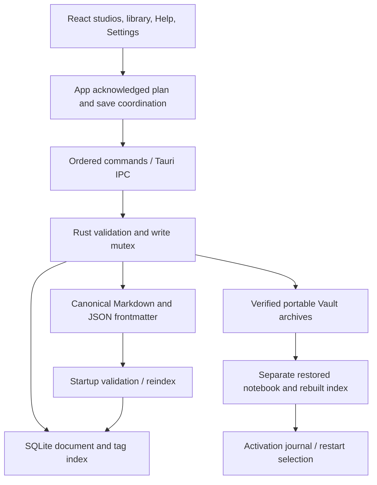

# MetaCognition Notebook — System Design

Authoritative architecture for **v0.6.2 — The Living Universe**, audited 2026-10-19. This describes implemented behavior, not a release or security certification. [README](README.md) introduces the product; [documentation index](docs/README.md) identifies historical evidence and pending acceptance.

## Architecture and boundaries

Tauri 2 hosts a React 18 / TypeScript / Vite frontend and Rust 2021 backend. The frontend owns view state and pending writing; the backend validates commands and owns filesystem/index access. Markdown with JSON frontmatter is canonical. SQLite is a derived metadata/tag index. Planning relationships are never sourced from a separate SQLite graph.



The diagram shows control/data flow, not a distributed transaction. Filesystem writes and SQLite commits remain separate operations.

| Area | Source of truth / scope |
| --- | --- |
| Notebook | A selected canonical root and its corresponding index; not a Book |
| Studio | Poetry, Philosophy or Lorebook document type; not a separate notebook |
| Universe | Stable planning ID/name, optional description/archive flag; logical workspace |
| Lore entity | Ordinary Lorebook document plus registration using its document ID and Universe ID |
| Book | Stable planning ID, owning Universe, name/description and continuity |
| Chapter | Ordinary Lorebook prose document with chapter entry type and Universe/Book/order metadata |
| Story Node | Stable planning milestone with scope/order/state records; never Chapter prose |
| Universe timeline | Nodes scoped to Universe with no Book |
| Book timeline | Nodes scoped to one Universe and one Book |
| Relationship | Canonical planning definition referencing entity IDs, optional Book/context node |

Universe/Book membership describes ownership within the planning model. A milestone's entity references, relationship endpoints and shared-event links are references: they neither copy prose nor transfer document ownership.

### Source map and command boundaries

- [App.tsx](src/App.tsx): document lifecycle, acknowledged plan, queues, guarded navigation/exit and Vault coordination.
- [AppLayout.tsx](src/components/layout/AppLayout.tsx): library views, search/filter/sort and navigation.
- [LorebookStudio.tsx](src/components/studios/LorebookStudio.tsx), [UniverseDashboard.tsx](src/components/studios/lorebook/UniverseDashboard.tsx), [BookView.tsx](src/components/studios/lorebook/BookView.tsx): Universe-first UI and separate prose/planning views.
- [lib.rs](src-tauri/src/lib.rs): startup selection and registered IPC command inventory. [commands.ts](src/services/commands.ts) and [api.ts](src/services/api.ts): typed frontend calls and mock boundary.
- [commands.rs](src-tauri/src/commands.rs), [models.rs](src-tauri/src/models.rs), [storage.rs](src-tauri/src/storage.rs), [db.rs](src-tauri/src/db.rs): document validation, Markdown I/O and index.
- [thought.rs](src-tauri/src/thought.rs): planning schema/validation/revision writes; [thought.ts](src/utils/thought.ts), [universe.ts](src/utils/universe.ts): planning operations and compatibility.
- [relationships.ts](src/utils/relationships.ts): semantic identity, perspective and queued attempts.
- [vault.rs](src-tauri/src/vault.rs), [notebook.rs](src-tauri/src/notebook.rs), [cipher.rs](src-tauri/src/cipher.rs): specialized native persistence.

Document commands include list/get/create/save/rename/delete/reindex/search, library information and organization/tag operations. Planning uses thought_get / thought_save; Vault, activation and Cipher have distinct command groups. Backend mutation guards remain necessary even when the UI is disabled.

## Canonical storage and index

Startup resolves the OS Documents directory and app-local data directory. The default root is Documents/MetaCognitionNotebook; if Documents resolution fails, startup falls back to the current directory. Active recovery can select another managed root. Settings reports the actual canonical/index locations.

```text
<active root>/
  Poetry/        *.md
  Philosophy/    *.md
  Lorebooks/     *.md (including shared planning catalog)
  Backups/       archived document files
  Attachments/   initialized; no attachment editing UI
  Dictionaries/  JSON dictionaries and .mckey recovery keys
  Vocabulary/    imported text pools
```

Default SQLite is app-local metadata.db with foreign keys and WAL enabled. Recovered slots use their own .vault-recovery/metadata.db. App-local Vault/, Notebooks/ and NotebookActivations/ are separate from canonical studio directories.

### Frontmatter and document lifecycle

A canonical file begins with `---json`, a JSON object, and a closing `---` line, followed by the body:

```text
---json
{"id":"document-uuid","title":"Example","type":"lorebook","created_at":"2026-10-19T00:00:00Z","updated_at":"2026-10-19T00:00:00Z","tags":[],"parent_id":null,"metadata":{}}
---
Document body
```

metadata_json in IPC/SQLite is the serialized metadata object, not a second body. Poetry form/Cipher metadata, Philosophy composition/blocks and Lorebook attributes/ownership coexist with reserved namespaces. Unknown supported metadata/frontmatter fields are retained when rewriting; formatting of JSON may change.

Creation validates studio/title, allocates an identity/path and writes the canonical file before indexing. Reads support raw Markdown without frontmatter, using indexed identity where available; durable frontmatter is added on supported writes. Do not rename/copy raw imports casually during recovery because their identity may depend on the index/catalog.

Writing uses a temporary file beside the destination, file flush and rename. This narrows partial-file exposure, but does not guarantee durability under every Windows sharing, permission, device or power failure. File/index operations are not one atomic transaction. Error handling may attempt to restore original bytes; if recovery fails, retain files and follow the reported reindex/recovery instructions.

Startup validates/scans canonical files and reconstructs the document/tag index. replace_index is a SQLite transaction, retaining the previous index on insertion failure. Reindex cannot recover deleted prose, infer historical values or reconstruct every raw-import identity from an anonymous file alone.

### SQLite schema

[db.rs](src-tauri/src/db.rs) currently migrates to schema version **1**, using CREATE TABLE IF NOT EXISTS initialization:

| Table | Stored fields / role |
| --- | --- |
| schema_version | version |
| documents | id, title, doc_type, unique relative_path, parent_id, metadata_json, created_at, updated_at |
| tags | id, unique name |
| document_tags | document_id/tag_id composite key, cascading foreign keys |
| collections | id, name, doc_type, parent_id, created_at, updated_at; deferred generic structure |
| document_links | source_id/target_id composite key, description; deferred generic structure |

Indexes cover document type/parent and tag joins. Generic collections/document_links are not the active Universe/Book/relationship model and have no supported UI. There is no new database migration for the Living Universe or its archive visibility flag.

## Organization and search

No schema migration is required. Tags continue using the existing frontmatter `tags` array and SQLite `tags` / `document_tags` tables. Favorites and recency use the existing indexed `metadata_json` object and canonical JSON frontmatter:

```json
{
  "chapter": "II",
  "_workshop": {
    "favorite": true,
    "last_opened_at": "2026-10-18T08:00:00+00:00"
  }
}
```

Missing fields mean unstarred and never recorded as opened. `_workshop` is reserved for application organization; existing unknown properties within it are retained. A non-object namespace fails safely. Existing studio metadata, including Philosophy composition/boundary information and Lorebook attributes, is preserved by organization commands.

`organization.rs` provides two additional Tauri commands:

| Command | Frontend arguments | Result |
| --- | --- | --- |
| `update_organization` | `{ id, patch: { tags?, favorite?, opened? } }` | Updated `DocumentMetadata` |
| `manage_tag` | `{ oldName, newName? }` | `{ updated: DocumentMetadata[], errors: string[] }` |

Neither command accepts a document body. The backend holds the existing database mutex, reads the current canonical file, applies only the requested organization fields, writes the same body through the temporary-file writer, then updates the index. It leaves logical `updated_at`, `created_at`, identity and paths unchanged. A failed index transaction triggers an attempt to restore the original file bytes. If restoration itself fails, the returned error explicitly directs reindex recovery. A process crash between file and index writes remains a cross-resource limitation; startup reindex rebuilds the index from canonical files.

Library-wide tag operations use per-document commits, not a global filesystem transaction. Each successful document is included in `updated`, and failed documents are identified in `errors`. Retrying the same rename/remove is idempotent and finishes remaining matches. Renaming to an existing tag merges exact, trimmed names without duplicates. Case is preserved and comparisons are case-sensitive. Only the selected old tag name is removed from the registry once it has no assignments; unrelated unused names are preserved. The UI includes the existing tag catalog as well as assigned tags, so unused names can also be renamed or removed. New tags are created naturally by assignment rather than through a standalone creation form.

The storage writer now preserves unknown top-level frontmatter fields. Frontmatter formatting can change when it is rewritten, while the body remains exact. Raw Markdown imports retain their indexed identity on reads and receive durable frontmatter when their first organization update is saved. Merely reading, searching, or listing documents never records history or rewrites a file.

The App explicitly queues an `opened: true` patch after an editor is displayed through selection, startup auto-opening, or creation. The backend records current UTC time when that patch is persisted. Only the latest timestamp per document is stored; this is not a full event log. Recent is ordered by that value, never by `updated_at`. Filesystem mtime can change when frontmatter is written, but logical last-modified sorting remains about writing/title changes.

`src/utils/organization.ts` supplies shared metadata handling, normalization, and library selection. Sorting/filtering runs over library metadata in React. All and Favorites support modified-descending, created-descending, locale-aware title ascending/descending with stable ID tie-breaking. Recent always uses last-opened descending. Studio, tag intersection (AND), view and search-result IDs compose. The library search uses the existing full-body/title search API with a 150ms debounce and ignores obsolete responses. The independent global search modal keeps its own studio filter and also rejects obsolete responses. Native snippet boundaries are UTF-8-safe.

Shared `DocumentOrganization` controls sit above all three studios. `AppLayout` adds compact library views, an optional Sort & filter section, clear-filter feedback and empty states. `TagManager` provides global rename/merge/remove with inline removal confirmation. The existing Gilded Identity tokens, studio canvases and canonical path scheme are retained. Filter/view/sort selections are session state; durable organization lives in Markdown.

Search first obtains applicable document metadata from SQLite, then StorageManager::search performs case-insensitive substring checks over titles and canonical bodies. Title matches precede body checks for that document; body read failures are skipped. It is neither SQLite FTS nor semantic search, and large-library performance is not established. A recent timestamp is not revision history.

## Studios and portable poem files

Poetry stores stanza text, form and supported metadata. Its UI provides form/font/counts and stanza operations, not automated meter/rhyme analysis. Imports of .txt/.md/.mcpoem create new documents with duplicate-title resolution and a 5 MB limit. Exports support text, Markdown frontmatter and poem packages.

Philosophy new documents default to freeform. Optional structured blocks have reasoning roles and stable boundaries; legacy documents without composition mode retain structured interpretation. Switching presentation preserves text rather than generating an argument or joining existing blocks destructively.

Lorebook separates Universe selection/dashboard, Book workspace and entity/Chapter writing. Categories and guided fields vary by entry type. Write/Preview currently preserves whitespace as text; it is not a Markdown rendering engine. Export Lore downloads the individual entry as Markdown; there is no general Philosophy export or manuscript compiler.

### Emotional Cipher

[emotionalCipher.ts](src/utils/emotionalCipher.ts) applies non-recursive substitutions with longest-phrase precedence and layout/casing handling. Quick swaps eligible words; Random draws from offline vocabulary pools; Manual uses rules/reusable dictionaries. Collision warnings and verified poem-specific records distinguish exact recovery from best-effort reversal.

Temporary previews become persisted keys through save/export operations. .mckey stores the exact key; .mccipher bundles encoded text and key. Import & Decode verifies and creates a recovered original, while Import Cipher Package retains encoded text/key. Saving a ciphered poem and key is sequential, not transactional. Partial failures must be inspected; a similar dictionary name or reroll is not a replacement for the original key.

Dictionaries use versioned JSON, imported vocabulary uses text files, and poem-specific keys are retained in Dictionaries. Key deletion checks poem references. These files participate in Vault, but Cipher is not encryption or an independent security boundary.

## Web of Thought and continuity

One ordinary Lorebook Markdown document, `Lorebooks/Web_of_Thought_<id>.md`, stores the shared `_web_of_thought` namespace. Format 1 includes revision, Universes, Books, entities, nodes and `plan.relationships`. Discovery rejects duplicate/malformed/future catalogs. Opening an empty desk alone creates no catalog; explicit creation does. The catalog has an 8 MiB / 30,000-ID validation bound, not a measured performance guarantee.

Universe and Book names can change without changing IDs. New Universe-first entities/Chapters use explicit ownership IDs; legacy string labels resolve by a unique case-insensitive name where possible. Unassigned/ambiguous entries remain accessible without silent reassignment. Planning renames do not rewrite legacy labels. The optional Universe archived flag defaults false and retains format 1; older strict readers may reject records where it is true.

Story Nodes retain IDs when reordered. Each has a Universe, optional Book, position, summary/perspective, optional date/status, questions, entity references, sparse property/relationship observations, history links and archive state. Order is normalized within its scope. Node archival preserves records and excludes them from active evaluation.

A property observation records entity/property, nullable new value, optional previous-value expectation and explanation. A value is direct at its node, earlier/uncertain evidence later, or unknown. Expected previous values do not backfill earlier nodes. Reordering recomputes conflicts; it does not rewrite observations or infer elapsed time, causes or unrecorded events. Comparisons use one timeline scope, with no automatic cross-Book state overlay.

Books are Canonical, Alternate or Standalone. A Canonical Book milestone can be explicitly confirmed for promotion as a copied/linked Universe history event. The original Book perspective survives. Other Books can reference shared history without overwriting their descriptions. Changing continuity does not promote anything or reverse a prior explicit promotion.

## Relationships and reciprocal views

`plan.relationships` is the single canonical collection. Definitions include stable ID, source/target entity IDs, label, direction, Universe, optional Book/context milestone, description and archive state. Node observations record later changes without overwriting history. A timeless baseline has no context node; missing/archived context can produce unknown evidence. Book views distinguish local observations from shared read-only definitions.

[relationships.ts](src/utils/relationships.ts) centralizes normalized semantic families and perspective:

| Author-entered connection | Reciprocal display |
| --- | --- |
| Character Member of / Affiliated with Faction | Faction Members |
| Faction Led by Character | Character Leads |
| Faction Controls Location | Location Controlled by |
| Allied with / Rival of | Same symmetric meaning at both endpoints |

Residence and ownership/creator/site/participant families also have explicit aliases. Membership does not imply leadership. Unknown custom labels retain incoming direction rather than inventing an inverse. Symmetric alliances/rivalries render without arrows, including legacy directed records in those families.

Duplicate identity includes normalized kind/orientation, Universe, Book and context. Equivalent reverse/symmetric input is rejected, while distinct kinds or contexts coexist. Existing historical duplicates are not destructively merged. Live endpoint/type/Universe checks protect new edits; missing historical IDs remain inspectable. Guided single-value replacement archives the applicable baseline, retaining contextual history. Legacy free text remains until explicit conversion; ambiguous candidates require a choice.

### State synchronization and writing protection

[autosave.ts](src/services/autosave.ts) supplies revision-tracked SaveCoordinator, retained MutationQueue, serialized CommandQueue and workspace/exit coordination. App owns the acknowledged plan and latest-plan reference; Lorebook consumes it directly rather than fetching a competing local copy.

Planning mutations may be functional transforms or snapshots. Transforms execute against the latest acknowledged plan at their ordered turn; snapshots retain the expected revision from submission. Prepared payload/IDs/revision survive retries for idempotence. Native thought_save compares canonical expected revision under the write mutex, validates the plan and rejects stale writes. Identical lost-ack retries are accepted. It preserves catalog body and unrelated metadata; indexing failure attempts restoration or retains a discoverable first-save catalog.

A failed action remains queued; additional edits are blocked behind the known failed head. Retry / Ctrl+S repeats the retained attempt. Explicit cancellation clears uncompleted queued changes and reloads acknowledged canonical data after writing flush; active writes and completed operations cannot be undone by cancellation. **There is no automatic whole-plan conflict merge in the current save handler.** The older reconcilePlans helper/tests remain in the repository but are not an active-handler guarantee.

Acknowledgements publish before dependent views. Each action reports its own outcome even if a later queued action fails. Library read generations reject stale responses; entity editor keys prevent one entity's local fields following another document. Relationship acknowledgements preserve newer pending prose.

Automatic writing save defaults to **3 seconds**, configurable **1–10 seconds** in [savePreferences.ts](src/utils/savePreferences.ts). Manual writing remains pending until Save / Ctrl+S; navigation/normal exit presents Save / Discard / Cancel for unsaved writing. Organization/planning actions have their own immediate persistence lifecycle. flushWorkspace drains mutations and writing and rechecks for newly queued work; ordinary navigation, close and Vault operations use that coordination. Failed writing stays in memory for retry, so process termination can still lose unsaved edits.

## Relationship graph

[RelationshipGraph.tsx](src/components/studios/lorebook/RelationshipGraph.tsx) is a shared dependency-free SVG view. [relationshipGraph.ts](src/utils/relationshipGraph.ts) uses deterministic force placement (120 passes) and rectangular separation (80 passes). Parallel/reversed edges have separate quadratic paths, self-loops use curves and labels follow curve midpoints with collision-avoidance attempts. Dense edge crossings and label overlap remain possible.

| Category | Shape / additional visual cue |
| --- | --- |
| Character | Blue ellipse, person |
| Faction | Amber hexagon, shield |
| Location | Emerald rectangle, pin |
| Artifact | Cyan diamond, sword |
| Event | Rose rectangle, calendar |
| Rule/concept | Violet hexagon, sparkles |
| Culture | Orange diamond, compass |
| Chapter | Orange rectangle, book |
| Other/missing | Primary rectangle, compass |

Semantic relationship and endpoint-category filters compose. Click or Enter/Space focuses a node and its direct neighbors; **Open focused entity** performs document navigation. Drag empty canvas to pan, use zoom controls and Fit; a focused SVG supports arrows, +/− and Home. Zoom is bounded to 0.15–4 times fitted scale. Text, shapes, legend and accessible names supplement color.

At most **240 matching edges** are drawn; complete Universe records remain in the list. The advanced desk graph receives all matching contextual rows independently of the list's 40-row reveal page. Long names/labels truncate with full tooltips/records. Camera, focus, filters and immediate Undo are session/view state, not canonical metadata.

## Archive and failure boundaries

| Action | Persisted effect | Recovery boundary |
| --- | --- | --- |
| Relationship unlink | Archives only selected relationship; retains identity/history | Immediate panel Undo is transient; refuses an equivalent active replacement or missing endpoint |
| Milestone archive | Retains node and observations but excludes active evaluation | Archived milestones can be explicitly recovered |
| Entity/document archive | Canonical file retained under Backups; entity links archived first | No one-click document recovery browser or durable archive intent journal |
| Universe archive | Selector visibility flag only; content/Books/Chapters/history retained | Archived Universes supports Inspect / Recover |
| Permanent Universe deletion | Not implemented | No aggregate destructive protocol |

[entityArchive.ts](src/services/entityArchive.ts) stages entity archival: flush pending work, review all active affected links and retained milestone references, verify no unreviewed links arrived, persist relationship archives, then archive the document. Retry remembers completed stages in-session. First-stage failure moves no document; second-stage failure can leave the entity intact with archived links. Process termination loses in-session intent, so inspect retained files rather than assuming automatic continuation.

The native [archive guard](src-tauri/src/thought.rs) runs under the database/write mutex and rejects deleting the shared catalog or an entity still referenced by active links. Storage archival uses timestamp/UUID/original-name copies and reports move/copy-remove failures. Database removal follows file preservation; it is not an atomic file/database operation. A crash after file movement can leave a stale index until startup reindex.

Universe danger-zone review lists scoped content/Books/milestones/relationships and requires the exact name. Its backup action opens Settings → Vault; it does not itself create a backup. Archive does not erase documents or observations. Keep a verified Vault backup before risky changes, and never delete Backups casually.

## Vault backup and recovery

A unique UTC/UUID filename ends in `.mcbackup`. It is a standard ZIP with Stored entries, a `manifest.json`, `library/...` payload and `state/catalog.json`. The manifest declares `format_version`, `app_version`, UTC `created_at`, and ordered file entries containing portable `path`, byte `size` and lowercase hexadecimal `sha256`. It contains no absolute machine-specific paths. User-authored writing/metadata is preserved, so paths deliberately written by an author are not scrubbed from their prose.

The catalog contains tag names and metadata for indexed raw Markdown imports. Canonical frontmatter is authoritative for all normal documents; no live SQLite, WAL or untrusted archived database is opened on restore. Unused collection/link tables have no supported UI and are not captured. App-local theme preferences, credentials, unrelated files/caches and older `.mcbackup` archives are excluded. Existing attachments and archived deletions are included as files. Unassigned tags are preserved separately because they have no canonical document assignment.

Backup capture holds the same database mutex as all app writes. Frontend VaultCoordinator flushes pending writing/metadata, then runs through CommandQueue while an interaction overlay pauses editing/navigation. Close waits for the operation and then flushes again. A failed autosave aborts capture. The backend captures the allowed trees, verifies the completed temporary archive, then rescans/re-hashes sources before publication to detect concurrent external edits. This coordinates application writes; it is not a filesystem/VSS snapshot against arbitrary external writers. Source changes detected during capture abort publication.

Verification uses bounded streaming hashing/read limits and a bounded ZIP central-directory preflight before constructing ZipArchive. It verifies central/local flags, filenames, CRC/size fields, contiguous non-overlapping data extents, entry counts and UTF-8 names. It rejects exact/case aliases, file/directory conflicts, traversal, absolute/ADS paths, Windows devices, symlinks/reparse source entries and non-regular ZIP files. It independently checks manifest membership, each size/hash, supported format version, UTC date, document studio/path agreement, document identity and supported JSON metadata. SHA-256 checks detect changes relative to the manifest; they are not signatures or source authentication.

Limits: at most 10,000 payload/catalog files plus the manifest; 64 MiB per payload file, 1 GiB total payload, 4 MiB manifest/catalog, 16 MiB central directory, and bounded portable path components. Format 1 rejects compression, encryption, ZIP64, comments and multipart ZIPs. A `.mcbackup` is not encrypted. Failed captures retain `.partial` files; the history labels them incomplete and does not treat them as verified. Known-backup history lists the managed Vault directory; external archives are selected through the native file picker rather than silently scanned elsewhere.

### Separate-folder recovery

Verification pins the selected archive digest to its preview. **Choose folder & restore separate copy** requires confirmation and a parent outside the active library; it does not publish an active selection. The backend re-verifies before extraction into a new unique .partial staging folder, using validated paths/create-new files and phase metadata in .vault-recovery/restore.json.

Raw imports receive durable frontmatter from catalog identity without changing prose. A fresh index is rebuilt/validated/checkpointed/closed, including document counts and SQLite integrity, before publishing the new folder by rename. Free-space checks estimate twice payload plus 64 MiB reserve; actual quota/disk errors can still occur. Interrupted staging and completed but unacknowledged copies are retained. Retry creates a fresh folder. The original notebook remains active; extraction success is not activation success.

### Active selection, restart and startup recovery

Active recovery uses a persistent selection store. The default slot remains Documents/MetaCognitionNotebook plus app-local metadata.db. Each selected slot has its own canonical root and index. Separate-folder recovery and its confirmation are unchanged; it never publishes a selection. Vault's managed backup directory remains app-local Vault/, independent of the selected index path.

NotebookManager uses an app-local exclusive OS file lock held for the process lifetime, rejecting concurrent instances of this version. Relaunch allows a bounded three-second wait for the departing process. Older versions do not participate; they must be closed. Startup reads the highest numbered committed record in NotebookActivations/. Records are immutable format-1 JSON with generation, active/previous root and index paths, verified preservation-backup path and outcome text. These local records contain absolute paths and are not portable backup metadata. Partial records are ignored; malformed committed records and noncanonical names fail closed.

Activation runs through the existing frontend flush/command queue, interaction overlay and backend write mutex. It verifies the selected archive against the preview digest, captures/verifies the current notebook into Vault/, restores a new unique managed notebook under app-local Notebooks/, validates/rebuilds/closes its separate index, then writes and fsyncs a unique partial selection record, closes it and renames it to a new generation filename in the same directory. No existing library, live index, or selection record is renamed over or deleted. The previous canonical folder/index remain in place, as does the verified pre-activation portable backup.

Publication is one selection-file rename, not an atomic filesystem/database replacement or a guarantee against hardware/power failure. There is no destructive replacement protocol to roll back. Before publication, any failure leaves the current selection/runtime writable and retains any prepared artifacts. After publication, an in-memory backend write barrier rejects create/save/rename/delete/reindex/tag mutations before filesystem changes. The frontend keeps writing surfaces inert, reconciles the authoritative selection even after an IPC error and requires restart; if reconciliation itself fails, it blocks editing until close/reopen. Normal close waits for activation and skips a redundant old-notebook flush once selection is published. The verified pending draft was flushed before preparation.

Restart launches a new process, which resolves the persisted slot before loading documents. It validates the supported source inventory and identities, checks SQLite integrity, scans canonical files, retains indexed raw-import identity, and transactionally replaces the selected document/tag index. A failed insertion rolls back that SQLite transaction. Frontend state starts fresh and opens from the selected index, including correct empty-library behavior. A success/recovery message appears and Settings retains both preservation locations. The old process never points its mounted editor at the new files.

If the selected notebook cannot open, startup validates the previous slot and publishes a new rollback generation before exposing it to editing. If that also fails, or rollback publication fails, startup stops with a native error dialog and retains all evidence. A corrupt committed journal is not guessed around; no empty fallback library is created for that case. Restore to Separate Folder remains an inspection tool; manual recovery can require restoring drive/path access or repairing the journal with assistance. Partial staging/records and completed unselected notebooks are retained, never automatically resumed or deleted. A process killed after publication needs no old-runtime acknowledgement: the next startup validates the new selection. Filesystem/device permissions, actual disk-full/quota behavior, forced-kill boundaries and Tauri restart on real Windows remain manual verification items.

Settings exposes Return to Previous Notebook with explicit confirmation. It preserves the current notebook/backup, validates the prior slot, appends a new selection generation, and uses the same restart/write barriers. It is reversible selection between retained folders, not a rollback that overwrites newer writing. No arbitrary folder picker, general notebook manager, schema migration, encryption, Google Drive or unrelated milestone is introduced.

### Vault emblem and themes

The official unmodified `src/assets/brand/vault.jpg` and `vault-light.jpg` masters are 2048x2048 JPEGs copied from the supplied files. Gold-pixel bounds are approximately (304,304)-(1744,1745) dark and (299,299)-(1748,1749) light: about 70% visible width. VaultEmblem uses a 64x64px object-contain image, yielding about 45px apparent artwork, in the Settings Vault section header. No cropping, recoloring, display derivative or studio-icon filter is applied. The JPEG edge colors are close to the existing charcoal/ivory backgrounds. Other studio icons are unchanged. There is no fourth studio or new studio navigation entry.

VaultEmblem reuses useIsDarkTheme, which observes the existing root dark class. `bindTheme` retains this root-class system and subscribes to live matchMedia changes only in System mode. Manual Dark/Light changes update the class immediately; System updates when the OS preference changes. No independent Vault theme state is introduced. Asset SHA-256 fixtures pin the exact artwork; theme resolution and live OS events have automated coverage. Native small-size visual alignment and JPEG blending still require desktop verification.

## Help, preferences and accessibility

Help content is a compiled TypeScript hierarchy (`src/help/manual.ts`), with seven chapters and 35 sections. `src/help/content.ts` derives chapter/section numbers from order, generates typed paragraph/heading/ordered-step/example/warning/note/internal-link blocks, and retains stable section IDs and the ten-term glossary. Each section supplies purpose, scenario, prerequisites, steps, example, result, mistakes and related IDs. Search covers normalized chapter/title/heading/keyword/body/note text with AND-token matching. No manually numbered titles, Markdown renderer or documentation framework is used. It uses no network, document command, generated sample project or new dependency. Sidebar Help & Guide is the global entry; Studio guide/F1 and explicit Web/Vault links select context. Unknown IDs fall back visibly to Getting started. Search is ephemeral UI state. HelpProvider retains expanded chapters and last section in memory across dialog closes for the app session; selecting a section from an entry point, search, related link or Previous/Next reveals the destination chapter. There is no new persistent navigation key. Old contextual IDs continue to resolve.

HelpProvider renders Help outside an inert application wrapper. The dialog labels its heading/search/navigation, focuses search, wraps Tab/Shift+Tab while excluding collapsed chapter panels and closed note contents, includes native note summaries, handles Escape and guide-search shortcuts and restores the invoking focus if still connected. App shortcuts avoid opening background search/create dialogs; Ctrl+S and Ctrl+Q remain on the normal save/exit path. Starting a Vault operation closes Help. ContextHelp notes are explicitly toggled, uniquely ID-linked, described when open and Escape-dismissable; hidden notes have an explicit display rule to avoid utility-style overrides. Tokens inherit Dark/Light/System; scoped focus and reduced-motion rules avoid unrelated visual redesign.

Web of Thought defaults to beginner presentation, not a new persistence model. Beginning/Ending buttons invoke the existing normal node insertion only on an author's explicit click, with generic titles rather than example lore. Compare Story Nodes is the clearer label for the existing world-state diff. Relationship tools appear after Show advanced tools; continuity, date/status, shared history and detailed state evidence are secondary expandable groups. Core Universe/Book creation is more discoverable. The advanced desk retains legacy membership/refresh controls. Universe-first creation registers entities in the shared plan; ordinary authors do not need manual catalog attachment. The planning schema, namespaces, IDs, archive/restore paths, write coordination and sparse-state semantics described above are unchanged.

The walkthrough is an inline, opt-in six-step panel. A pure reducer clamps navigation, distinguishes Skip/Finish, allows restart and closes/resets on notebook-context change. No active step is persisted. The keyed component also resets on notebook change/unmount. Show this step calls view-only callbacks/ref focus; absent, disabled, detached or renamed controls produce instruction fallback rather than selector errors or automatic actions. Starting it reveals beginner controls for the session without overwriting a separately saved advanced-mode preference. Eryndor/The Fall of Eryndor/Peaceful→Destroyed/The Great Betrayal occur only in instructional text.

App-local `mc_thought_help_v1` stores version 1, beginner/advanced mode and unseen/skipped/completed status using the established localStorage settings approach. Status updates reread mode to avoid clobbering another preference. Malformed/future/blocked storage falls back safely; persistence failure is reported as session-only. Preferences are global to this app origin/profile, not portable notebook metadata, and are excluded from Vault like theme preferences. No SQLite migration, filesystem store or automatic sample/catalog write is introduced.

`tests/v061_help.test.ts` exercises production search/routing, rendered guide structure, focus wrapping logic, walkthrough transitions/preferences/context reset, no-write rendering, graceful target fallback and contextual-note accessibility attributes. Existing v0.6.0 world-state/persistence and prior Vault/cipher/studio suites remain enabled. Rendered markup/helper tests do not replace actual browser focus, screen-reader, native restart, visual or first-time-author acceptance. `tests/v061_manual.test.ts` adds hierarchy renumbering, chapter transitions, nested search, related-link integrity, previous/next boundaries, both worked examples, absent-feature accuracy, hidden-target focus filtering and offline/no-command rendering of all 35 sections. No Rust, document API, notebook schema or save lifecycle changed in the manual overhaul. See docs/TEST_REPORT_v0.6.1_HELP_OVERHAUL.md for the historical overhaul verification and full contents; docs/TEST_REPORT_v0.6.1.md retains the initial onboarding report.

The current manual distinguishes the Book workspace's Chapters & Prose / Story Milestones Timeline from the separate detailed Web of Thought desk. Eryndor practice starts with Universe creation; its state-comparison instructions explicitly switch to that desk. Existing section IDs/hierarchy are retained.

## Build, verification and operational limits

The root [package scripts](package.json) define Vite development/preview, TypeScript + production frontend build, Node/tsx tests and the Tauri CLI. [Cargo.toml](src-tauri/Cargo.toml) uses bundled SQLite. [tauri.conf.json](src-tauri/tauri.conf.json) connects the dev server/frontend distribution and native bundle resources. Commands and Windows prerequisites are in the [README](README.md#getting-started).

Native startup uses a process-lifetime lock, selection validation and index reconstruction before documents load. Normal frontend close handling flushes/guards pending writing; forced termination does not run that protocol. Restart is a new process loading the selected slot, not an in-place switch of a mounted editor.

Local-first writing needs no cloud account/API. This is not an audited security guarantee: local files/archives are unencrypted, Tauri CSP is currently null, and filesystem access/recovery remains subject to OS permissions. No network/telemetry certification or universal sandbox guarantee is claimed. Do not use Cipher to protect secrets.

The [Graph & Safety report](docs/TEST_REPORT_v0.6.2_GRAPH_SAFETY.md) records the latest full implementation verification and manual Windows checklist. The [documentation audit](docs/DOCUMENTATION_AUDIT_v0.6.2.md) records checks rerun for this pass. Automated helpers/SSR/fixture tests and successful builds do not establish native focus, pointer, visual, accessibility, disk-full or restart acceptance.

Known engineering limits: a single active editing canvas, whole-catalog snapshot persistence/discovery scanning, unmeasured upper-bound search/graph performance, no automatic external conflict merge, no crash-atomic multi-file archive and no attachment editor. These are implementation boundaries, not fixes delivered by this documentation pass. [Roadmap](docs/ROADMAP.md) distinguishes subsequent planned work.
