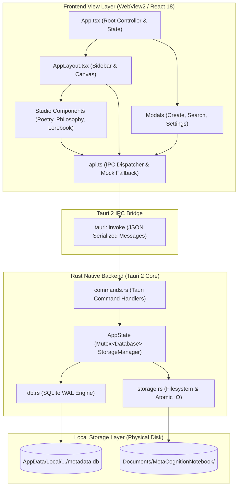
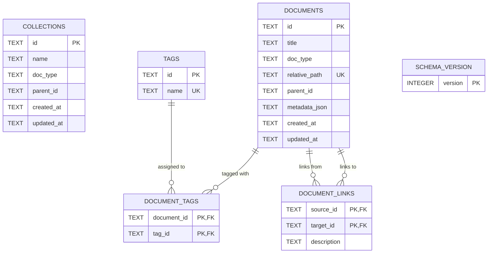
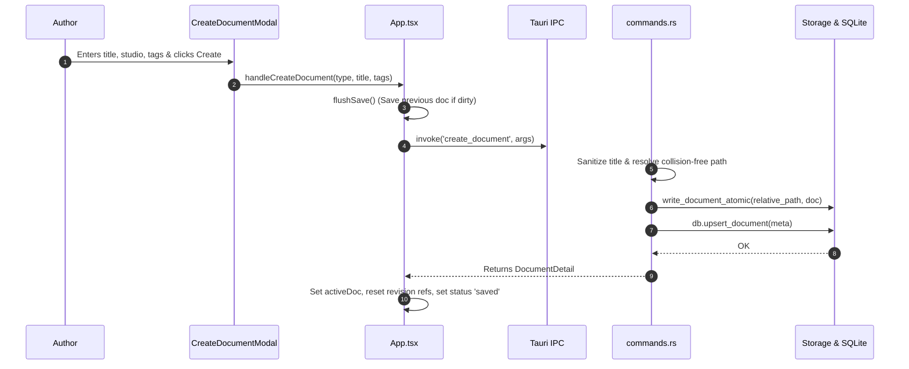
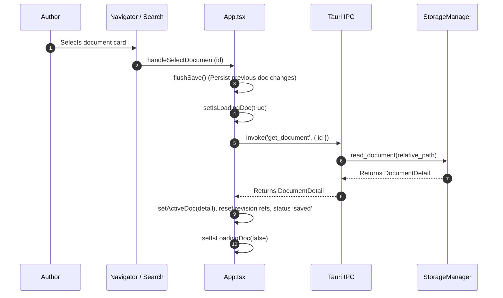
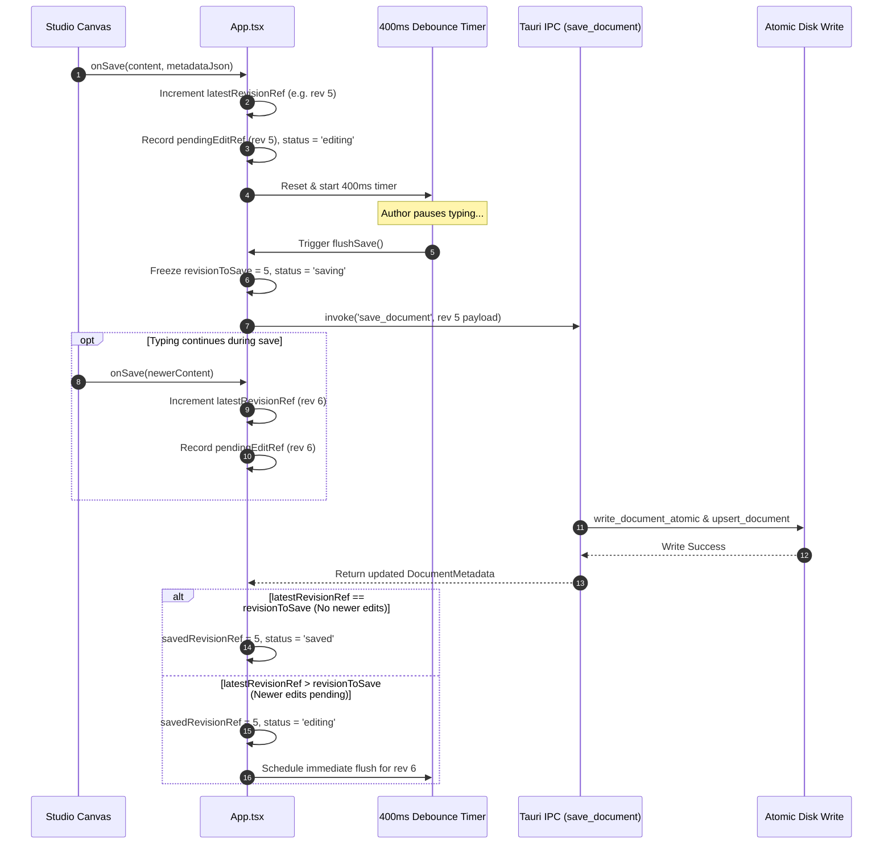
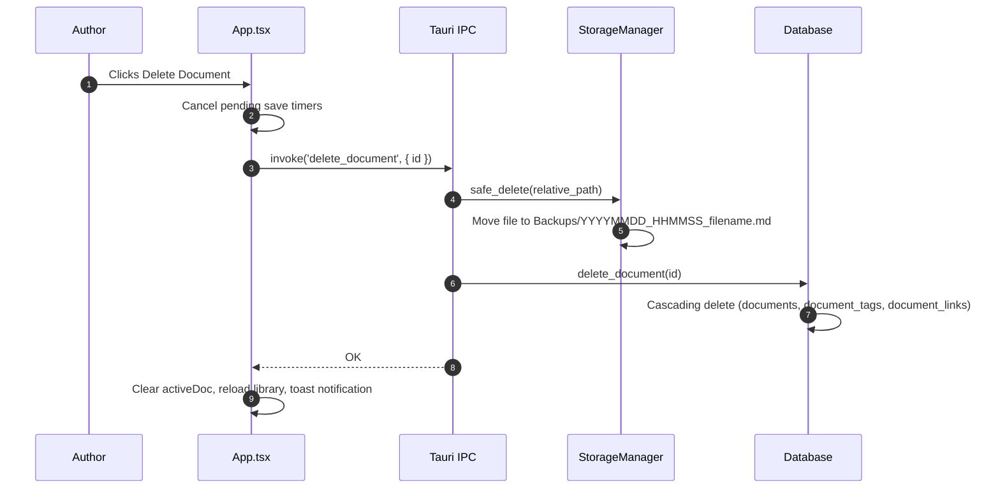
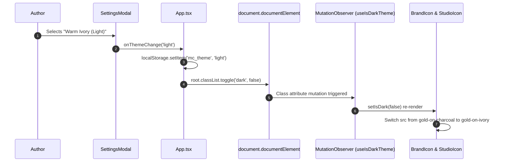

# MetaCognition Notebook — Technical System Design & Architecture

> **Engineering Reference Document for MetaCognition Notebook (MC)**  
> **Target Audience:** Systems Architects, Core Developers, Technical Contributors, QA Engineers  
> **Application Version:** `v0.6.2`
> **Product Overview:** See [`README.md`](./README.md) for product motivations, studio overviews, and user workflows.

---

## Table of Contents

- [1. System Overview](#1-system-overview)
- [2. Architectural Architecture](#2-architectural-architecture)
  - [High-Level Architectural Diagram](#high-level-architectural-diagram)
- [3. Technology Stack & Rationale](#3-technology-stack--rationale)
- [4. Repository & Directory Structure](#4-repository--directory-structure)
- [5. Frontend Architecture](#5-frontend-architecture)
- [6. Backend Architecture (Rust)](#6-backend-architecture-rust)
- [7. Tauri IPC Contract Reference](#7-tauri-ipc-contract-reference)
- [8. Database Design & Relational Schema](#8-database-design--relational-schema)
  - [Entity-Relationship Diagram](#entity-relationship-diagram)
  - [Schema Definitions](#schema-definitions)
- [9. Document Data Model & Storage Lifecycle](#9-document-data-model--storage-lifecycle)
- [10. Core Application Workflows](#10-core-application-workflows)
  - [Workflow A: Startup & Database Initialization](#workflow-a-startup--database-initialization)
  - [Workflow B: Document Creation](#workflow-b-document-creation)
  - [Workflow C: Document Opening & Loading](#workflow-c-document-opening--loading)
  - [Workflow D: Debounced Autosave & In-Flight Protection](#workflow-d-debounced-autosave--in-flight-protection)
  - [Workflow E: Safe Archival (Deletion)](#workflow-e-safe-archival-deletion)
  - [Workflow F: Theme Switching & Asset Resolution](#workflow-f-theme-switching--asset-resolution)
- [11. Autosave & Data Integrity Engine](#11-autosave--data-integrity-engine)
- [12. Security & Privacy Architecture](#12-security--privacy-architecture)
- [13. Theme & Branding System Architecture](#13-theme--branding-system-architecture)
- [14. Build, Packaging & Distribution](#14-build-packaging--distribution)
- [15. Verification & Testing Strategy](#15-verification--testing-strategy)
- [16. Error Handling & Observability](#16-error-handling--observability)
- [17. Performance Characteristics & Resource Budgets](#17-performance-characteristics--resource-budgets)
- [18. Architectural Decisions & Trade-Offs](#18-architectural-decisions--trade-offs)
- [19. Future Architecture & Extension Points](#19-future-architecture--extension-points)
- [20. Technical Debt, Risks & Open Questions](#20-technical-debt-risks--open-questions)
- [21. Technical Glossary](#21-technical-glossary)

---

## 1. System Overview

### 1.1 Purpose
MetaCognition Notebook is a specialized, local-first desktop application engineered to provide domain-specific writing interfaces for Poetry, Philosophy, and Worldbuilding (Lorebook) authors. It unites these creative modes within a single managed document ecosystem.

### 1.2 Local-First Principles
- **Canonical Markdown on Disk:** The authoritative source of truth for all user prose is standard UTF-8 Markdown (`.md`) files containing structured JSON frontmatter stored in the user's OS `Documents` folder.
- **SQLite Metadata Index:** A local embedded SQLite database acts as a query accelerator, relationship graph, and index cache. The database can be wiped and fully rebuilt from filesystem Markdown files at any time.
- **Zero Remote Dependencies:** The application does not require internet access, remote authentication, or external API connectivity to create, edit, save, or search documents. User-facing export is planned for v0.7.0.

### 1.3 System Boundaries
- **Runtime Environment:** Windows 10/11 desktop operating systems (x86_64).
- **Filesystem Boundaries:**
  - Content Root: `%USERPROFILE%\Documents\MetaCognitionNotebook\`
  - Default Database Root: `%USERPROFILE%\AppData\Local\com.metacognition.notebook\metadata.db`; v0.5.1 selected notebooks use their own `.vault-recovery/metadata.db` (section 9.11).
- **Network Boundaries:** No outgoing or incoming socket connections are initiated by the application runtime.

---

## 2. Architectural Architecture

The system is structured as a two-tier desktop architecture: a **Web UI View Layer** (React/TypeScript) and a **Native Desktop Shell & Controller** (Tauri 2/Rust). Communication occurs across a strictly typed, asynchronous Inter-Process Communication (IPC) bridge.

### High-Level Architectural Diagram



---

## 3. Technology Stack & Rationale

| Layer | Component | Version | Role in Architecture | Architectural Rationale & Constraints |
| :--- | :--- | :--- | :--- | :--- |
| **Shell** | [Tauri 2](https://v2.tauri.app/) | `^2.2.0` | Desktop Application Shell & Native Host | Lightweight footprint (~15MB RAM idle vs ~150MB+ for Electron). Utilizes native Windows WebView2 runtime; sandboxed OS filesystem access via Rust backend. |
| **Backend** | [Rust](https://www.rust-lang.org/) | `2021 Edition` | Core Domain, Filesystem IO, SQLite Driver | Memory safety without garbage collection; fast startup; thread-safe atomic file replacement. |
| **Frontend** | [React](https://react.dev/) | `^18.3.1` | Declarative UI View Framework | Component-based UI for complex dynamic studio canvases; well-supported ecosystem for rich state management. |
| **Language** | [TypeScript](https://www.typescriptlang.org/) | `^5.7.3` | Type System & Compilation | End-to-end interface contracts aligning frontend IPC payloads with Rust Serde structs. |
| **Database** | [SQLite 3](https://www.sqlite.org/) | `3.x` via `rusqlite 0.32` | Local Relational Indexing Engine | Zero-configuration embedded database; Write-Ahead Logging (WAL) for concurrent read access; fast indexing of metadata and tags. |
| **Styling** | [Tailwind CSS](https://tailwindcss.com/) | `^3.4.17` | Utility-First Design Token Engine | Centralized design tokens (Charcoal, Antique Gold, Warm Ivory); zero runtime CSS overhead; responsive desktop layouts. |
| **Icons** | [Lucide React](https://lucide.dev/) | `^0.475.0` | System Action Iconography | Clean, scalable SVG icons for system navigation, document actions, and window controls. |
| **Bundler** | [Vite](https://vitejs.dev/) | `^6.1.0` | Frontend Build Engine & HMR | Instant Hot Module Replacement during development; highly optimized production rollup bundling. |

---

## 4. Repository & Directory Structure

```text
MetaCognitionNotebook/
├── index.html                   # HTML entrypoint with font imports and root viewport
├── package.json                 # Node dependencies, scripts, and build tasks
├── tailwind.config.js           # Design tokens, color palette, and dark mode setup
├── tsconfig.json                # TypeScript compiler configuration
├── vite.config.ts               # Vite configuration with React plugin and path aliases
├── README.md                    # Product-oriented overview and beginner workflow
├── SYSTEM_DESIGN.md             # This technical architecture document
├── tests/                       # Automated frontend and integration test suites
│   ├── document_operations.test.ts        # Document lifecycle and mock IPC contract tests
│   └── phase2a_autosave_reliability.test.ts # Autosave debouncing and persistence tests
├── src/                         # React Frontend Application
│   ├── main.tsx                 # React DOM mount point
│   ├── App.tsx                  # Root state controller, autosave debouncer, shortcuts
│   ├── index.css                # Atmospheric background gradients, scrollbars, filters
│   ├── types/
│   │   └── index.ts             # Domain models, metadata types, studio definitions
│   ├── services/
│   │   ├── api.ts               # Unified API client (Tauri invoke + Mock fallback)
│   │   └── commands.ts          # Strongly typed Tauri command argument maps
│   ├── utils/
│   │   └── cn.ts                # Tailwind class merging utility (clsx + tailwind-merge)
│   ├── assets/
│   │   └── brand/               # Official brand master assets (dark and light artwork)
│   │       ├── app-icon-square.png         # Dark square MC emblem (1024x1024)
│   │       ├── app-icon-square-light.png   # Light square MC emblem (460x460)
│   │       ├── logo-horizontal.jpg         # Dark horizontal wordmark
│   │       ├── brand-horizontal-light.jpg  # Light horizontal wordmark
│   │       ├── studio-poetry.jpg           # Dark Poetry emblem
│   │       ├── studio-poetry-light.jpg     # Light Poetry emblem
│   │       ├── studio-philosophy.jpg       # Dark Philosophy emblem
│   │       ├── studio-philosophy-light.jpg # Light Philosophy emblem
│   │       ├── studio-lorebook.jpg         # Dark Lorebook emblem
│   │       └── studio-lorebook-light.jpg   # Light Lorebook emblem
│   └── components/
│       ├── common/              # Reusable UI controls and dialogs
│       │   ├── BrandIcon.tsx               # Theme-aware brand and studio icon components
│       │   ├── CreateDocumentModal.tsx     # New document modal with studio selectors
│       │   ├── Modal.tsx                   # Accessible backdrop dialog wrapper
│       │   ├── SearchModal.tsx             # Universal search dialog with keyword highlight
│       │   ├── SettingsModal.tsx           # Theme settings, paths, and reindex trigger
│       │   └── Toast.tsx                   # Toast notification context and container
│       ├── layout/
│       │   └── AppLayout.tsx               # Dual sidebar, header, and workspace canvas
│       └── studios/             # Specialized studio editors
│           ├── PoetryStudio.tsx            # Stanza editor, line metrics, poem metadata
│           ├── PhilosophyStudio.tsx        # Freeform writing and optional reasoning blocks
│           └── LorebookStudio.tsx          # Worldbuilding editor, attributes, canon status
└── src-tauri/                   # Rust Native Desktop Backend
    ├── Cargo.toml               # Rust dependencies and crate metadata
    ├── tauri.conf.json          # Tauri application configuration, window specs, icon suite
    ├── icons/                   # Generated multi-resolution Windows icons (.ico, .png)
    └── src/
        ├── main.rs              # Application entrypoint
        ├── lib.rs               # Tauri setup, state instantiation, command registration
        ├── models.rs            # Serde data transfer objects (DocumentMetadata, Frontmatter)
        ├── db.rs                # SQLite database connection, migrations, SQL queries
        ├── storage.rs           # Filesystem IO, atomic write, safe delete, parser, reindex
        └── commands.rs          # IPC command handlers and unit test suites
```

---

## 5. Frontend Architecture

### 5.1 Application State Model
The root controller (`src/App.tsx`) manages core application state:
- `documents: DocumentMetadata[]` — The cached collection of library documents for sidebar navigation.
- `activeDoc: DocumentDetail | null` — The currently open document (metadata + raw content).
- `selectedCategory: DocumentType | 'all'` — The active studio filter.
- `saveStatus: SaveStatus` — Visual state machine (`saved` | `saving` | `editing` | `error`).
- `theme: 'dark' | 'light' | 'system'` — Active interface appearance preference stored in `localStorage` (`mc_theme`).

### 5.2 Navigation & Layout
[`AppLayout.tsx`](file:///d:/Jetbrains_IDE_Projects/rustrover/MetaCognitionNotebook/src/components/layout/AppLayout.tsx) coordinates a three-region responsive workspace:
1. **Primary Sidebar (`Region A`):** Collapsible panel (`w-64` expanded, `w-18` collapsed) containing the brand emblem, quick creation button, studio navigators (All Library, Poetry, Philosophy, Lorebook), search shortcut, and settings toggle.
2. **Secondary Document Navigator (`Region B`):** Collapsible panel (`w-72` expanded, `w-0` collapsed) displaying real-time search filtering, tag filters, and sorted document cards with active selection states.
3. **Workspace Canvas (`Region C`):** The primary view displaying either the active studio editor or the introductory empty workspace hero with studio selection cards.

### 5.3 Theme Detection Architecture
Theme switching is completely decoupled from prop drilling via the `useIsDarkTheme()` hook in [`BrandIcon.tsx`](file:///d:/Jetbrains_IDE_Projects/rustrover/MetaCognitionNotebook/src/components/common/BrandIcon.tsx):
- Utilizes a `MutationObserver` on `document.documentElement.classList`.
- Immediately detects when `App.tsx` toggles the `.dark` class.
- Dynamically swaps image source references between gold-on-charcoal and gold-on-ivory assets without requiring an application restart.

---

## 6. Backend Architecture (Rust)

The Rust backend is encapsulated in `src-tauri/src/` with clear separation of concerns:

```
┌────────────────────────────────────────────────────────┐
│                      commands.rs                       │
│  (Tauri IPC Command Handlers & Parameter Validation)   │
└──────────────────────────┬─────────────────────────────┘
                           │ Calls
             ┌─────────────┴─────────────┐
             ▼                           ▼
┌─────────────────────────┐ ┌────────────────────────────┐
│          db.rs          │ │         storage.rs         │
│  (rusqlite Database &   │ │  (StorageManager, Atomic   │
│     WAL Index Engine)   │ │    Writes, Reindex Engine) │
└─────────────────────────┘ └────────────────────────────┘
```

- **`lib.rs`:** Initial setup life-cycle. Resolves OS paths (`Documents/MetaCognitionNotebook` and `AppData/Local/...`), initializes storage directories, opens SQLite database, runs migrations, spawns initial library reindexing, and registers commands.
- **`commands.rs`:** Defines `AppState { db: Mutex<Database>, storage: StorageManager, db_path: PathBuf }` and dispatches commands. All commands map to pure `*_impl` functions to facilitate direct Rust unit testing without mocking Tauri runtime states.
- **`storage.rs`:** Manages physical file manipulation:
  - `write_document_atomic`: Writes content to a temporary file via [`tempfile`](https://crates.io/crates/tempfile) in the same directory, flushes buffers, and executes an atomic file replace, guaranteeing file integrity against sudden power loss.
  - `resolve_safe_path`: Enforces strict path traversal defenses by inspecting path components for `ParentDir` (`..`), `RootDir`, or drive prefixes.
  - `safe_delete`: Moves deleted files to a timestamped `Backups/` directory rather than unlinking them from disk.
  - `parse_document_content`: Extracts YAML-like JSON frontmatter (`---json\n{...}\n---\n`) from raw Markdown files.
- **`db.rs`:** Wraps a `rusqlite::Connection` configured with `PRAGMA foreign_keys = ON;` and `PRAGMA journal_mode = WAL;`. Executes schema migrations via a version-tracked `schema_version` table.

---

## 7. Tauri IPC Contract Reference

The following table documents all 10 verified Tauri IPC commands exposed by the Rust backend and called by the React frontend:

| Command Name | Frontend Method (`api.ts`) | Parameters Received (Rust) | Return Type | Validation & Error Handling |
| :--- | :--- | :--- | :--- | :--- |
| `get_library_info` | `api.getLibraryInfo()` | *None* | `LibraryInfo` | Returns total document count, per-studio counts, and filesystem paths. |
| `list_documents` | `api.listDocuments(docType?)` | `doc_type: Option<String>` | `Vec<DocumentMetadata>` | Validates `doc_type` against allowed values (`poetry`, `philosophy`, `lorebook`). Returns sorted by `updated_at DESC`. |
| `get_document` | `api.getDocument(id)` | `id: String` | `DocumentDetail` | Queries database for document metadata; reads Markdown file from `relative_path`. Returns error if ID not found or file unreadable. |
| `create_document` | `api.createDocument(...)` | `doc_type`, `title`, `parent_id?`, `initial_content?`, `metadata_json?`, `tags?` | `DocumentDetail` | Sanitizes filename; handles file collision by incrementing suffix (`_1.md`); writes file atomically; indexes in SQLite. |
| `save_document` | `api.saveDocument(...)` | `id`, `content`, `title?`, `tags?`, `metadata_json?` | `DocumentMetadata` | Updates timestamps to UTC RFC-3339; atomic replace of Markdown file; updates SQLite index. |
| `rename_document` | `api.renameDocument(...)` | `id`, `new_title` | `DocumentMetadata` | Resolves new filename; creates new file atomically; deletes old file; updates SQLite index with new path and title. |
| `delete_document` | `api.deleteDocument(id)` | `id: String` | `()` | Moves Markdown file to timestamped `Backups/` folder; cascades deletion in SQLite (`documents`, `document_tags`, `document_links`). |
| `reindex_library` | `api.reindexLibrary()` | *None* | `ReindexReport` | Scans disk folder tree; parses frontmatter; clears and rebuilds SQLite index. Returns error list and count. |
| `search_documents` | `api.searchDocuments(...)` | `query: String`, `doc_type: Option<String>` | `Vec<SearchResult>` | Matches title (weight: title) or content (weight: snippet). Returns empty vector for blank queries. |
| `list_tags` | `api.listTags()` | *None* | `Vec<String>` | Returns all unique tag names from `tags` table in alphabetical order. |
| `cipher_list_dictionaries` | `api.listCipherDictionaries()` | *None* | `Vec<CipherDictionary>` | Scans `library/Dictionaries/*.json`, validates v1 schema, and returns sorted by dictionary name. |
| `cipher_get_dictionary` | `api.getCipherDictionary(id)` | `id: String` | `CipherDictionary` | Retrieves and parses the named dictionary from disk. Returns error if not found. |
| `cipher_save_dictionary` | `api.saveCipherDictionary(dict)` | `dictionary: CipherDictionary` | `CipherDictionary` | Validates id, name, and mappings; atomic write to `library/Dictionaries/<id>.json`. |
| `cipher_delete_dictionary` | `api.deleteCipherDictionary(id)` | `id: String` | `()` | Deletes the dictionary file from `library/Dictionaries/`. |
| `cipher_export_dictionary` | `api.exportCipherDictionary(...)` | `id: String`, `target_path: String` | `()` | Exports dictionary JSON payload to specified filesystem destination. |
| `cipher_import_dictionary` | `api.importCipherDictionary(path)` | `source_path: String` | `CipherDictionary` | Reads external JSON, validates v1 schema, assigns UUID if needed, and saves to library. |
| `cipher_list_vocabulary_pools` | `api.listVocabularyPools()` | *None* | `Vec<VocabularyPoolInfo>` | Lists bundled English dataset and custom pools in `library/Vocabulary/*.txt`. |
| `cipher_get_vocabulary_sample` | `api.getVocabularySample(...)` | `pool_id?`, `count`, `exclude_words` | `Vec<String>` | Samples unique candidate words excluding words present in the source poem. |
| `cipher_import_vocabulary_pool` | `api.importVocabularyPool(...)` | `name: String`, `content: String` | `VocabularyPoolInfo` | Saves user `.txt` word lists to `library/Vocabulary/<name>.txt`. |
| `cipher_delete_vocabulary_pool` | `api.deleteVocabularyPool(id)` | `pool_id: String` | `()` | Deletes custom `.txt` word lists from `library/Vocabulary/`. |

> **Serialization Notice:** Tauri 2 automatically maps frontend camelCase parameter objects (e.g., `{ docType: 'poetry', newTitle: 'New' }`) to Rust snake_case variables (`doc_type`, `new_title`).

---

## 8. Database Design & Relational Schema

### Entity-Relationship Diagram



### Schema Definitions

The SQLite database (`metadata.db`) is initialized and migrated in [`db.rs`](file:///d:/Jetbrains_IDE_Projects/rustrover/MetaCognitionNotebook/src-tauri/src/db.rs):

```sql
-- Schema Migration Version Tracker
CREATE TABLE IF NOT EXISTS schema_version (
    version INTEGER PRIMARY KEY
);

-- Planned Collections (Hierarchical Grouping)
CREATE TABLE IF NOT EXISTS collections (
    id TEXT PRIMARY KEY,
    name TEXT NOT NULL,
    doc_type TEXT NOT NULL,
    parent_id TEXT,
    created_at TEXT NOT NULL,
    updated_at TEXT NOT NULL
);

-- Core Documents Index Table
CREATE TABLE IF NOT EXISTS documents (
    id TEXT PRIMARY KEY,
    title TEXT NOT NULL,
    doc_type TEXT NOT NULL,
    relative_path TEXT NOT NULL UNIQUE,
    parent_id TEXT,
    metadata_json TEXT,
    created_at TEXT NOT NULL,
    updated_at TEXT NOT NULL
);

CREATE INDEX IF NOT EXISTS idx_documents_doc_type ON documents(doc_type);
CREATE INDEX IF NOT EXISTS idx_documents_parent_id ON documents(parent_id);

-- Unique Tags Repository
CREATE TABLE IF NOT EXISTS tags (
    id TEXT PRIMARY KEY,
    name TEXT NOT NULL UNIQUE
);

-- Many-to-Many Document Tags Mapping
CREATE TABLE IF NOT EXISTS document_tags (
    document_id TEXT NOT NULL,
    tag_id TEXT NOT NULL,
    PRIMARY KEY(document_id, tag_id),
    FOREIGN KEY(document_id) REFERENCES documents(id) ON DELETE CASCADE,
    FOREIGN KEY(tag_id) REFERENCES tags(id) ON DELETE CASCADE
);

CREATE INDEX IF NOT EXISTS idx_document_tags_doc ON document_tags(document_id);
CREATE INDEX IF NOT EXISTS idx_document_tags_tag ON document_tags(tag_id);

-- Document Relationship Graph
CREATE TABLE IF NOT EXISTS document_links (
    source_id TEXT NOT NULL,
    target_id TEXT NOT NULL,
    description TEXT,
    PRIMARY KEY(source_id, target_id),
    FOREIGN KEY(source_id) REFERENCES documents(id) ON DELETE CASCADE,
    FOREIGN KEY(target_id) REFERENCES documents(id) ON DELETE CASCADE
);
```

---

## 9. Document Data Model & Storage Lifecycle

### 9.1 Frontmatter Format
Documents on disk use strict JSON frontmatter delimited by `---json` and `---`:

```markdown
---json
{
  "id": "c7a8b41e-5f92-4d2a-8d6b-3e5f1b9a2c4d",
  "title": "On the Indivisibility of Consciousness",
  "type": "philosophy",
  "created_at": "2026-10-18T05:30:00Z",
  "updated_at": "2026-10-18T05:45:22Z",
  "tags": ["epistemology", "mind"],
  "parent_id": null,
  "metadata": {
    "work_title": "Prolegomena to Metacognition",
    "chapter": "Section II"
  }
}
---
<!-- premise -->
Conscious perception occurs as a unified experiential field.
```

### 9.2 Fallback Parsing
If an external Markdown file without frontmatter is placed into a studio folder, [`storage.rs`](file:///d:/Jetbrains_IDE_Projects/rustrover/MetaCognitionNotebook/src-tauri/src/storage.rs#L122-L151) infers the document type from its folder name, assigns a new UUIDv4, extracts the title from the filename, and serializes canonical frontmatter on the next save.

### 9.3 Philosophy Composition Views (v0.3.1)

`src/utils/philosophy.ts` owns parsing and serialization used by `PhilosophyStudio.tsx`. The body remains the single canonical content string. Existing SQLite `metadata_json` and JSON frontmatter store all additional fields; no schema migration or second copy of prose is needed.

- `composition_mode`: `freeform` or `structured`. Empty new Philosophy documents default to `freeform` in native creation and MockStorage, and the creation modal supplies it explicitly. Supplied existing content is not reclassified by creation defaults. Missing or unrecognized modes open as Structured Reasoning.
- `philosophy_representation`: `plain` or `legacy`. A mode switch records the original body interpretation independently from the requested view. Plain freeform prose stays one block even after switching and reopening in Structured Reasoning. Legacy documents retain their original paragraph and marker interpretation in either view.
- `thinking_desk_intro_dismissed`: document-scoped dismissal of the optional introduction.
- `philosophy_blocks`: after a block edit, an ordered array of `{ classification, length }`, where `length` counts JavaScript UTF-16 code units of that block's text. This is boundary information, not duplicate content. The body retains the existing `<!-- classification -->` prefix for non-prose blocks, followed by exact text; blocks are joined with `\n\n`. General Prose has no marker. The parser validates prefixes, separators, lengths, and total consumption before accepting the layout. Blank lines, empty blocks, whitespace, Unicode, and literal marker comments inside block text roundtrip without ambiguity.

Opening never reinterprets the body; v0.4.0 records last-opened time in metadata. Changing view and dismissing the introduction never serialize the body from blocks. A view-only change preserves its bytes exactly, including legacy formatting. Block edits serialize using the existing marker convention and update boundary metadata together. Valid unknown metadata properties are retained by spreading the original object. Legacy parsing preserves the prior blank-line block convention and recognized classifications, without trimming block text. Inter-block separators are normalized to two newlines when legacy blocks are first edited; opening and switching views do not normalize them.

Freeform renders a single borderless expanding textarea for a new document. For an existing block document it renders one borderless writing area per block, retaining order and hidden classifications. Structured Reasoning reveals role selectors, contextual descriptions, the optional role reference, and create/delete/reorder controls. There is no merge, automatic argument template, or automatic splitting of a freeform draft.

Backward compatibility is forward-loading: v0.3.1 reads legacy files without a rewrite. Earlier app versions ignore boundary metadata, so editing a multiline v0.3.1 block in an earlier version can split it. External body edits can invalidate boundary metadata; the parser then falls back to legacy parsing and preserves readable content, though inferred boundaries or roles can differ. The browser preview remains in-memory only.

---

### 9.4 The Writer's Workshop (v0.4.0)

No schema migration is required. Tags continue using the existing frontmatter `tags` array and SQLite `tags` / `document_tags` tables. Favorites and recency use the existing indexed `metadata_json` object and canonical JSON frontmatter:

```json
{
  "chapter": "II",
  "_workshop": {
    "favorite": true,
    "last_opened_at": "2026-10-18T08:00:00+00:00"
  }
}
```

Missing fields mean unstarred and never recorded as opened. `_workshop` is reserved for application organization; existing unknown properties within it are retained. A non-object namespace fails safely. Existing studio metadata, including Philosophy composition/boundary information and Lorebook attributes, is preserved by organization commands.

`organization.rs` provides two additional Tauri commands:

| Command | Frontend arguments | Result |
| --- | --- | --- |
| `update_organization` | `{ id, patch: { tags?, favorite?, opened? } }` | Updated `DocumentMetadata` |
| `manage_tag` | `{ oldName, newName? }` | `{ updated: DocumentMetadata[], errors: string[] }` |

Neither command accepts a document body. The backend holds the existing database mutex, reads the current canonical file, applies only the requested organization fields, atomically writes the same body and updates the index. It leaves logical `updated_at`, `created_at`, identity and paths unchanged. A failed index transaction triggers an attempt to restore the original file bytes. If restoration itself fails, the returned error explicitly directs reindex recovery. A process crash between file and index writes remains a cross-resource limitation; startup reindex rebuilds the index from canonical files.

Library-wide tag operations use per-document commits, not a global filesystem transaction. Each successful document is included in `updated`, and failed documents are identified in `errors`. Retrying the same rename/remove is idempotent and finishes remaining matches. Renaming to an existing tag merges exact, trimmed names without duplicates. Case is preserved and comparisons are case-sensitive. Only the selected old tag name is removed from the registry once it has no assignments; unrelated unused names are preserved. The UI includes the existing tag catalog as well as assigned tags, so unused names can also be renamed or removed. New tags are created naturally by assignment rather than through a standalone creation form.

The storage writer now preserves unknown top-level frontmatter fields. Frontmatter formatting can change when it is rewritten, while the body remains exact. Raw Markdown imports retain their indexed identity on reads and receive durable frontmatter when their first organization update is saved. Merely reading, searching, or listing documents never records history or rewrites a file.

The App explicitly queues an `opened: true` patch after an editor is displayed through selection, startup auto-opening, or creation. The backend records current UTC time when that patch is persisted. Only the latest timestamp per document is stored; this is not a full event log. Recent is ordered by that value, never by `updated_at`. Filesystem mtime can change when frontmatter is written, but logical last-modified sorting remains about writing/title changes.

`src/utils/organization.ts` supplies shared metadata handling, normalization, and library selection. Sorting/filtering runs over library metadata in React. All and Favorites support modified-descending, created-descending, locale-aware title ascending/descending with stable ID tie-breaking. Recent always uses last-opened descending. Studio, tag intersection (AND), view and search-result IDs compose. The library search uses the existing full-body/title search API with a 150ms debounce and ignores obsolete responses. The independent global search modal keeps its own studio filter and also rejects obsolete responses. Native snippet boundaries are UTF-8-safe.

Shared `DocumentOrganization` controls sit above all three studios. `AppLayout` adds compact library views, an optional Sort & filter section, clear-filter feedback and empty states. `TagManager` provides global rename/merge/remove with inline removal confirmation. The existing Gilded Identity tokens, studio canvases and canonical path scheme are retained. Filter/view/sort selections are session state; durable organization lives in Markdown.

### 9.5 Organization, Autosave and Close Coordination

`MutationQueue` retains metadata actions until successful or explicitly canceled. `CommandQueue` serializes actual metadata commands and writing saves together with their acknowledgements. `SaveCoordinator` still drains revision-tracked writing. `flushWorkspace` repeatedly drains organization actions and writing, then rechecks for organization actions queued during an in-flight writing save. Navigation and `ExitCoordinator` await this combined flush.

Full studio saves preserve the current reserved `_workshop` state even if a mounted studio submits an earlier metadata snapshot; normal autosave omits tags, retaining current tag assignments. Organization acknowledgements preserve any newer pending draft body and studio metadata in memory. Save failures retain queued actions and expose Retry / Ctrl+S. Cancel organization update explicitly clears uncompleted metadata actions, never draft writing or already completed library updates. Active writes cannot be canceled.

### 9.6 The Vault (v0.5.0): Architecture Assessment

Canonical content remains under Documents/MetaCognitionNotebook. The index is a separate SQLite database in app-local data with WAL enabled. `Attachments/` is initialized but has no attachment editing UI. `Backups/` holds deleted-file archives, not full-library snapshots. Writing and organization commands hold `AppState.db`; frontend mutation/body commands are ordered through CommandQueue and flushWorkspace.

Vault history and captures live in a sibling `Vault/` directory beside the index. No new document type, database migration, filesystem plugin capability or cloud connection is added. Rust async command wrappers offload native dialogs, filesystem work and hashing to blocking workers. The existing capabilities remain unchanged; backend commands only expose the specific Vault actions. Browser MockStorage explicitly refuses Vault operations rather than fabricating durable backups.

### 9.7 Portable Format 1 and Verification

A unique UTC/UUID filename ends in `.mcbackup`. It is a standard ZIP with Stored entries, a `manifest.json`, `library/...` payload and `state/catalog.json`. The manifest declares `format_version`, `app_version`, UTC `created_at`, and ordered file entries containing portable `path`, byte `size` and lowercase hexadecimal `sha256`. It contains no absolute machine-specific paths. User-authored writing/metadata is preserved, so paths deliberately written by an author are not scrubbed from their prose.

The catalog contains tag names and metadata for indexed raw Markdown imports. Canonical frontmatter is authoritative for all normal documents; no live SQLite, WAL or untrusted archived database is opened on restore. Unused collection/link tables have no supported UI and are not captured. App-local theme preferences, credentials, unrelated files/caches and older `.mcbackup` archives are excluded. Existing attachments and archived deletions are included as files. Unassigned tags are preserved separately because they have no canonical document assignment.

Backup capture holds the same database mutex as all app writes. Frontend VaultCoordinator flushes pending writing/metadata, then runs through CommandQueue while an interaction overlay pauses editing/navigation. Close waits for the operation and then flushes again. A failed autosave aborts capture. The backend captures the allowed trees, verifies the completed temporary archive, then rescans/re-hashes sources before publication to detect concurrent external edits. This coordinates application writes; it is not a filesystem/VSS snapshot against arbitrary external writers. Source changes detected during capture abort publication.

Verification uses bounded streaming hashing/read limits and a bounded ZIP central-directory preflight before constructing ZipArchive. It verifies central/local flags, filenames, CRC/size fields, contiguous non-overlapping data extents, entry counts and UTF-8 names. It rejects exact/case aliases, file/directory conflicts, traversal, absolute/ADS paths, Windows devices, symlinks/reparse source entries and non-regular ZIP files. It independently checks manifest membership, each size/hash, supported format version, UTC date, document studio/path agreement, document identity and supported JSON metadata. SHA-256 checks detect changes relative to the manifest; they are not signatures or source authentication.

Limits: at most 10,000 payload/catalog files plus the manifest; 64 MiB per payload file, 1 GiB total payload, 4 MiB manifest/catalog, 16 MiB central directory, and bounded portable path components. Format 1 rejects compression, encryption, ZIP64, comments and multipart ZIPs. A `.mcbackup` is not encrypted. Failed captures retain `.partial` files; the history labels them incomplete and does not treat them as verified. Known-backup history lists the managed Vault directory; external archives are selected through the native file picker rather than silently scanned elsewhere.

### 9.8 Restore Safety and Interrupted Operations

Restore only creates a NEW separate folder. No active-library path, active database or existing document is replaced. Verification returns a whole-archive SHA-256 that pins the explicit UI preview. After the confirmation checkbox and restore button, a native folder picker selects a parent outside the active library. The backend re-verifies the selected archive and compares the preview digest before creating anything.

A uniquely created `.partial` staging folder contains `.vault-recovery/restore.json` with staging/validated phase information. Paths are validated before extraction; files use create_new and are flushed. The current library is not copied as a rollback snapshot because it is never modified. Free space must exceed a conservative estimate of twice payload size plus 64 MiB reserve; OS write errors still fail safely if space/quota availability changes.

After extraction, raw imports get canonical frontmatter using their saved indexed identity and original prose. StorageManager validates/reindexes the recovered canonical files into a fresh `.vault-recovery/metadata.db`, restores the tag catalog, checks document counts and SQLite integrity, checkpoints and closes the new index. The archive digest is checked again. A validated staging directory is renamed to a unique final folder within the selected parent. This is publication of a prepared separate copy, not a claim that replacing multiple live files and databases is atomic.

On failure or interruption, the original library remains untouched, the archive remains available, and staging is retained for review/retry. A retry creates another new folder and does not delete earlier recovery data. A process killed after publication but before UI acknowledgement can leave a completed folder at the selected parent. No automatic cleanup, activation, destructive in-place restore or startup replacement recovery is implemented. The active editor needs no reload after separate-folder recovery; it deliberately continues using its original library. This separate-folder option never activates a notebook; the distinct v0.5.1 workflow in section 9.11 adds explicit selection and restart. Restored documents can be inspected as Markdown and are reopened through StorageManager in automated tests.

### 9.9 Vault Visual Identity and Theme Resolution

The official unmodified `src/assets/brand/vault.jpg` and `vault-light.jpg` masters are 2048x2048 JPEGs copied from the supplied files. Gold-pixel bounds are approximately (304,304)-(1744,1745) dark and (299,299)-(1748,1749) light: about 70% visible width. VaultEmblem uses a 64x64px object-contain image, yielding about 45px apparent artwork, in the Settings Vault section header. No cropping, recoloring, display derivative or studio-icon filter is applied. The JPEG edge colors are close to the existing charcoal/ivory backgrounds. Other studio icons are unchanged. There is no fourth studio or new studio navigation entry.

VaultEmblem reuses useIsDarkTheme, which observes the existing root dark class. `bindTheme` retains this root-class system and subscribes to live matchMedia changes only in System mode. Manual Dark/Light changes update the class immediately; System updates when the OS preference changes. No independent Vault theme state is introduced. Asset SHA-256 fixtures pin the exact artwork; theme resolution and live OS events have automated coverage. Native small-size visual alignment and JPEG blending still require desktop verification.

### 9.10 Google Drive Feasibility: Deferred

Phase B has no implementation or credentials. Required follow-up: a Google Cloud project with Drive API enabled; consent-screen/test-user configuration and a Desktop OAuth client; external-browser authorization code flow with S256 PKCE, state validation and an ephemeral loopback callback; Windows Credential Locker/DPAPI-backed token storage; refresh/revocation/disconnect behavior; and explicit user-triggered resumable uploads/downloads with bounded retry/quota handling and post-download Vault verification. No token should enter logs, archives, localStorage or repository files.

Scope design must choose between `drive.file` for app-created/user-visible backup files and `drive.appdata` for a hidden app-only folder. Broad Drive access is unnecessary. The hidden folder's visibility and deletion lifecycle need a product decision before using it for long-lived backups. Uploads must create distinct objects, never overwrite remote backups automatically, and never remove the local verified copy.

Primary references: [desktop OAuth and PKCE](https://developers.google.com/identity/protocols/oauth2/native-app), [token security](https://developers.google.com/identity/protocols/oauth2/resources/best-practices), [least-privilege scopes](https://developers.google.com/workspace/drive/api/guides/api-specific-auth), [app-data lifecycle](https://developers.google.com/workspace/drive/api/guides/appdata), [resumable uploads](https://developers.google.com/workspace/drive/api/guides/manage-uploads), [quotas and error handling](https://developers.google.com/workspace/drive/api/guides/limits). This assessment does not constitute an implemented or validated cloud connection.

### 9.11 v0.5.1: Active Notebook Selection and Startup Recovery

The fixed-path v0.5.0 startup design is extended with a persistent selection store, not destructive replacement. The default slot remains Documents/MetaCognitionNotebook plus app-local metadata.db. Each selected slot has its own canonical root and index. Separate-folder recovery and its confirmation are unchanged; it never publishes a selection. Vault's managed backup directory remains app-local Vault/, independent of the selected index path.

NotebookManager uses an app-local exclusive OS file lock held for the process lifetime, rejecting concurrent instances of this version. Relaunch allows a bounded three-second wait for the departing process. Older versions do not participate; they must be closed. Startup reads the highest numbered committed record in NotebookActivations/. Records are immutable format-1 JSON with generation, active/previous root and index paths, verified preservation-backup path and outcome text. These local records contain absolute paths and are not portable backup metadata. Partial records are ignored; malformed committed records and noncanonical names fail closed.

Activation runs through the existing frontend flush/command queue, interaction overlay and backend write mutex. It verifies the selected archive against the preview digest, captures/verifies the current notebook into Vault/, restores a new unique managed notebook under app-local Notebooks/, validates/rebuilds/closes its separate index, then writes and fsyncs a unique partial selection record, closes it and renames it to a new generation filename in the same directory. No existing library, live index, or selection record is renamed over or deleted. The previous canonical folder/index remain in place, as does the verified pre-activation portable backup.

Publication is one selection-file rename, not an atomic filesystem/database replacement or a guarantee against hardware/power failure. There is no destructive replacement protocol to roll back. Before publication, any failure leaves the current selection/runtime writable and retains any prepared artifacts. After publication, an in-memory backend write barrier rejects create/save/rename/delete/reindex/tag mutations before filesystem changes. The frontend keeps writing surfaces inert, reconciles the authoritative selection even after an IPC error and requires restart; if reconciliation itself fails, it blocks editing until close/reopen. Normal close waits for activation and skips a redundant old-notebook flush once selection is published. The verified pending draft was flushed before preparation.

Restart launches a new process, which resolves the persisted slot before loading documents. It validates the supported source inventory and identities, checks SQLite integrity, scans canonical files, retains indexed raw-import identity, and transactionally replaces the selected document/tag index. A failed insertion rolls back that SQLite transaction. Frontend state starts fresh and opens from the selected index, including correct empty-library behavior. A success/recovery message appears and Settings retains both preservation locations. The old process never points its mounted editor at the new files.

If the selected notebook cannot open, startup validates the previous slot and publishes a new rollback generation before exposing it to editing. If that also fails, or rollback publication fails, startup stops with a native error dialog and retains all evidence. A corrupt committed journal is not guessed around; no empty fallback library is created for that case. Restore to Separate Folder remains an inspection tool; manual recovery can require restoring drive/path access or repairing the journal with assistance. Partial staging/records and completed unselected notebooks are retained, never automatically resumed or deleted. A process killed after publication needs no old-runtime acknowledgement: the next startup validates the new selection. Filesystem/device permissions, actual disk-full/quota behavior, forced-kill boundaries and Tauri restart on real Windows remain manual verification items.

Settings exposes Return to Previous Notebook with explicit confirmation. It preserves the current notebook/backup, validates the prior slot, appends a new selection generation, and uses the same restart/write barriers. It is reversible selection between retained folders, not a rollback that overwrites newer writing. No arbitrary folder picker, general notebook manager, schema migration, encryption, Google Drive or unrelated milestone is introduced.

### 9.12 v0.5.2: The Emotional Cipher Architecture

The Emotional Cipher is a creative, reversible, dictionary-based text substitution system integrated into Poetry Studio (`src/utils/emotionalCipher.ts`, `src/components/studios/EmotionalCipherModal.tsx`, `src-tauri/src/cipher.rs`).

#### 9.12.1 Core Architectural Principles
1. **Playful Literary Concealment:** The feature provides surreal transformation, creative friction, and playful obfuscation for verse authors. It is explicitly not a cryptographic encryption tool or data compression system.
2. **Deterministic, Single-Pass Non-Recursive Substitution:** Substitutions are executed across the token stream from left to right in a single pass. Substituted segments are marked and never re-evaluated against the dictionary. This prevents recursive chain loops (e.g., if `love -> hate` and `hate -> chicken`, the word `love` becomes `hate` and never degrades into `chicken`).
3. **Longest-Phrase Match Precedence:** Active mappings are sorted descending by word count and string length before pattern compilation. Multiword phrases (e.g., `dark night` -> `gilded sunrise`) match before individual constituent words (`dark` -> `amber`, `night` -> `noon`).
4. **Cadence & Layout Preservation:** All line breaks, stanza breaks (`\n\n`), indentation whitespace, em-dashes, and punctuation marks are preserved intact.
5. **Casing Preservation:** Word replacements mirror the casing pattern of the source word (`Love` -> `Chlorophyll`, `LOVE` -> `CHLOROPHYLL`, `love` -> `chlorophyll`, `Dark Night` -> `Gilded Sunrise`).
6. **Non-Destructive Document Model:** Original poems are never overwritten or altered. Transformed verses are either copied to clipboard or saved as independent documents with cipher metadata (`{ "cipher": { "dictionary_id": "...", "dictionary_name": "...", "is_cipher": true } }`).

#### 9.12.2 Collision and Ambiguity Detection
The engine analyzes substitution mappings in real time (`detectCollisions`) to determine reversibility fidelity:
- **Target Collisions:** Detected when multiple unique original words map to the identical replacement word (e.g., `sun -> gold` and `moon -> gold`).
- **Vocabulary Overlaps:** Detected when a replacement word matches an unchanged word in the source poem (e.g., `heart -> stone` while the word `stone` already occurs unchanged in the verse).
- **Collision Feedback:** Transparent warning banners and badges in the UI explicitly notify the author if standalone heuristic decoding would be ambiguous.

#### 9.12.3 Reversible Decoding Engine
- **Manifest-Based Lossless Reversal:** During encoding, the engine records an immutable `CipherManifest` containing exact character offsets, source text, and substituted text. When present, decoding guarantees 100% lossless reconstruction regardless of duplicate targets or vocabulary overlaps.
- **Standalone Heuristic Reversal:** When decoding raw pasted or external cipher text without a manifest, the engine constructs a reverse mapping with longest-replacement-phrase precedence, returning a fidelity status (`lossless` vs `ambiguous`) with explicit candidate conflict warnings.

#### 9.12.4 Dictionary Persistence and Vault Integration
- Dictionaries are stored canonically on disk as version-1 JSON files in `library/Dictionaries/<id>.json`.
- The format conforms to strict validation (`validateCipherDictionary`):
  ```json
  {
    "version": 1,
    "id": "dict-botanical-default",
    "name": "Botanical Surrealism",
    "description": "Plant and flower substitutions",
    "created_at": "2026-10-18T10:00:00Z",
    "updated_at": "2026-10-18T10:00:00Z",
    "mappings": [
      { "original": "heart", "replacement": "rhizome" }
    ]
  }
  ```
- **Vault Archive Compatibility:** `src-tauri/src/vault.rs` includes `library/Dictionaries/` in `allowed()` paths and `sources()` collection. All cipher dictionaries are automatically backed up in `.mcbackup` archives and unpacked cleanly during restore operations without being treated as studio Markdown documents.

### 9.13 v0.6.0: Web of Thought (Lorebook only)

Repository assessment: Universe/Book/Chapter are currently free-text Lorebook metadata, not separate persisted objects. Existing document UUIDs supply lore entity identity. SQLite has generic collections/document_links tables but no supported timeline semantics; using them as canonical state would conflict with Vault's rebuilt-index model. No relational migration is necessary. The planning catalog is an ordinary Lorebook Markdown document with a standard ID/path/frontmatter, explanatory body, and `_web_of_thought` metadata object. Other studios and Emotional Cipher are unchanged. Lorebook metadata editing now retains unknown metadata fields when spreading parsed metadata.

Format 1 contains revision, universes, books, entities, nodes and relationships. Universe records have UUID/name; Book records add universe_id and continuity (canonical/alternate/standalone). Initial creation explicitly groups exact existing Universe/Book labels without modifying existing files. New Books are standalone. Entity membership stores the existing lore document ID and Universe ID, without copying prose or world snapshots. Registry renames preserve references and intentionally do not rewrite legacy document labels. New/unassigned lore can be explicitly attached later.

Story Nodes have stable IDs, Universe ID, optional Book ID, integral position, title, description/perspective, optional era, planned/drafted/written status, unresolved questions, entity references, sparse changes, relationship observations, optional linked_event_id/origin_node_id, archive flag and timestamps. Ordering is per (Universe, optional Book); insertion/move normalizes ranks without changing identity or attached data. Equal titles and missing dates are valid. Deletion is confirmed archival; it does not delete entities or create/delete chapters. Archived nodes are excluded from active evaluation and remain recoverable.

Property observations contain stable change ID, entity ID, custom property key, optional expected previous value, nullable new value (explicit unknown) and note. Evaluation replays only the selected linear scope. Values are direct at the recording milestone or marked earlier evidence thereafter, with intervening uncertainty stated explicitly. No backward inference, default state, full-world snapshot, missing-cause generation or cross-timeline state merge is performed. Conflicts between expected previous values and known earlier evidence are derived at evaluation time, so reordering recomputes them without rewriting records. Comparison endpoints must share a scope; missing properties display unknown rather than unchanged.

Relationship definitions have stable ID, endpoints, Universe/optional Book, direction, initial label, description, optional context milestone and archive flag. A null context explicitly defines a timeless baseline; a missing/archived context leaves state unknown until another observation. Later label/null observations live on Story Nodes and preserve earlier history. Book views allow local observations but make shared Universe definitions read-only. The SVG graph is focused by one entity, capped at 12 drawn edges, with dashed unknowns; records are progressively revealed in groups of 40. Evaluation is limited to the chosen entity and revealed records. Timelines paginate at 40 nodes. No graph package is introduced.

Book nodes may link the same Universe node, retaining independent descriptions/order. Universe nodes serve as shared events, avoiding a second redundant event registry. Promotion is an explicit confirmed copy/link: the new shared event references its origin and the original Book node links it. Only a Canonical source Book can promote; the backend enforces source/scope and preserves the Book node. Later classification changes do not undo prior explicit history. Missing/archived shared events retain links and warn. Shared edits never overwrite Book perspectives. Linked history is not an automatic state overlay.

`thought_get` discovers canonical catalogs in Lorebooks and rejects duplicate/malformed/future formats; merely viewing creates nothing. `thought_save` uses the existing database/write mutex and activation barrier, validates references/scopes/types/duplicate IDs/changes, and compares expected canonical revision before writing. Incoming stale writes fail without replacing data; identical lost-ack retries are idempotent and repair an absent SQLite row. Existing body, unrelated metadata and unknown top-level frontmatter are retained. Atomic document writes use the established storage writer. An update indexing failure restores original canonical bytes; a first-save indexing failure retains a discoverable canonical catalog for retry/reindex. Manuscript save commands reject planning catalog overwrites. SQLite remains derived; there is no second custom filesystem store or migration.

The UI enqueues planning snapshots through the existing MutationQueue/CommandQueue, computes expected revision at execution from acknowledged revisions, retains failed actions for Ctrl+S/retry, and participates in close/navigation/Vault flushing. The optimistic local view does not replace newer edits on older acknowledgements. Snapshot persistence rewrites one catalog; this is a deliberate simple foundation with an 8 MiB / 30,000-ID bound, not a claim of graph-database scale. Catalog discovery scans Lorebooks; performance at the upper bound needs native measurement.

Vault includes this ordinary Markdown file automatically. Canonical backup/startup metadata validation also validates the planning namespace. Temporary-fixture tests cover backup, separate recovery, relocation, malformed metadata and index failures; existing active-recovery tests remain enabled. No machine-specific paths are embedded in planning data. Planning IDs and context/history are the future Echo Library foundation only: no prose detection, hover UI, AI inference, background scanning or cross-studio links are implemented.

### 9.14 v0.6.1: Offline Help and Guided Onboarding

Help content is a compiled TypeScript hierarchy (`src/help/manual.ts`), with seven chapters and 35 sections. `src/help/content.ts` derives chapter/section numbers from order, generates typed paragraph/heading/ordered-step/example/warning/note/internal-link blocks, and retains stable section IDs and the ten-term glossary. Each section supplies purpose, scenario, prerequisites, steps, example, result, mistakes and related IDs. Search covers normalized chapter/title/heading/keyword/body/note text with AND-token matching. No manually numbered titles, Markdown renderer or documentation framework is used. It uses no network, document command, generated sample project or new dependency. Sidebar Help & Guide is the global entry; Studio guide/F1 and explicit Web/Vault links select context. Unknown IDs fall back visibly to Getting started. Search is ephemeral UI state. HelpProvider retains expanded chapters and last section in memory across dialog closes for the app session; selecting a section from an entry point, search, related link or Previous/Next reveals the destination chapter. There is no new persistent navigation key. Old contextual IDs continue to resolve.

HelpProvider renders Help outside an inert application wrapper. The dialog labels its heading/search/navigation, focuses search, wraps Tab/Shift+Tab while excluding collapsed chapter panels and closed note contents, includes native note summaries, handles Escape and guide-search shortcuts and restores the invoking focus if still connected. App shortcuts avoid opening background search/create dialogs; Ctrl+S and Ctrl+Q remain on the normal save/exit path. Starting a Vault operation closes Help. ContextHelp notes are explicitly toggled, uniquely ID-linked, described when open and Escape-dismissable; hidden notes have an explicit display rule to avoid utility-style overrides. Tokens inherit Dark/Light/System; scoped focus and reduced-motion rules avoid unrelated visual redesign.

Web of Thought defaults to beginner presentation, not a new persistence model. Beginning/Ending buttons invoke the existing normal node insertion only on an author's explicit click, with generic titles rather than example lore. Compare Story Nodes is the clearer label for the existing world-state diff. Relationship tools appear after Show advanced tools; continuity, date/status, shared history and detailed state evidence are secondary expandable groups. Core Universe/Book creation is more discoverable. If no entity is attached, instructions and Refresh lore entries expose the existing explicit membership workflow. Refresh only lists documents; it never attaches them automatically. The planning schema, namespaces, IDs, archive/restore paths, write coordination and sparse-state semantics from 9.13 are unchanged.

The walkthrough is an inline, opt-in six-step panel. A pure reducer clamps navigation, distinguishes Skip/Finish, allows restart and closes/resets on notebook-context change. No active step is persisted. The keyed component also resets on notebook change/unmount. Show this step calls view-only callbacks/ref focus; absent, disabled, detached or renamed controls produce instruction fallback rather than selector errors or automatic actions. Starting it reveals beginner controls for the session without overwriting a separately saved advanced-mode preference. Eryndor/The Fall of Eryndor/Peaceful→Destroyed/The Great Betrayal occur only in instructional text.

App-local `mc_thought_help_v1` stores version 1, beginner/advanced mode and unseen/skipped/completed status using the established localStorage settings approach. Status updates reread mode to avoid clobbering another preference. Malformed/future/blocked storage falls back safely; persistence failure is reported as session-only. Preferences are global to this app origin/profile, not portable notebook metadata, and are excluded from Vault like theme preferences. No SQLite migration, filesystem store or automatic sample/catalog write is introduced.

`tests/v061_help.test.ts` exercises production search/routing, rendered guide structure, focus wrapping logic, walkthrough transitions/preferences/context reset, no-write rendering, graceful target fallback and contextual-note accessibility attributes. Existing v0.6.0 world-state/persistence and prior Vault/cipher/studio suites remain enabled. Rendered markup/helper tests do not replace actual browser focus, screen-reader, native restart, visual or first-time-author acceptance. `tests/v061_manual.test.ts` adds hierarchy renumbering, chapter transitions, nested search, related-link integrity, previous/next boundaries, both worked examples, absent-feature accuracy, hidden-target focus filtering and offline/no-command rendering of all 35 sections. No Rust, document API, notebook schema or save lifecycle changed in the manual overhaul. See docs/TEST_REPORT_v0.6.1_HELP_OVERHAUL.md for the current verification and full contents; docs/TEST_REPORT_v0.6.1.md retains the initial onboarding report.

### 9.15 v0.6.2: The Living Universe (Universe-First Architecture)

#### 9.15.1 Architectural Problem & Objective
Prior to v0.6.2, Lorebook Studio operated as a flat collection of loosely tagged documents with free-text `universe` / `book` metadata strings and an isolated "Web of Thought" planning desk requiring manual entity attachment, manual list refreshes, and technical jargon exposure (e.g., catalog discovery, state diffs).

v0.6.2 introduces **The Living Universe**, a comprehensive information architecture redesign that establishes the **Universe** as a first-class logical container:
- *The Universe contains the world.*
- *Books tell stories within it.*
- *Lore entities describe what exists.*
- *Chapters contain narrative prose.*
- *Story Nodes describe what happens.*

#### 9.15.2 Information Hierarchy & Data Modeling
```
Notebook
└── Lorebook Studio
    ├── Universe: Eryndor (First-Class Logical Workspace)
    │   ├── Universe Overview (Dashboard summary, category counts, quick actions)
    │   ├── Worldbuilding (8 Categories: Characters, Locations, Factions & Nations, Rules & Systems, Cultures & History, Artifacts, Events, Other Lore)
    │   ├── Books & Stories (Containers holding Chapters prose & Story Milestones)
    │   ├── Universe Timeline (Historical shared events across all books)
    │   └── World Relationships (Interactive visual network graph & entity filter)
    └── Unassigned Lore (Safe fallback for ambiguous or unassigned legacy entries)
```

1. **Rust Core Extension (`src-tauri/src/thought.rs`):**
   - Extended `Universe` and `Book` structs with optional `description: Option<String>`.
   - Utilizes `#[serde(default, skip_serializing_if = "Option::is_none")]` to ensure zero breaking changes or deserialization failures on legacy catalogs lacking description keys.
   - All 77 Rust test suites pass unmodified.

2. **TypeScript Domain Models (`src/types/index.ts` & `src/utils/thought.ts`):**
   - Extended `LorebookEntryType` union: `'character' | 'location' | 'faction' | 'event' | 'concept' | 'artifact' | 'chapter' | 'rule' | 'culture' | 'other'`.
   - Introduced `LoreCategory` (`'characters' | 'locations' | 'factions' | 'rules' | 'cultures' | 'artifacts' | 'events' | 'other'`) mapped deterministically via `getCategoryForEntryType()`.
   - Extended `LorebookMetadata`:
     - `universe_id?: string` (stable UUID linking entity to universe container)
     - `book_id?: string` (stable UUID linking chapter to parent book)
     - `chapter_order?: number` (integral ordering for chapters in a book)
     - `character_fields?: { role?, species?, affiliation?, goals?, motivations?, strengths?, weaknesses? }`
     - `location_fields?: { type?, climate?, geography?, political_control?, notable_features? }`
     - `faction_fields?: { type?, ideology?, leader?, base_of_operations?, allies?, enemies? }`
     - `rule_fields?: { type?, source?, limitations?, consequences? }`

3. **Catalog Filtering & Vault Isolation (`src/utils/organization.ts`):**
   - Added `isCatalogDoc()` to exclude internal planning desk files (`_web_of_thought` frontmatter) from user-facing sidebar lists (`selectLibrary`), hiding internal technical catalogs while preserving their canonical status on disk, SQLite indexing, and Vault backup/restore roundtrips.

4. **Safe Legacy Resolution Layer (`src/utils/universe.ts`):**
   - `resolveEntityUniverse()` safely maps documents to universes using a 3-tier cascade:
     1. Exact `universe_id` match.
     2. Case-insensitive unique name match against existing plan universes.
     3. Ambiguous (duplicate universe names) or unassigned legacy entries fall back to `isUnassigned: true`, grouping them under "Unassigned Lore" without silent data alterations or file moves.
   - Idempotent entity synchronization via `syncPlanEntities()` automatically registers newly created entities into the active plan without manual catalog refresh steps.

#### 9.15.3 Component Architecture & UX Surface
1. **Universe Selector (`UniverseSelector.tsx`):**
   - Welcomes users on empty workspace with guidance: *"Every story begins somewhere. Create a Universe to organize your world..."*.
   - Renders responsive grid of Universe cards showing entity count, book count, description, and direct actions (Open Universe, Rename Universe, Unassigned Lore).

2. **Universe Dashboard (`UniverseDashboard.tsx`):**
   - Persistent top-level workspace with quick action bar (`+ Add Character`, `+ Add Location`, `+ Add Faction`, `+ Add Nation`, `+ Add World Rule`, `+ Add Other Lore`, `+ Add Book`).
   - 5 dedicated tabs:
     - **Overview:** Universe stats, categorized worldbuilding matrix with direct creation shortcuts, and Books & Stories summary.
     - **Worldbuilding:** 8 category filters with search, count badges, and entity cards.
     - **Books & Stories:** Grid of Books showing continuity badges, chapter counts, story milestone counts, and direct entry.
     - **Universe Timeline:** Chronological shared historical events across the Universe with promotion provenance.
     - **World Relationships:** Visual SVG network graph rendering all active relationships, entity focus filter, and inline relationship creation.

3. **First-Class Book Container (`BookView.tsx`):**
   - Explicit separation between Chapter prose writing and Story Node planning:
     - **Chapters Tab:** Ordered list of manuscript chapters with move up/down controls, word counts, and one-click "Write Prose" navigation into the main Markdown editor.
     - **Story Milestones Tab:** Beginning, Milestone, and Ending story planning nodes with sparse world-state tracking and an explicit confirmation modal for promoting Canonical milestones to shared Universe History.
   - Author-facing continuity selector with clear literary definitions:
     - *Canonical:* Official history of the Universe; eligible for promotion to shared Universe Timeline.
     - *Alternate:* Explores "what if" divergent branches without affecting official history.
     - *Standalone:* Independent story or uncommitted continuity; cannot publish shared events.

4. **In-Context Guided Fields & Relationships (`EntityGuidedFields.tsx` & `EntityRelationshipsCard.tsx`):**
   - Guided attribute fields for Character, Location, Faction, and Rules are rendered directly below the editor header, collapsing gracefully to keep focus on Markdown prose.
   - Relationships card on entity pages renders inbound and outbound connections with directional indicators (`->`, `<-`, `<->`), one-click jump pills to connected entity documents, and inline creation forms with common relationship suggestions.

5. **Integrated Studio Layout (`LorebookStudio.tsx` & `AppLayout.tsx`):**
   - Clear breadcrumb navigation: `[< Back to Universe Dashboard] Universe > Book / Chapter`.
   - Secondary sidebar includes a persistent "Universe Dashboard" shortcut button whenever the active document is a lorebook entry.

## 10. Core Application Workflows

### Workflow A: Startup & Database Initialization

```mermaid
sequenceDiagram
    autonumber
    participant Host as Tauri Host (lib.rs)
    participant Storage as StorageManager
    participant DB as SQLite (db.rs)
    participant Web as WebView (App.tsx)

    Host->>Host: Lock app-local notebook.lock; resolve committed selection
    alt No selection record (original notebook)
        Host->>Storage: initialize original library
        Host->>DB: Open default metadata.db and reindex
    else Selected notebook
        Host->>Storage: Validate selected canonical files
        Host->>DB: Open selected index, integrity check, transactional rebuild
        Note over Host,DB: On failure validate previous slot and publish rollback, or stop startup
    end
    Host->>Host: app.manage(AppState and NotebookRuntime)
    Host->>Web: Launch React frontend
    Web->>Host: invoke('vault_activation_status')
    Web->>Host: invoke('get_library_info')
    Web->>Host: invoke('list_documents')
```

### Workflow B: Document Creation



### Workflow C: Document Opening & Loading



### Workflow D: Debounced Autosave & In-Flight Protection



### Workflow E: Safe Archival (Deletion)



### Workflow F: Theme Switching & Asset Resolution



---

## 11. Autosave & Data Integrity Engine

To protect pending writing during normal navigation and desktop close while avoiding database thrashing, MetaCognition Notebook utilizes a **Revision-Tracked Debounced Persistence Engine**:

1. **400ms Debouncing:** Edits immediately update `pendingEditRef`, increment the revision, and reset the shared timer in `App.tsx`. Philosophy mode and intro changes submit the latest canonical body and metadata through this same path.
2. **Serialized Revision Drain:** `SaveCoordinator` (`src/services/autosave.ts`) shares one in-flight promise across writing flush callers; `flushWorkspace` also drains queued organization actions before returning. Its callback writes one snapshot at a time and repeats immediately if newer edits arrived. Acknowledgements preserve the latest local body and metadata. An older write cannot overtake a newer write on disk.
3. **Navigation Protection:** Document selection, studio selection, creation, and rename await the flush result. Failed saves retain pending edits and prevent the transition; creation rejects so the modal stays open.
4. **Desktop Close Protection:** `ExitCoordinator` shares a guard across close entry points. Native `onCloseRequested` prevents the default close; title-bar close, keyboard exit, and Settings Exit await a successful drain before `exit_app`. There is no timeout that discards pending writing. Failed saves allow retry; an indefinitely stalled save keeps the window open. The browser `beforeunload` prompt cannot guarantee completion of asynchronous writes, and browser preview is volatile.
5. **Atomic File Replacement:** `StorageManager::write_document_atomic` creates a uniquely named temporary file beside the destination, writes and calls `sync_all`, then uses `std::fs::rename` to replace the destination. It does not use `NamedTempFile::persist`. This prevents partially written canonical files during ordinary writes; forced termination or power failure cannot guarantee persistence of edits still in memory. Disk and SQLite writes are sequential, not one cross-resource transaction; startup reindex recovers the metadata index from canonical files.

---

## 12. Security & Privacy Architecture

- **Path Traversal Elimination:** The backend strictly evaluates every relative path component in `StorageManager::resolve_safe_path`:
  ```rust
  for component in Path::new(relative_path).components() {
      match component {
          Component::ParentDir | Component::RootDir | Component::Prefix(_) => {
              return Err("Invalid path traversal attempted".to_string());
          }
          _ => {}
      }
  }
  ```
- **SQL Injection Prevention:** All SQLite queries execute through parameterized prepared statements (`params![...]`). Raw string concatenation of user inputs into SQL strings is forbidden.
- **Zero Remote Attack Surface:** The Tauri configuration declares no remote URL permissions or external capabilities. No HTTP clients are embedded in the Rust backend.
- **Data Boundary:** User data resides exclusively on local block storage. Encryption at rest is not currently implemented; security relies on host OS user-account access controls.

---

## 13. Theme & Branding System Architecture

### 13.1 Palette Tokens (`tailwind.config.js`)
- **Charcoal Ground:** `#252629` (Primary dark surface), `#343538` (Elevated card), `#444549` (Borders).
- **Warm Ivory Ground:** `#FAF7F2` (Primary light canvas), `#F5EFE6` (Secondary surface), `#EDE5D8` (Borders).
- **Gold Accents:**
  - `gold.primary`: `#C6A66B` (Classic antique gold)
  - `gold.rich`: `#DDBA78` (Luminous active borders and highlights)
  - `gold.highlight`: `#F0D59A` (Drop shadows and focus rings)

### 13.2 Asset Suite
- All brand emblems exist in paired dark and light variations:
  - Dark: High-contrast gold lines over dark charcoal ground.
  - Light: Warm gold lines over ivory ground with internal gold borderlines.
- Sizing polish (+30%) standardizes display dimensions: `w-10 h-10` (sidebar emblem), `w-8 h-8` (nav icons), `w-18 h-18` (empty workspace cards), `w-12 h-12` (modal selectors).

---

## 13.5 The Emotional Cipher Architecture (v0.5.2)

The Emotional Cipher is a playful, reversible text substitution engine integrated into Poetry Studio, engineered for surreal wordplay, defamiliarization, and creative friction.

### 13.5.1 The Three Operating Modes & Mandatory Cipher Keys (`.mckey`)
1. **First-Class Cipher Keys (`.mckey`):**
   - Every cipher generation pass produces a structured `CipherKey` containing `version: 1`, `algorithm_version: "1.0"`, `id`, `name` (automatically formatted as `<Mode> Cipher Key — <Poem Title> — <Timestamp>`), `mode` (`'quick' | 'random' | 'manual'`), `committed`, `word_count`, `mappings`, `manifest` (`CipherManifest`), `source_fingerprint`, `encoded_fingerprint`, and `associated_poem_ids` / `associated_poem_titles`.
   - **Temporary vs. Committed Key Lifecycle:** Preview keys start with `committed: false` so experimenting with "Randomize Again" does not pollute the persistent key library. Rerolling increments a deterministic roll seed (`createSeededRng`) and creates a distinct key ID without ever overwriting a committed key. Saving a ciphered poem, clicking "Save Key to Library", or exporting `.mckey` commits the key (`committed: true`).
2. **Quick Cipher (Default Mode — Existing-Word Swaps):**
   - **Involution Invariant:** Partitions $k$ randomly chosen unique words into disjoint bidirectional transposition pairs $(A_i \leftrightarrow B_i)$, where $k$ is even and $0 \le k \le \lfloor \text{uniqueWords} / 2 \rfloor \times 2$.
   - **Contraction-Safe & Single-Letter Case Invariants:** Word boundaries (`(?<![\p{L}\p{N}])(?<![\p{L}\p{N}]['’\-])` and `(?![\p{L}\p{N}])(?![\'’\-][\p{L}\p{N}])`) align 1:1 with `WORD_REGEX`, preventing shorter words (`it`, `night`, `moon`) from splitting contractions (`it's`, `night's`) or hyphenated words (`moon-lit`). Single-letter capitalized words (`"I"`, `"A"`, `"O"`) are treated as Title Case rather than `ALL CAPS`, ensuring exact case restoration even in heuristic mode.
3. **Random Cipher (Offline Vocabulary Substitution):**
   - **Original Poem Word Exclusion:** Candidate replacement words are drawn from offline vocabulary datasets, strictly filtering out any words occurring in the original poem (case-insensitive normalized).
   - **Zero Collision Guarantee:** Every selected poem word receives a unique candidate word, guaranteeing zero duplicate targets and zero collision with unchanged poem vocabulary.
4. **Manual Cipher (Custom Dictionary & Frequency Map):**
   - **Frequency Analysis & Longest Match Precedence:** Aggregates word frequencies and applies longest-phrase substitutions first (`dark night` before `dark`), with collision detection for duplicate targets and vocabulary overlaps.
5. **Mandatory Key Validation & Diagnostic Decoding (`decodeWithCipherKey`):**
   - Validates key schema (`version === 1` when present, `algorithm_version === '1.0'` when present; legacy pre-v1 dictionaries without `version` or fingerprints load cleanly as reusable dictionaries without false corruption warnings).
   - Rejects duplicate conflicting original entries.
   - Verifies `expectedKeyId` and `encoded_fingerprint` against the input text and explicitly distinguishes between:
     - `wrong_key` (`"This Cipher Key does not match the selected poem."`) when a different poem's key is selected.
     - `text_modified` (`"The ciphered poem text was modified after encoding. Its fingerprint no longer matches this Cipher Key."`) when the poem's associated key is selected but the ciphered text was edited after encoding.
   - Reconstructs text via manifest or reverse mappings, and verifies `computeTextFingerprint(decodedText) === key.source_fingerprint`. Never reports `lossless` if the recovered text fingerprint differs from `source_fingerprint`.
6. **Non-Nesting Naming & Decode UX (`extractBasePoemTitle`, `formatDefaultCipherKeyName`, `formatCipheredPoemTitle`):**
   - Strips existing cipher/decode suffixes so automatic key names (`"<Base Poem Title> — <Mode> #<N>"`, e.g., `"Women as Both Art and Craftswoman — Quick #1"`) and saved poem titles (`"<Base Poem Title> (Quick Cipher)"`, `"<Base Poem Title> (Decoded)"`) never recursively nest titles, modes, or timestamps.
   - Opening Decode on a saved ciphered poem automatically resolves its associated key (by `key_id` or `encoded_fingerprint`) and renders a compact **Matched Cipher Key Summary Card**, with secondary **Choose Different Key** (grouped by **Poem Cipher Keys** vs **Reusable Manual Dictionaries** via `classifyCipherKey`) and **Import Key (`.mckey`)** actions.

### 13.5.2 Key Library Management, Poem Import/Export & Cipher Packages (`.mccipher`)
- **Reference-Protected Deletion:** Both the Rust backend (`cipher::delete_dictionary_impl`) and frontend `MockStorage` inspect saved poems (`metadata_json.cipher.key_id` / `dictionary_id`) before deleting a key. Ordinary and bulk deletions of keys referenced by saved ciphered poems are blocked with a clear warning naming the dependent poems. Unreferenced test keys can be deleted individually or via multi-select bulk delete.
- **Poetry Studio Import & Export (`serializePoemExport`, `parsePoemImport`):**
  - *Export Formats:* Plain Text (`.txt`), Markdown with `---json` frontmatter (`.md`), and versioned JSON Poem Package (`.mcpoem`, `format: "mcpoem"`, `version: 1`) containing title, stanza structure, poetic form, meter, rhyme scheme, tags, and optional cipher metadata without machine-specific paths.
  - *Import Validation:* Enforces safe extensions (`.txt`, `.md`, `.mcpoem`), rejects path traversal (`..`, absolute paths), null bytes, malformed JSON, and oversized payloads (> 5 MB), and resolves duplicate titles via `resolveUniquePoemTitle` so existing poems are never overwritten.
- **Portable Cipher Package Sharing (`.mccipher`):**
  - `createCipherPackage`, `validateCipherPackage`, and `decodeCipherPackage` bundle a ciphered poem (`title`, `encoded_text`, `poetic_form`, `tags`), its exact `CipherKey` (`mappings`, `manifest`), `source_fingerprint`, `encoded_fingerprint`, and an explicit literary disclosure (`MCCIPHER_DISCLOSURE`: *"Creative obfuscation for literary wordplay — not cryptographic encryption."*).
  - Enables one-step **Import & Decode (`.mccipher`)** in any fresh notebook installation without requiring the sender's local database, while detecting any transit modification to `encoded_text`.
- **Vocabulary Pools vs. Cipher Keys:**
  - *Vocabulary Pools* (`resources/dictionaries/random_words.txt`, `library/Vocabulary/*.txt`): candidate replacement word lists (bundling the 370k-word public-domain `dwyl/english-words` dataset).
  - *Cipher Keys / Dictionaries* (`library/Dictionaries/*.json` and portable `.mckey` files): saved mappings, manifests, and fingerprints.
- **Vault Archive Roundtrip:** Both `library/Dictionaries/` (`.json` and `.mckey`) and `library/Vocabulary/` are included in `vault.rs` sources and allowed directories, surviving backup and restoration without schema migrations.
- **Non-Destructive Principle:** Original poems are never mutated or silently overwritten; encoded, decoded, and imported poems are always created as new documents with unique titles.

---

## 14. Build, Packaging & Distribution

### 14.1 Compilation Pipeline
```
[TypeScript / TSX Sources] ──> [tsc & Vite] ──> [dist/ Web Assets (HTML, CSS, JS, Chunks)]
                                                          │
                                                          ▼
[Rust Sources (src-tauri)] ──> [Cargo & Tauri CLI] ──> [Native Executable & Windows Bundle]
```

### 14.2 Build Commands
```bash
# Frontend Compilation Check & Asset Packaging
npm run build

# Native Debug Binary Compilation
cargo build --manifest-path src-tauri/Cargo.toml

# Production Desktop Binary & Installer Bundle
npm run tauri build
```

---

## 15. Verification & Testing Strategy

The repository contains automated unit and integration tests across both languages. See `docs/TEST_REPORT_v0.5.1.md` for the commands actually run and their results:

### 15.1 Frontend Test Suites (`npm test`)
Executed via Node's native test runner (`tsx --test`, using the locked development dependency):
- [`document_operations.test.ts`](file:///d:/Jetbrains_IDE_Projects/rustrover/MetaCognitionNotebook/tests/document_operations.test.ts): Verifies document creation across all three studios, filtering, renaming, content persistence, safe deletion, search filtering, and camelCase Tauri IPC parameter mappings.
- [`phase2a_autosave_reliability.test.ts`](file:///d:/Jetbrains_IDE_Projects/rustrover/MetaCognitionNotebook/tests/phase2a_autosave_reliability.test.ts): Verifies rapid typing debouncing, in-flight race condition prevention, automatic flush on document switching, failure recovery, tag preservation, and desktop keyboard shortcuts dispatch.

- `tests/v051_recovery.test.ts`: Explicit active confirmation, save-before-activation, published/uncertain selection barriers, acknowledgement reconciliation, close/restart save handling and desktop-only APIs.
- `tests/v050_vault.test.ts`: Production Vault save/close gate, failed autosave, preview confirmation, desktop-only behavior, exact official asset hashes, and root-class Dark/Light/System binding with live OS events.
- `tests/v040_workshop.test.ts`: Tests tag assignment and global rename/delete/merge, metadata-only preservation, stale-autosave protection, exact opening semantics, all sorts and combined filters/search, rendered shared controls, failure retry/cancellation and an organization action queued during close.
- `tests/v031_thinking_desk.test.ts`: Exercises production parsing, serialization, mode selection, rendered Studio markup, metadata preservation, malformed-layout fallback, and save coordination across both views. Rendering assertions do not substitute for native UI interaction or visual QA.
- `tests/v030_regression_suites.test.ts`: Retains studio/branding checks, aligns version assertions to v0.5.1, and exercises production close coordination including slow saves, failures, and duplicate close requests.

### 15.2 Backend Rust Test Suites (`cargo test`)

`src-tauri/src/notebook/tests.rs` adds successful/empty activation, preservation, stale-write rejection, staged/publication failures, startup rollback and fail-closed behavior, repeated restores, user return, pending-writing backup, transactional index rollback and exclusive-lock checks.

`src-tauri/src/vault/tests.rs` covers creation, metadata/attachments/archives, empty libraries, raw imports, manifest/hash/CRC integrity, unsafe/duplicate/oversized ZIPs, separate-folder restore, staged failures and retained recovery, preview pinning, destination safety and observed external-edit detection.
Executed via Cargo:
- `storage::tests::test_path_traversal_protection`: Asserts rejection of `../`, `..\\`, and absolute path escape attempts.
- `storage::tests::test_frontmatter_roundtrip`: Asserts exact serialization and deserialization of YAML-like JSON frontmatter and UTF-8 prose.
- `db::tests::test_database_crud_and_tags`: Asserts SQLite transactions, cascading tag deletions, and unique constraints.
- `commands::tests::*`: Tests collision resolution (`file_1.md`), invalid document type rejections, safe deletion archival, and search snippet extraction.

---

`src-tauri/tests/workshop.rs` adds restart/reindex tests across all studios, global tag management, stale-save protection, unknown frontmatter preservation, injected SQLite-failure rollback, partial-operation retry, Unicode search, empty/raw legacy files and safe namespace collision handling. All use temporary fixtures.

`src-tauri/tests/thinking_desk.rs` adds temporary-library tests for creation defaults, exact multiline content, mode metadata, legacy loading without file mutation, file-backed SQLite restart, and reindex. These tests never open the user's document library.

## 16. Error Handling & Observability

- **Frontend Observability:** Asynchronous failures are captured and displayed through the `ToastProvider` ([`Toast.tsx`](file:///d:/Jetbrains_IDE_Projects/rustrover/MetaCognitionNotebook/src/components/common/Toast.tsx)), providing actionable user feedback (e.g., "Save Failed: Disk full. Your edits are retained in memory. Press Ctrl+S to retry").
- **Backend Error Propagation:** All Rust command handlers return `Result<T, String>`. Internal `std::io::Error` and `rusqlite::Error` types are mapped to descriptive string messages sent across the IPC barrier.
- **Unsaved Edit Protection:** Save errors flip the UI status to `error` without clearing `pendingEditRef`, allowing the author to retry manual saves without losing in-memory edits.

---

## 17. Performance Characteristics & Resource Budgets

- **Idle Memory:** ~15MB – 35MB RAM (significantly lower than comparable Chromium/Electron runtimes).
- **Storage Footprint:** Minimal disk consumption (plain text files consume ~2KB – 100KB each; SQLite database index consumes ~100KB – 2MB for thousands of entries).
- **Search Latency:** Sub-millisecond title and snippet matching across typical personal libraries (<5,000 documents) via in-memory scanning of cached SQLite records.

---

## 18. Architectural Decisions & Trade-Offs

| Decision | Selected Option | Alternative Considered | Rationale & Trade-Off |
| :--- | :--- | :--- | :--- |
| **Document Storage** | Markdown (`.md`) with JSON Frontmatter | Monolithic SQLite blob storage | **Rationale:** Absolute data portability; user files remain readable by any external text editor.<br>**Trade-off:** Filesystem IO requires synchronization with SQLite index cache. |
| **Desktop Shell** | Tauri 2 (Rust + WebView2) | Electron | **Rationale:** Minimal binary size, low memory consumption, native security guarantees.<br>**Trade-off:** Windows builds require Microsoft C++ Build Tools and WebView2 runtime. |
| **Database Engine** | Embedded SQLite 3 (WAL mode) | Flat JSON index file | **Rationale:** Atomic transactions, relational tag queries, fast sorting, zero data corruption.<br>**Trade-off:** Adds native compilation dependency (`rusqlite`). |
| **Studio Models** | Specialized Domain Studios | Generic unstructured editor with plugins | **Rationale:** Optimized mental models for specific writing disciplines (verse, logic, lore).<br>**Trade-off:** Requires dedicated studio UI maintenance. |
| **Autosave Engine** | 400ms Debounce + Monotonic Revisions | Auto-save on every keystroke | **Rationale:** Prevents excessive disk IO and database lock contention while ensuring safety.<br>**Trade-off:** Requires in-flight revision tracking. |

---

## 19. Future Architecture & Extension Points

The following extensions are planned for future roadmap milestones and **are not yet implemented in the codebase**:

1. **Notes Studio & Essay Studio:** Future studio modules sharing the universal `DocumentDetail` and `DocumentType` models. (Essay Studio will encompass both formal treatises and letter correspondence).
2. **Web of Thought (v0.6.0):** Lorebook narrative planning described in section 9.13. Generic cross-studio wikilinks are not part of this milestone.
3. **Echo Library (v0.8.0):**
   - **Exclusively for Lorebook Studio:** A specialized worldbuilding entity registry.
   - **Explicit Registration Only:** Entities (characters, locations, factions) must be deliberately registered by the author; arbitrary words will never be registered automatically.
   - **Stable Entity Identifiers:** Entities are tracked by UUID, allowing multiple distinct entities to share the same display name.
   - **Explicit Mention Linking:** Authors explicitly link text mentions to registered entities, displaying contextual hover previews and character sheets without modifying the user's raw prose.
4. **Conversation Archive (v0.9.0):** A separate archive engine for importing and indexing conversation transcripts from AI platforms without conflating them with Echo Library entities.

---

## 20. Technical Debt, Risks & Open Questions

1. **Full-Text Search Scaling:** The current search implementation scans document titles in SQLite and searches contents in memory. As libraries grow past 10,000 large entries, activating SQLite FTS5 (Full-Text Search 5) will be necessary.
2. **Multi-Window Editing:** Tauri 2 supports multi-window architectures, but current state management (`App.tsx`) assumes a single active canvas. Supporting side-by-side split windows will require moving state to a shared store.
3. **Binary Attachments:** The `Attachments/` directory is created on disk during initialization, but frontend drag-and-drop attachment handling is not yet integrated.

---

## 21. Technical Glossary

- **Atomic File Write:** A file-writing technique where data is written to a temporary file on the same volume and then renamed into the target path, ensuring the file is never left in a partially written or corrupted state.
- **Canon Status:** A Lorebook metadata flag (`canon`, `draft`, `speculative`) indicating the factual authority of an entry within a fictional universe.
- **Dialectical Classification:** A Philosophy Studio marker (`premise`, `argument`, `objection`, `example`, `conclusion`, `prose`) designating the argumentative function of a paragraph.
- **Frontmatter:** Metadata positioned at the absolute start of a Markdown document, enclosed by formal delimiter markers (`---json` and `---`).
- **Local-First:** Software architecture prioritizing local data ownership, local execution, and total offline autonomy over remote cloud dependence.
- **Reindex Engine:** A recovery routine in `storage.rs` that traverses the local storage directory and rebuilds the SQLite database from disk Markdown files.
- **Studio:** A distinct, domain-specific writing environment within MetaCognition Notebook tailored to a particular discipline of thought.
- **Write-Ahead Logging (WAL):** A SQLite operational mode that writes changes to a sequential log, allowing concurrent readers without blocking writes.

---

*This document is maintained as the authoritative technical reference for MetaCognition Notebook. For product features and usage guidelines, refer to [`README.md`](./README.md).*
