# Architecture Audit & Implementation Plan — Poetry Studio Per-Stanza Emotional Cipher

**Document ID:** `docs/poetry-per-stanza-cipher-architecture-audit.md`  
**Status:** READ-ONLY ARCHITECTURE AUDIT & IMPLEMENTATION PLAN  
**Date:** 2026-10-31  
**Target Milestone:** v0.8.0  
**Authors:** MetaCognition Team (DeepMind Pair Programming Agent)  
**Scope Boundary:** Read-only audit and design contract. Zero production code modifications, zero SQLite schema migrations, zero version bumps.

---

## Executive Summary

Currently, MetaCognition Notebook's **Poetry Studio** includes a manual, dictionary-based text transformation tool called **The Emotional Cipher** (`src/utils/emotionalCipher.ts`, `src/components/studios/EmotionalCipherModal.tsx`, `src-tauri/src/cipher.rs`). In its current v0.8.0-beta.4 implementation, manual cipher mappings operate strictly at the **whole-poem** scope. Every occurrence of a word across all stanzas receives the exact same substitution.

For expressive poetic composition, this whole-poem constraint is limiting. In verse, words frequently repeat across stanzas with shifting emotional, symbolic, or tonal valences. For example:
- **Stanza 1:** `love → ember` (passion / burning)
- **Stanza 2:** `love → silence` (alienation / distance)
- **Stanza 3:** `love → home` (peace / resolution)

This audit establishes the architectural blueprint, data model, stanza-identification contract, conflict resolution semantics, user experience, and safety boundaries for **Per-Stanza Manual Emotional Cipher**.

### Core Acceptance Invariant
> **The same word may have distinct emotional substitutions in different stanzas without corrupting canonical Markdown poem text, losing mappings on structural edits, or altering legacy whole-poem behavior.**

---

## 1. Existing Poetry Studio & Emotional Cipher Architecture

### 1.1 Component Hierarchy & Data Flow

```
+-----------------------------------------------------------------------------------+
| AppLayout.tsx                                                                     |
|  ├─ activeDocument: DocumentDetail (doc_type === 'poetry')                         |
|  ├─ onSaveDocument: (content: string, metadataJson?: string) => void             |
|  └─ PoetryStudio.tsx                                                              |
|      ├─ stanzas: string[] (state in memory, parsed from document.content)         |
|      ├─ metadata: PoetryMetadata & { cipher?: any }                               |
|      ├─ parseStanzas(rawContent) / serializeStanzas(stanzas)                      |
|      ├─ Stanza editor cards (array of controlled <textarea> elements)             |
|      └─ EmotionalCipherModal.tsx                                                  |
|          ├─ activeTab: 'quick' | 'random' | 'manual' | 'decode' | 'keys'         |
|          ├─ manualKeyAndResult: createCipherKey({ mode: 'manual', ... })          |
|          ├─ encodeCipher(poemContent, mappings) -> EncodeResult                   |
|          ├─ Dictionaries / Key Library (.mckey / .json in notebook/Dictionaries)  |
|          └─ Save Ciphered Poem -> api.createDocument(...)                         |
+-----------------------------------------------------------------------------------+
```

### 1.2 Current Source Files & Functions

| Subsystem | File Path | Key Functions & Types | Current Scope & Behavior |
| :--- | :--- | :--- | :--- |
| **Poetry Studio UI** | [`src/components/studios/PoetryStudio.tsx`](../src/components/studios/PoetryStudio.tsx) | `parseStanzas`, `serializeStanzas`, `handleStanzaChange`, `handleAddStanza`, `handleDeleteStanza`, `handleMoveStanza`, `handleExportPoem`, `handleImportPoemFile` | Parses poem body into `stanzas: string[]` via `/\n\s*\n/`. Each stanza is edited in a separate `<textarea>`. No intra-studio history/undo stack. Auto-saves via `triggerSave`. |
| **Cipher Modal** | [`src/components/studios/EmotionalCipherModal.tsx`](../src/components/studios/EmotionalCipherModal.tsx) | `manualKeyAndResult`, `manualEncodeResult`, `handleSaveAsNewPoem`, `handleExportCipherPackage`, `handleExportCipherKey` | 5 tabs (`quick`, `random`, `manual`, `decode`, `keys`). Operates on `poemContent: string` (entire serialized poem). Manual mappings `mappings: CipherMapping[]` apply globally. |
| **Cipher Engine** | [`src/utils/emotionalCipher.ts`](../src/utils/emotionalCipher.ts) | `encodeCipher`, `decodeCipher`, `decodeWithCipherKey`, `detectCollisions`, `applyCase`, `buildWordBoundaryPattern`, `splitPoemStanzas`, `computeTextFingerprint`, `serializePoemExport`, `parsePoemImport` | Single-pass, non-recursive, longest-phrase-first substitution engine. Preserves whitespace, layout, and line breaks. Computes 128-bit FNV-1a/Murmur fingerprints. |
| **Rust Backend** | [`src-tauri/src/cipher.rs`](../src-tauri/src/cipher.rs) | `validate_cipher_key_struct`, `list_dictionaries_impl`, `save_dictionary_impl`, `delete_dictionary_impl`, `find_referencing_poems_impl` | Validates `CipherDictionary` structs. Stores `.json` in `root/Dictionaries/`. Enforces deletion protection for referenced keys. |
| **Document Types** | [`src/types/index.ts`](../src/types/index.ts) | `PoetryMetadata`, `DocumentDetail`, `DocumentMetadata` | `PoetryMetadata` currently defines optional `poetic_form`, `rhyme_scheme`, and `meter`. Frontmatter stores `cipher` as an arbitrary nested object. |
| **Persistence / Autosave** | [`src/services/autosave.ts`](../src/services/autosave.ts), [`src/App.tsx`](../src/App.tsx) | `SaveCoordinator`, `handleSaveDocument`, `flushSave` | Manages document save lifecycle. Debounced in auto mode (1500ms default), instant in manual mode. Flushes pending edits before tab/house switches or application shutdown. |
| **Portable Universe / Vault** | [`src-tauri/src/portable/`](../src-tauri/src/portable/), [`src-tauri/src/vault/`](../src-tauri/src/vault/) | `backup`, `restore`, `import_portable_universe` | Captures `Poetry/` documents and `Dictionaries/` keys into portable zip archives. Raw Markdown files retain frontmatter and content round-trip purity. |

### 1.3 Verified Current Limitations

1. **Monolithic Input String**: `EmotionalCipherModal` receives `poemContent: string` (the serialized string produced by joining stanzas with `\n\n`). `encodeCipher` processes this string as a single text block.
2. **Global Regex Matching**: `buildWordBoundaryPattern` constructs a global regex matching across the entire document text. It is impossible to specify that match $N$ in Stanza 1 should map to $X$ while match $M$ in Stanza 2 should map to $Y$.
3. **Word Frequency Aggregation**: `analyzeWordFrequency(poemContent)` aggregates counts across the whole poem. A word occurring 1 time in Stanza 1 and 2 times in Stanza 2 is reported as `word ×3` globally.
4. **Cipher Key Manifest Monolith**: `CipherManifest.substitutions` stores absolute character offsets (`start`, `end`) relative to the root of the serialized poem string. Any edit to Stanza 1 invalidates the offsets of Stanza 2 and Stanza 3.
5. **No Scope Concept in Key Library**: `CipherKey` metadata has no `scope` field; it assumes a flat list of `CipherMapping[]`.

---

## 2. Stanza Identification Strategy

### 2.1 Audit of Existing Stanza Parsing

In `PoetryStudio.tsx` (lines 39–43):
```typescript
const parseStanzas = (raw: string): string[] => {
  const normalized = (raw ?? '').replace(/\r\n/g, '\n');
  const list = normalized.split(/\n\s*\n/).map(s => s.replace(/^\n+|\n+$/g, ''));
  return list.length > 0 && list[0] !== '' ? list : [''];
};
```

In `emotionalCipher.ts` (lines 1503–1509):
```typescript
export function splitPoemStanzas(rawContent: string): string[] {
  const norm = normalizeCipherText(rawContent ?? '');
  const list = norm
    .split(/\n\s*\n/)
    .map(s => s.replace(/^\n+|\n+$/g, ''));
  return list.length > 0 && list[0] !== '' ? list : [''];
}
```

Serialization in `PoetryStudio.tsx` (lines 82–84):
```typescript
const serializeStanzas = (list: string[]): string => {
  return list.map(s => s.replace(/\n+$/g, '')).join('\n\n');
};
```

### 2.2 Edge Case Analysis

| Edge Case Scenario | Current Behavior | Risk / Vulnerability | Recommended Resolution |
| :--- | :--- | :--- | :--- |
| **Blank-Line Separation (`\n\n`)** | Splits into separate array elements. | None; canonical Markdown standard. | Retain `\n\n` as canonical stanza delimiter. |
| **Multiple Blank Lines (`\n\n\n\n`)** | `/\n\s*\n/` collapses arbitrary consecutive blank lines into single splits. | When re-serialized with `.join('\n\n')`, excess blank lines are normalized to exactly one blank line. | Retain normalization; poems in Poetry Studio intentionally use stanzas as first-class structural units. |
| **CRLF (`\r\n`) vs LF (`\n`)** | Pre-normalized via `.replace(/\r\n/g, '\n')`. | If windows CRLF is not normalized before fingerprinting, hash mismatch occurs. | Always run `normalizeCipherText` before stanza splitting and fingerprinting. |
| **Empty Stanza in Middle** | Filtered by `.replace(/^\n+|\n+$/g, '')`. If empty string, retained if other stanzas exist. | An empty stanza `""` can exist if the author creates one with "+ Add Stanza". | Allow empty stanzas in the UI array, but omit them from cipher transformation (pass through unchanged). |
| **Leading / Trailing Whitespace** | Stripped by `s.replace(/^\n+|\n+$/g, '')`. | Indented poetry lines (e.g. concrete poetry or deliberate tab indents) could have leading spaces stripped if not careful. | Only strip leading/trailing **newlines** (`\n`), never strip horizontal indentation spaces on verse lines. |
| **Single-Stanza Poems** | Returns `[text]`. | None. | Handled identically; `stanzas.length === 1`. |
| **Punctuation & Diacritics** | Preserved inside line text. | None in splitting. | Word boundary regex in cipher must use `\p{L}\p{N}` to support Unicode verse. |
| **Repeated Stanzas (Refrains)** | Two identical stanzas produce identical text strings. | Content-hash-only identification collapses both stanzas to the same key, making them indistinguishable. | **Must use persistent Stanza UUIDs** rather than raw text hashes to distinguish identical refrains. |

### 2.3 Recommended Segmentation Contract: Zero Prose Pollution

> [!IMPORTANT]
> **No Hidden Markers in Poem Prose**: Canonical Markdown poem files (`Poetry/*.md`) must NEVER contain artificial HTML comments, hidden tags, or stanza ID markers (e.g. `<!-- stanza: 1 -->`). The prose must remain clean, standard Markdown readable in any external editor (Obsidian, VSCode, iA Writer).

Deterministic Stanza Segmentation Rules:
1. Normalize line endings to LF (`\n`).
2. Split on `/(\n[ \t]*\n)+/`.
3. Trim leading and trailing newlines from each block.
4. Join with exactly `\n\n`.
5. Empty document produces exactly one empty stanza: `['']`.

---

## 3. Stanza Mapping Architecture: Hybrid Identity Model

### 3.1 Architectural Evaluation of Options

We evaluated three potential strategies for associating cipher mappings with stanzas:

```
Option A: Pure Index-Based
Stanza 0 -> Mappings A
Stanza 1 -> Mappings B
[Risk]: Inserting a stanza at the top shifts all indices; Stanza 1 silently gets Mappings A!

Option B: Pure Content-Fingerprint Anchored
Fingerprint("The river sings...") -> Mappings A
[Risk]: Editing a typo invalidates the mapping! Duplicate refrains collide!

Option C: Hybrid Persistent Stanza UUIDs + Content Anchors (APPROVED)
Frontmatter metadata tracks:
  stanza_id: stable UUID ("stz-9f8a2")
  position: current sequence index
  content_fingerprint: snapshot hash for structural change detection
  preview_anchor: first 30 characters of first line (for human verification)
```

### 3.2 Approved Hybrid Architecture Specification

In document frontmatter (`document.metadata.metadata_json`), under `poetry.cipher`:

```json
{
  "poetic_form": "Free Verse",
  "cipher": {
    "version": 2,
    "scope": "per_stanza",
    "key_id": "key-poem-solitude-2026",
    "stanzas": [
      {
        "id": "stz-e1a4b820",
        "index": 0,
        "content_fingerprint": "a8f3b21c...",
        "line_preview": "The river sings in winter...",
        "mappings": [
          { "original": "love", "replacement": "ember" },
          { "original": "cold", "replacement": "silver" }
        ]
      },
      {
        "id": "stz-c4d9f102",
        "index": 1,
        "content_fingerprint": "b71e403d...",
        "line_preview": "The river knows what silence...",
        "mappings": [
          { "original": "love", "replacement": "silence" },
          { "original": "cold", "replacement": "glass" }
        ]
      }
    ]
  }
}
```

### 3.3 Structural Edit Lifecycle & Mutation Semantics

| Author Action in Poetry Studio | Stanza Array Mutation | Stanza Metadata Reconciliation | Outcome / Safety Guarantee |
| :--- | :--- | :--- | :--- |
| **Edit Stanza Text** | `stanzas[i] = newText` | `stanzas[i].content_fingerprint` updated on save. `id` and `mappings` remain intact. | Mappings remain attached to the edited stanza. |
| **Move Stanza Up / Down** | Array elements swapped: `[stanzas[i], stanzas[j]] = [stanzas[j], stanzas[i]]` | Metadata stanza entries swapped in order. Each stanza retains its `id` and `mappings`. | **Mappings travel with the stanza.** Stanza 1 moved to position 2 still uses its Stanza 1 mappings. |
| **Insert Stanza Above / Below** | `stanzas.splice(idx, 0, '')` | Insert new metadata entry with new `id: uid()`, empty mappings `[]`, and new index. Existing entries retain IDs and mappings. | Zero mapping slippage. Existing stanzas unaffected. |
| **Delete Stanza** | `stanzas.splice(idx, 1)` | Stanza entry removed from active list. If mappings existed, preserved in `metadata.cipher.orphaned_stanzas` for 1 session or undo. | Author is warned if deleting a stanza that has active cipher mappings. |
| **Split Stanza (Author adds blank line in textarea)** | `stanzas` expands by 1. | Reconciled on blur or manual split. First half keeps original `id` and mappings; second half receives new `id` with empty mappings. | No silent mapping duplication across splits. |
| **Merge Stanzas (Author deletes blank line)** | Two stanzas collapse into one. | Merged stanza retains the first stanza's `id`. If both had mappings: non-conflicting mappings merged; conflicts flagged for review. | Explicit conflict review rather than silent loss. |
| **External Markdown File Edit (Outside MetaCognition)** | `parseStanzas(fileContent)` count differs from `metadata.cipher.stanzas.length`. | Reconciliation engine executes: matches stanzas by `content_fingerprint` first, then by line count / position proximity. Any unmatchable mapping is marked `unresolved`. | **Never guesses.** Unresolved mappings are displayed in a drawer for author re-assignment. |

---

## 4. Mode Switching Semantics & Conflict Resolution

### 4.1 Mode Transition Matrix

```
                        +----------------------------+
                        |   Whole Poem Mode (v1)     |
                        |   One shared Cipher Key    |
                        +----------------------------+
                                      |
                     Switch to        |        Switch to
                     Per-Stanza       |        Whole-Poem
                     (Reversible)     |        (Conflict Check)
                                      v
                        +----------------------------+
                        |   Per-Stanza Mode (v2)     |
                        |   Independent Stanza Maps  |
                        +----------------------------+
```

### 4.2 Transition Contract: Whole Poem → Per Stanza

When switching from **Whole Poem** to **Per Stanza**:
1. The existing global mapping dictionary (e.g. `love → ember`, `dark → luminous`) is **copied as the baseline** into every existing stanza's mapping list.
2. The global key ID and configuration are preserved under `metadata.cipher.whole_poem_backup`.
3. Transformed output is **100% identical** at the moment of switching (zero visual jump or unexpected mutation).
4. The author can now independently modify Stanza 2's `love` to `silence` without affecting Stanza 1 or Stanza 3.
5. The switch is completely non-destructive and immediately reversible.

### 4.3 Transition Contract: Per Stanza → Whole Poem (Conflict Resolution)

When switching from **Per Stanza** to **Whole Poem**, collisions may exist:
- Stanza 1 maps: `love → ember`
- Stanza 2 maps: `love → silence`
- Stanza 3 maps: `love → home`

#### Conflict Detection Algorithm:
1. Aggregate all mappings from all stanzas: `Map<original_lowercase, Set<replacement>>`.
2. Partition into:
   - **Compatible Mappings**: Originals mapped to the exact same replacement across all stanzas, or appearing in only one stanza.
   - **Conflicting Mappings**: Originals mapped to two or more distinct replacements.
3. If **zero conflicts** exist:
   - Cleanly consolidate into the single whole-poem dictionary.
   - Switch mode immediately.
4. If **conflicts exist**:
   - **Do NOT guess or silently pick the first stanza's value.**
   - Open the **Cipher Scope Conflict Resolver** modal.
   - The author is presented with each conflicting word:
     ```
     Conflict for "love":
     ( ) Stanza 1: "ember"
     ( ) Stanza 2: "silence"
     ( ) Stanza 3: "home"
     ( ) Custom:   [_____________]
     ```
   - The author selects the desired global replacement for each conflicting word.
   - The previous per-stanza mappings are archived in `metadata.cipher.per_stanza_backup` so reverting to Per Stanza restores the exact per-stanza configuration losslessly.

---

## 5. Manual Cipher Substitution Engine & Word Replacement

### 5.1 Stanza-Scoped Execution Model

In Whole Poem mode, `encodeCipher` is invoked once:
$$\text{Output} = \text{encodeCipher}(\text{PoemText}, \text{GlobalMappings})$$

In Per Stanza mode, each stanza is transformed independently using its own local mapping table:
$$\text{StanzaOutput}_i = \text{encodeCipher}(\text{Stanza}_i, \text{StanzaMappings}_i)$$
$$\text{EncodedPoemText} = \text{serializeStanzas}([\text{StanzaOutput}_0, \text{StanzaOutput}_1, \dots, \text{StanzaOutput}_{n-1}])$$

### 5.2 Verification of Replacement Contracts

| Dimension | Engine Contract & Behavior | Per-Stanza Verification |
| :--- | :--- | :--- |
| **Contraction-Safe Word Boundaries** | Regex pattern: `(?<![\p{L}\p{N}])(?<![\p{L}\p{N}]['\-])phrase(?![\p{L}\p{N}])(?!['\-][\p{L}\p{N}])`. | Prevents substring collisions (e.g. mapping `love` does not touch `glove`, `clover`, or `beloved`). Verified safe in `tests/v052_cipher.test.ts`. |
| **Case Preservation (`applyCase`)** | `Love` → `Ember`, `LOVE` → `EMBER`, `love` → `ember`. Single-letter uppercase (`I`, `A`, `O`) treated as Title Case for exact roundtripping. | Preserved identically per stanza. Stanza 1 `Love` becomes `Ember`; Stanza 2 `Love` becomes `Silence`. |
| **Longest-Phrase First** | Mappings sorted by token count descending, then character length descending. | Multi-word phrases like `dark night` take precedence over `dark` or `night` within that stanza. |
| **Single-Pass Non-Recursive** | Replaced tokens are never re-evaluated during the same pass. | Prevents infinite loops (`love → hate`, `hate → love`). |
| **Unicode & Multilingual Text** | Uses Unicode property classes `\p{L}` (letters) and `\p{N}` (numbers). | Full support for accented characters, diacritics, Cyrillic, Greek, and CJK text. |
| **Empty Replacements** | Mappings with whitespace-only replacements are filtered out before execution. | Preserves source text rather than deleting words. |
| **Multiple Occurrences in One Stanza** | All occurrences of the target word within that specific stanza receive that stanza's mapped value. | Stanza 1: "love and love" → "ember and ember". Stanza 2: "love and love" → "silence and silence". |

---

## 6. Data Model, Frontmatter Schema & Backward Compatibility

### 6.1 TypeScript Schema Definitions

In `src/types/index.ts` and `src/utils/emotionalCipher.ts`:

```typescript
export type CipherScope = 'whole_poem' | 'per_stanza';

export interface StanzaCipherEntry {
  id: string;                      // Stable stanza UUID (e.g. "stz-a1b2c3d4")
  index: number;                   // Visual ordinal index (0, 1, 2...)
  content_fingerprint?: string;    // FNV-1a hash of the source stanza text
  line_preview?: string;           // First line snippet (for human diagnostics)
  mappings: CipherMapping[];       // Substitution rules for this stanza
  manifest?: CipherManifest;       // Exact substitution spans for this stanza
  source_fingerprint?: string;     // Stanza source text fingerprint
  encoded_fingerprint?: string;    // Stanza encoded text fingerprint
}

export interface PoemCipherMetadata {
  version: 1 | 2;                  // v1 = legacy whole-poem, v2 = scope-aware
  scope: CipherScope;              // 'whole_poem' (default) | 'per_stanza'
  
  // Whole-poem fields (active when scope === 'whole_poem')
  key_id?: string;
  dictionary_id?: string;
  dictionary_name?: string;
  mode?: CipherMode;
  algorithm_version?: '1.0' | '2.0';
  source_fingerprint?: string;
  encoded_fingerprint?: string;
  manifest?: CipherManifest;
  
  // Per-stanza fields (active when scope === 'per_stanza')
  stanzas?: StanzaCipherEntry[];
  
  // Reversibility archives (preserves configuration across scope toggles)
  whole_poem_backup?: {
    mappings: CipherMapping[];
    key_id?: string;
    dictionary_name?: string;
  };
  per_stanza_backup?: StanzaCipherEntry[];
}

export interface PoetryMetadata {
  poetic_form?: string;
  rhyme_scheme?: string;
  meter?: string;
  cipher?: PoemCipherMetadata;
}
```

### 6.2 Backward Compatibility & Zero-Migration Guarantee

1. **Legacy Poems (v1 / Unscoped)**:
   - Any poem metadata lacking `scope` or `version: 2` is automatically treated as `scope: 'whole_poem'`.
   - Existing whole-poem decoding, key matching, and export work without any changes.
   - Zero database migrations; SQLite continues storing raw Markdown in files and derived metadata in `metadata_json`.
2. **Export Packages (`.mcpoem`, `.mccipher`, `.mckey`)**:
   - In `.mcpoem`: `cipherMeta` includes `scope: 'per_stanza'` and `stanzas` array. Unpacking recognizes both v1 and v2 poems.
   - In `.mckey`: A per-stanza key exports with `algorithm_version: '2.0'` and includes `stanzas: [...]`. A v1 reader reading a v2 key gracefully displays an informative upgrade message rather than crashing.
   - In `.mccipher`: Encoded poem text is stored along with the stanza-scoped manifest. Decode validates each stanza's fingerprint.
3. **House & Universe Isolation**:
   - Poetry documents remain strictly isolated to their owning House.
   - Stanza cipher dictionaries are scoped to the active notebook's `Dictionaries/` folder and respect House restrictions.

---

## 7. Author-Facing UX Architecture

### 7.1 Scope Selector in EmotionalCipherModal

In `EmotionalCipherModal.tsx`, inside the **3. Manual Cipher** tab:

```
+---------------------------------------------------------------------------------------+
|  The Emotional Cipher — Manual Substitution                                       [X] |
+---------------------------------------------------------------------------------------+
|  Scope:  (•) Whole Poem      ( ) Per Stanza                                           |
|  Notice: [Switching to Per Stanza allows different substitutions in each stanza]       |
+---------------------------------------------------------------------------------------+
```

When **Per Stanza** is selected:

```
+---------------------------------------------------------------------------------------+
|  Stanza Navigator:                                                                    |
|  [ < Prev ]   [ Stanza 1 (4 lines) ]  [• Stanza 2 (4 lines) ]  [ Stanza 3 (6 lines) ] |
+---------------------------------------------------------------------------------------+
|  LEFT: Stanza 2 Rules & Frequencies (5 cols) | RIGHT: Transformed Preview (7 cols)    |
|  ------------------------------------------- | -------------------------------------  |
|  Stanza 2 Word Frequency:                    | Transformed Stanza 2:                  |
|  [ love x1 ] [ silence x1 ] [ night x2 ]     | "The river knows what silence grows,   |
|                                              |  where cold glass blows..."            |
|  Substitution Rules for Stanza 2:            |                                        |
|  [ love       ] -> [ silence  ]  [Trash]     | Stanza 1 Summary (Inherited):          |
|  [ cold       ] -> [ glass    ]  [Trash]     | love -> ember, cold -> silver          |
|  [+ Add Rule to Stanza 2]                    |                                        |
|                                              | [Full Poem Live Side-by-Side Toggle]   |
|  [Copy Stanza 2 Rules to All Stanzas]        |                                        |
+---------------------------------------------------------------------------------------+
|  [Export .mccipher]   [Export .mckey]        [ Save Ciphered Poem & Key (Per-Stanza) ]|
+---------------------------------------------------------------------------------------+
```

### 7.2 In-Studio Visual Indicators (`PoetryStudio.tsx`)

On each stanza card in the main Poetry Studio writing surface:
1. When a poem has active per-stanza cipher mappings, each stanza card displays a subtle pill badge in its header:
   `STANZA 2 • 4 lines • [Cipher: 2 rules (love → silence, cold → glass)]`
2. Clicking the cipher badge opens `EmotionalCipherModal` directly focused on that specific stanza.
3. When moving stanzas up or down via the arrow buttons (`ArrowUp`, `ArrowDown`), a brief tooltip confirms:
   `"Moved Stanza 2 (mappings retained)"`.

---

## 8. Comprehensive Testing & Verification Plan

```mermaid
flowchart TD
    A["Test Suite: Per-Stanza Emotional Cipher"] --> B["Unit: Stanza Segmentation & Hashing"]
    A --> C["Engine: Independent Stanza Substitutions"]
    A --> D["Reconciliation: Structural Stanza Edits"]
    A --> E["Modal: Scope Switching & Conflict Resolution"]
    A --> F["Serialization: Export / Import / Vault Portability"]

    B --> B1["LF / CRLF normalization"]
    B --> B2["Multi-blank-line collapse"]
    B --> B3["Whitespace & indentation preservation"]
    B --> B4["Identical refrain distinction via UUID"]

    C --> C1["Repeated word different mappings across stanzas"]
    C --> C2["Word boundaries & contraction safety"]
    C --> C3["Case preservation per stanza"]
    C --> C4["Longest phrase first per stanza"]

    D --> D1["Move stanza up/down retains mappings"]
    D --> D2["Insert stanza above/below isolates new stanza"]
    D --> D3["Delete stanza archives orphaned mappings"]
    D --> D4["External editor reconciliation"]

    E --> E1["Whole Poem to Per Stanza baseline clone"]
    E --> E2["Per Stanza to Whole Poem conflict modal"]
    E --> E3["Reversible scope toggling"]

    F --> F1[".txt / .md export purity"]
    F --> F2[".mcpoem roundtrip with stanzas"]
    F --> F3[".mccipher / .mckey per-stanza decode"]
    F --> F4["Vault backup and restore"]
```



### 8.1 Required Automated Test Cases

1. **Legacy Compatibility Test**: Unscoped v1 poems load, edit, and save without schema errors; `scope` defaults to `'whole_poem'`.
2. **Distinct Stanza Substitutions Test**: Verify that in a 3-stanza poem with source word `love` in all stanzas, Stanza 1 encodes to `ember`, Stanza 2 to `silence`, and Stanza 3 to `home`.
3. **Move Stanza Invariant Test**: When Stanza 2 (with mapping `love → silence`) is moved to position 0 via `handleMoveStanza`, its mapping remains `love → silence` at index 0.
4. **Insert Stanza Isolation Test**: Inserting an empty stanza between Stanza 1 and Stanza 2 assigns a fresh UUID and empty mappings without shifting existing stanza mappings.
5. **Delete Stanza Safety Test**: Deleting Stanza 2 leaves Stanza 1 and Stanza 3 mappings intact.
6. **Whole-to-Stanza Scope Switch Test**: Switching scope from `whole_poem` to `per_stanza` replicates global rules into each stanza and preserves exact transformed text.
7. **Stanza-to-Whole Conflict Detection Test**: Switching scope from `per_stanza` to `whole_poem` with conflicting mappings (`love → ember` vs `love → silence`) triggers the conflict detector and refuses silent overwrite.
8. **Case & Contraction Safety Test**: Per-stanza replacements preserve Title Case, ALL CAPS, single-letter uppercase (`I`, `A`), and contraction boundaries (`don't` vs `do`).
9. **Unicode & Diacritics Test**: Accented words (e.g. `cœur`, `élégie`, `schön`) transform accurately under per-stanza mappings.
10. **Export & Import Roundtrip Test**: Exporting a per-stanza poem to `.mcpoem` and re-importing verifies complete fidelity of stanzas, metadata, and cipher mappings.
11. **Vault Portability Test**: Creating a Vault backup of a notebook containing per-stanza ciphered poems, followed by a staged restore, confirms zero data loss.
12. **House Isolation Test**: Per-stanza ciphered poems and dictionaries remain strictly isolated within their owning House.

---

## 9. Risk Analysis & Mitigation Matrix

| Identified Risk | Severity | Probability | Mitigation Strategy |
| :--- | :---: | :---: | :--- |
| **Silent Mapping Drift on Stanza Reordering** | High | Medium | Use persistent Stanza UUIDs in metadata. Array swaps in UI swap the metadata objects atomically. Mappings travel with the stanza identity, not the raw array index. |
| **Data Loss on Per-Stanza → Whole-Poem Switch** | High | Low | Always save `per_stanza_backup` in metadata before flattening. Implement an explicit Conflict Resolution UI. Never silently discard conflicting stanza mappings. |
| **Prose Pollution from Stanza Markers** | Critical | Low | Strictly forbid inline HTML comments or tags in poem Markdown. All stanza identities and mappings reside exclusively in YAML frontmatter `metadata.cipher`. |
| **Performance Degradation on Large Poems** | Medium | Low | Stanza transformations are executed per-stanza using memoized mappings. A 50-stanza poem processes in under 5ms (benchmarked against single-pass regex). |
| **Collision with Existing Vault Backups** | High | Low | Schema versioning: v1 dictionaries continue to deserialize; v2 dictionaries contain backward-compatible fields. Vault backup format requires zero structural changes. |
| **External Markdown Edit Divergence** | Medium | Medium | Reconciliation engine matches stanzas by content hash first, line count proximity second. Unmatched mappings are marked `unresolved` in a drawer rather than guessed. |

---

## 10. Phased Implementation Roadmap

```
+-----------------------------------------------------------------------------------+
| Phase 1: Core Engine & Metadata Schema                                            |
| - Define PoemCipherMetadata v2 and StanzaCipherEntry in TypeScript & Rust         |
| - Implement stanza-aware encodeStanzasCipher / decodeStanzasCipher in engine      |
| - Unit tests for independent stanza transformations & case preservation           |
+-----------------------------------------------------------------------------------+
                                          |
                                          v
+-----------------------------------------------------------------------------------+
| Phase 2: Reconciliation & Stanza Identity Lifecycle                               |
| - Implement stanza UUID lifecycle (generate, reorder, insert, delete, split)      |
| - Implement external edit reconciliation (fingerprint matching + unresolved state)|
| - Integration tests for structural stanza mutations                               |
+-----------------------------------------------------------------------------------+
                                          |
                                          v
+-----------------------------------------------------------------------------------+
| Phase 3: UI Implementation in EmotionalCipherModal & PoetryStudio                 |
| - Add Whole Poem / Per Stanza scope selector in Manual Cipher tab                 |
| - Add Stanza Navigator (Stanza 1, 2, 3...) with stanza-local word frequencies    |
| - Implement Scope Conflict Resolution Modal for Per-Stanza -> Whole-Poem          |
| - Add stanza-level cipher badge indicators in PoetryStudio                        |
+-----------------------------------------------------------------------------------+
                                          |
                                          v
+-----------------------------------------------------------------------------------+
| Phase 4: Import / Export / Package Sharing & Vault Hardening                      |
| - Update .mcpoem, .mccipher, and .mckey serializers for per-stanza keys           |
| - Add Rust integration tests for portable universe & vault roundtrip              |
| - End-to-end regression testing across full test suite                            |
+-----------------------------------------------------------------------------------+
```

---

## 11. Acceptance Matrix & GO / NO-GO Recommendation

### 11.1 Acceptance Criteria Checklist

- [ ] **A-01: Independent Mapping Support**: Distinct stanzas support different substitutions for identical words (`love → ember` vs `love → silence`).
- [ ] **A-02: Legacy Behavior Preservation**: Existing whole-poem ciphers continue to operate identically with zero regression.
- [ ] **A-03: Clean Prose Invariant**: No hidden identifiers, comments, or tags are added to canonical poem Markdown.
- [ ] **A-04: Structural Edit Safety**: Moving, inserting, or deleting stanzas retains correct mappings without index drift.
- [ ] **A-05: Reversible Scope Switching**: Switching between Whole Poem and Per Stanza preserves mappings with explicit conflict handling.
- [ ] **A-06: Word Boundary & Case Safety**: Contractions (`don't`), diacritics, Unicode letters, and casing patterns (`Love`, `LOVE`) behave deterministically.
- [ ] **A-07: Package Sharing**: `.mccipher` packages bundle per-stanza manifests and verify fingerprints upon decoding.
- [ ] **A-08: Vault & Portability Durability**: Stanza ciphers survive Vault backup/restore and Portable Universe import/export.

### 11.2 Recommendation: FULL GO FOR ARCHITECTURE

The proposed architecture provides a clean, local-first, non-destructive design for Per-Stanza Emotional Cipher. It strictly preserves canonical Markdown poem purity, guarantees 100% backward compatibility for legacy whole-poem ciphers, and eliminates mapping drift through persistent stanza UUIDs and explicit conflict resolution.

**Verdict: FULL GO to proceed with implementation planning and phased delivery.**
